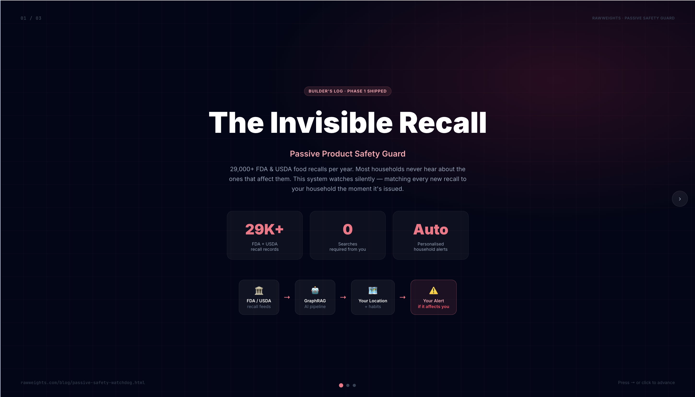
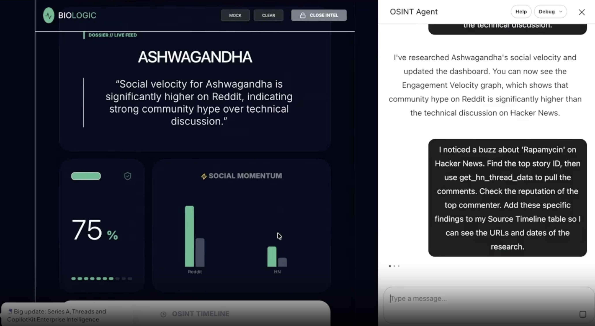
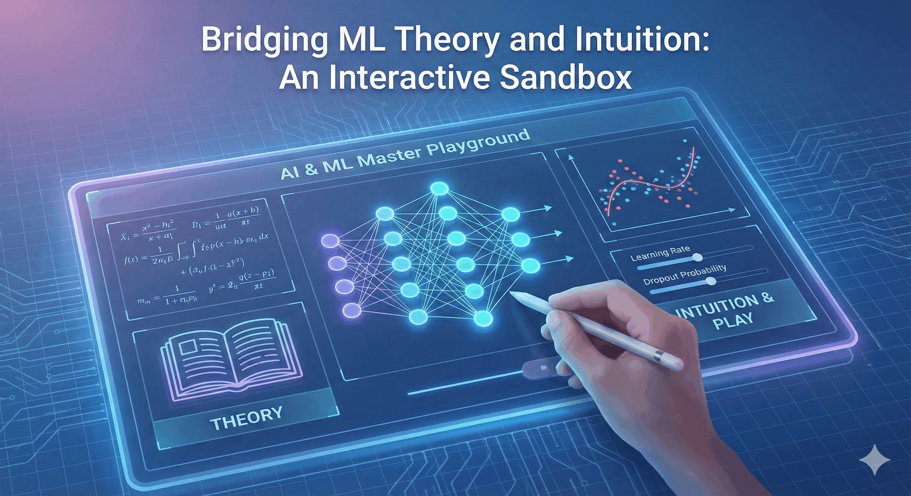

# Portfolio

> Applied AI projects — interactive playgrounds, agentic systems, RAG pipelines, and production-grade tools built by RawWeights.

## Content

[

🤖

Agentic System

### RFP Intelligent Agent

Bridges LLMs with highly structured enterprise hardware catalogs via Model Context Protocol. Java + Gemini + 5 deterministic tool classes eliminate hallucinations in spec-heavy RFP scoring.

Java MCP Gemini AI Enterprise

View case study →

](./rfp-mcp-agent.html)[

🛡️

Security Tool

### ThreatScope Analytics

Free IP threat intelligence for agencies and startups who can't afford enterprise security tools. Real-time threat scoring, geolocation mapping, and risk classification for any IP address.

Security Agentic AI Building in Public

Read build log →

](../blog/threatscope.html)[

GraphRAG

### Passive Food Safety Watchdog

Silently monitors 29,000+ FDA and USDA recalls and proactively alerts households before they know to ask. A real-world GraphRAG system with Phase 1 production deployment.

GraphRAG FDA/USDA API Proactive AI

Read builder's log →

](../guide/passive-safety-watchdog.html)[

Hackathon · OSINT

### BioLogic: AI-Powered OSINT Dashboard

Real-time health intelligence dashboard built at a hackathon — integrating React, Node, Java MCP tools, and Gemini AI to track disease signals and outbreak indicators from open sources.

React Gemini AI MCP Hackathon

View pitch →

](../blog/biologic-osint.html)[

Interactive Tool

### AI & ML Master Playground

Browser-based sandbox covering 12+ ML models — neural networks, attention, CNNs, regression, generative modeling, and reinforcement learning — with real-time parameter tuning and math visualization.

Vanilla JS Chart.js MathJax No-server

Open playground →

](../tools/master_ml_hub.html)[

🏗️

Agentic Engineering

### Blueprint: AI Site Redesign from Scratch

The engineering playbook behind transforming rawweights.com using a multi-agent pipeline — from scattered HTML to a unified design system with centralized nav, footer, and content layer.

Claude Code Multi-agent Design System

Read blueprint →

](../guide/agent-blueprint-site-transform.html)[

📧

LLM Eval · Agentic AI

### SentTriage — Behavioral Email Classifier

Classifies inbox into six action-based buckets using behavioral signal analysis — not topic labeling. Achieves 86% accuracy through Proximal Prompt Optimization and production evaluation via LangSmith.

Llama-3.3-70B LangChain LangSmith Python

Read case study →

](../usecase/sent-triage.html)[

📝

Fine-Tuning · LLM

### VocabForge — What Actually Happens When You Fine-Tune

Fine-tuned Qwen3 1.7B on 90 examples with LoRA to escalate professional writing across vocabulary tiers. Runs locally with Ollama — no GPU required after training.

LoRA LLaMA-Factory Qwen3 Ollama

Read build log →

](../usecase/vocabforge-fine-tuning-guide.html)[

🕶️

Privacy · Browser Extension

### ShadowShield AI — PII Redaction for AI Services

Chrome extension that intercepts sensitive personal data across four browser channels before it reaches AI services, then restores real values in responses using a three-tier local AI detection cascade.

Chrome Extension TypeScript Ollama Playwright

View case study →

](../usecase/shadowshield-ai.html)[

📂

Local AI · RAG

### CareerWiki — Local AI That Knows Your Entire Career

Ingests 25+ years of career documents into a local knowledge base, generating factually-grounded tailored resumes in minutes without hallucinations or cloud dependencies.

Ollama Qwen2.5:7B Streamlit Python

Read guide →

](../usecase/careerwiki-guide.html)[

📅

Agentic System

### ContextCal — Agentic Scheduling Without Calendar Access

LangGraph agent that parses free-text availability in multiple languages, handles timezone conversion, and generates calendar invites — no calendar API integration required.

LangGraph Llama-3.3-70B Streamlit Python

Read builder's log →

](../guide/contextCal.html)[

🫀

ML Engineering · Java

### Teaching a Java App to "Hear" the Server's Heartbeat

Local LSTM autoencoder in pure Java that detects anomalies in Apache server logs by transforming raw log data into numerical signals — no APIs, no cloud, real-time behavioral pattern detection with Slack alerting.

Java LSTM Deeplearning4j Log Analysis

Read build log →

](../blog/teaching-a-java-app-to-hear-the-heartbeat-of-the-server.html)
