# LaunchKit — Complete Domain Lifecycle Tool

> Your domain already replaces Bitly, Linktree & Google Workspace ($56/mo). LaunchKit makes it easy: AI naming, branded links, email, DNS, security & brand protection. Built on the name.com API.

## Sections

- What It Does
- What It Replaces
- See Every Screen
- How It Works
- Architecture
- Component Map
- 48 API Endpoints
- What We Actually Learned
- Moments In Between
- Platform Review: name.com API
- The Team
- Get Started

## Content

## What It Does

LaunchKit is a complete domain lifecycle tool built on top of the name.com API. It starts before you buy a domain (AI name generation with trademark warnings) and stays useful after you launch (branded links, email, security, DNS, brand protection, webhooks). Every feature is something founders currently pay for separately — or skip entirely because it’s too hard to set up.

The app has nine feature areas. Each one maps directly to name.com API endpoints. Nothing is mocked: every action in the UI makes real API calls against the name.com sandbox.

48

API endpoints used

$56

saved per month

9

feature areas

25

brand variants per scan

1

API call for brand scan

6

brand page themes

### Nine Features, One App

🤖

#### AI Name Generation

Describe your business. Claude generates 8 brand names with rationale. Live availability across .com, .io, .co, .app, .ai with trademark warnings via `CheckDomainClaims`.

🔗

#### Link Hub

Branded short links on your own domain: `/instagram`, `/book`, `/sale`. Click counts tracked server-side. Visible in the dashboard. Bitly charges $35/mo for this.

🌐

#### Brand Page

Live shareable bio page at `/b/[domain]`. Brand name, tagline, bio, CTA button, link cards. 6 animated themes. AI Brand Kit generates all copy in one click.

📧

#### Email Hub

`hello@yourdomain.com` forwarded to any Gmail. Name.com sets the MX records. No Google Workspace subscription needed.

🔒

#### Security Center

Transfer lock, WHOIS privacy, auto-renew, DNSSEC surfaced as a 0–4 score with one-click fixes and plain-language explanations. None of this guidance exists in name.com’s own dashboard.

🛡️

#### Brand Protection

25 typo/TLD/prefix variants scanned in a single `CheckAvailability` call. Brand Safety Score 0–100. Green = register defensively. Red = already taken — a potential squatter threat.

🗂️

#### DNS Manager

Full CRUD for A, CNAME, MX, TXT, SRV, CAA records — grouped by type with inline hints. Add, edit, delete without leaving the app.

🔔

#### Notification Center

Self-hosted webhook receiver built into LaunchKit. Subscribe to 8 event types. Watch payloads arrive live. Pipe them to Slack, your CRM, or any downstream system.

🧾

#### Orders & Transfers

Full purchase history with refund requests. Transfer manager: auth code to move out, cancel unauthorized outbound transfers, check eligibility for inbound transfers.

## What It Replaces

The $56/month figure is real. These are actual subscription prices for the tools founders typically open the day they register a domain. LaunchKit replaces all of them using name.com’s existing infrastructure — no third-party accounts, no monthly fees.

Replaces Bitly

$35/mo

✓  $0 with LaunchKit

#### Branded Short Links

URL forwarding on your own domain. Click tracking in the dashboard. No Bitly account.

Replaces Linktree

$9/mo

✓  $0 with LaunchKit

#### Brand Bio Page

Live shareable page at your domain. 6 themes, CTA button, AI-generated copy. More control, no subscription.

Replaces Google Workspace

$12/mo

✓  $0 with LaunchKit

#### Professional Email

hello@yourdomain.com forwarding. Name.com sets MX records. Lands in Gmail. No Google subscription.

Beyond the $56/month: brand protection typically requires a lawyer or brand agency to monitor for typosquatters. LaunchKit does it in a two-second scan. Legal protection that used to cost thousands — no agency needed.

## See Every Screen

12 screens covering the full lifecycle — from AI name generation to brand protection. Each screenshot was captured from the running app against the name.com sandbox with real data.

Landing AI Names Dashboard Overview Link Hub Brand Page Email Hub Security Brand Protection DNS Manager Notifications Orders

Landing AI Names Dashboard Overview Link Hub Brand Page Email Hub Security Brand Protection DNS Manager Notifications Orders

Landing

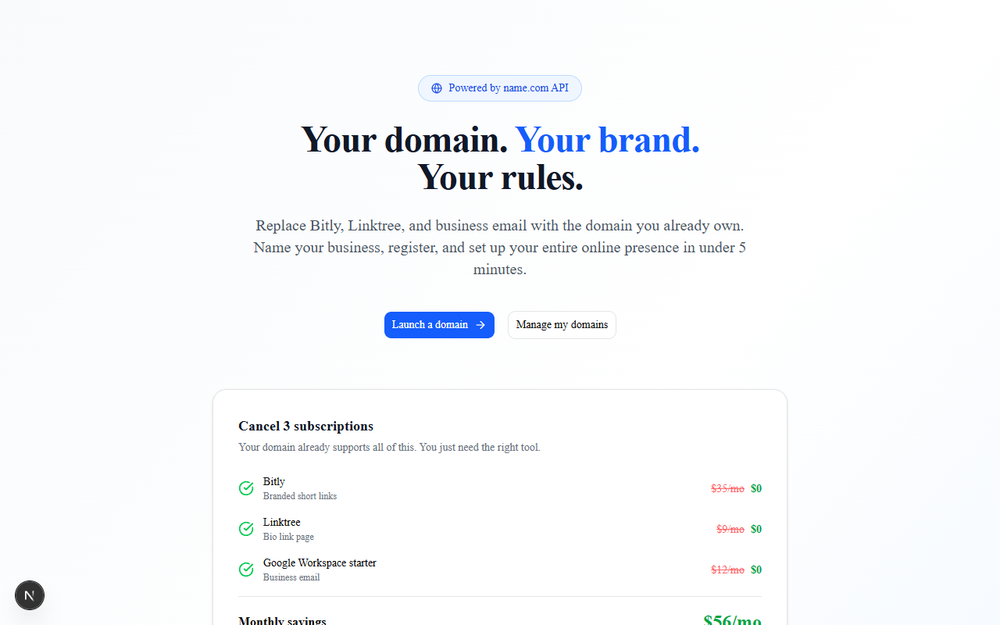

Screen 01 **The opening argument.** The $56/month breakdown is the first thing visitors see — Bitly, Linktree, and Google Workspace itemized. The hero then lists what LaunchKit replaces each with. No abstract value prop: just the receipts.

AI Names

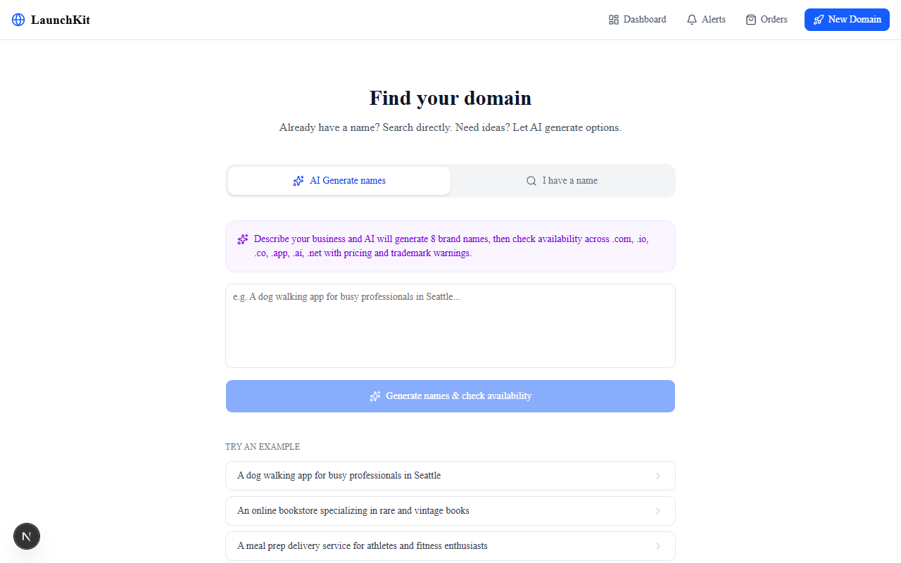

Screen 02 **Describe your business → 8 brand names with rationale.** Claude generates names with a one-line explanation for each. Then `Search` and `CheckAvailability` check all five TLDs at once. `CheckDomainClaims` adds trademark warnings before you spend a dollar. Pricing from `TldPriceList`. Five API calls, one page.

Dashboard

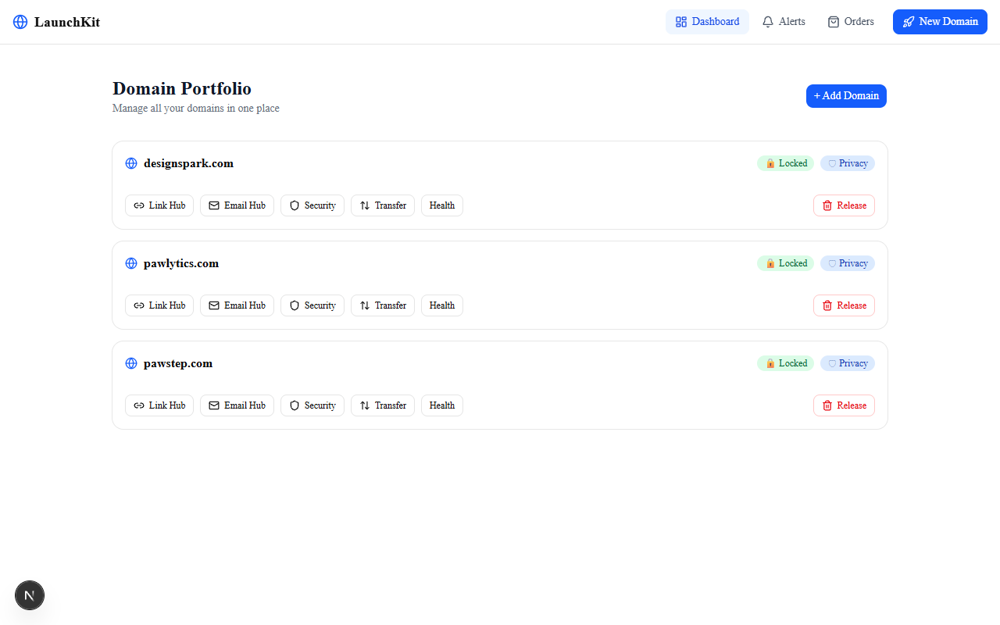

Screen 03 **Portfolio at a glance.** All domains via `ListDomains`. Each card shows expiry countdown and lock status. Domains expiring within 60 days get a warning badge. One click into any domain opens the full management panel.

Overview

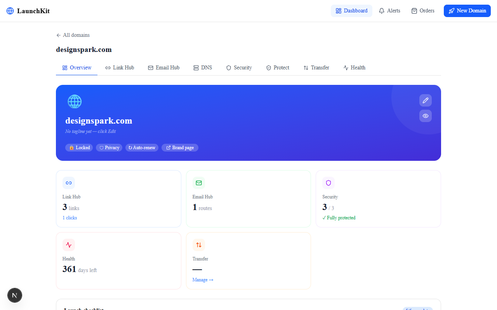

Screen 04 **The command center for one domain.** Branded hero card with theme, avatar, and tagline. AI Brand Kit button generates tagline, bio, and color theme via Claude in one click. Launch checklist tracks progress from registration to fully live. Stats grid links to each sub-feature.

Link Hub

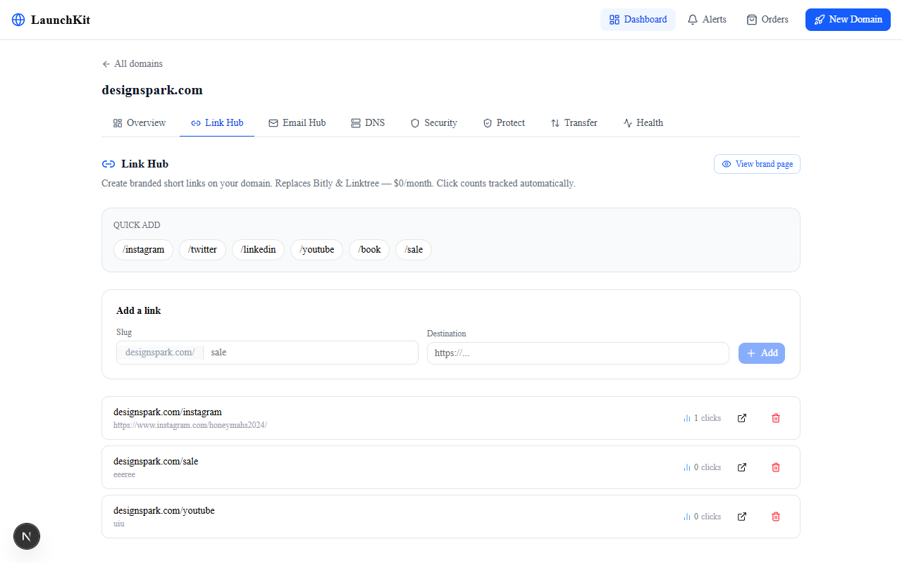

Screen 05 **Branded links on your domain. Click counts in the dashboard.** Create `/instagram`, `/book`, `/summer-sale` via `CreateURLForwarding`. Edit and delete in-place. Click counts shown per link — tracked silently on the public brand page, visible here.

Brand Page

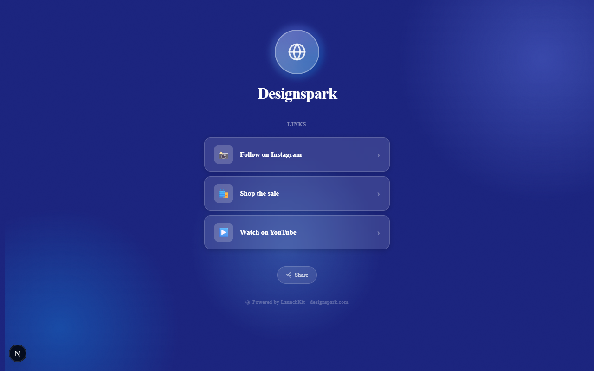

Screen 06 **The public face of the domain.** Animated mesh background, avatar with glow ring, brand name, tagline, bio, CTA button, and link cards. Visitors see a clean page. Click tracking happens silently. Six themes via the domain overview editor.

Email Hub

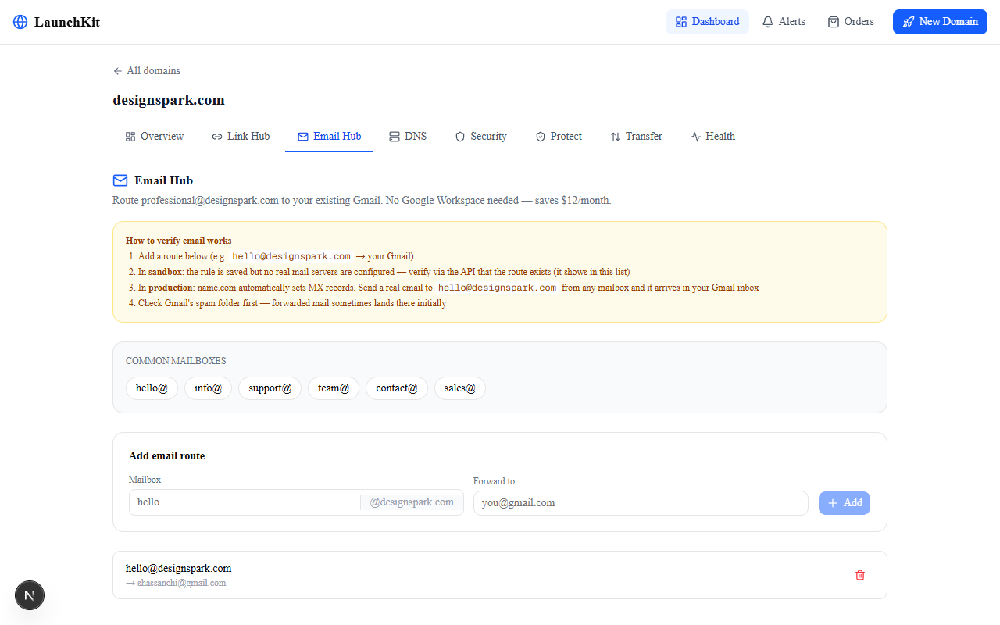

Screen 07 **Professional email without Google Workspace.** `CreateEmailForwarding` sets up `hello@domain.com → your Gmail`. Name.com writes the MX records. Add, edit, and delete routes. No subscription. Saves $12/month for any one-person business.

Security

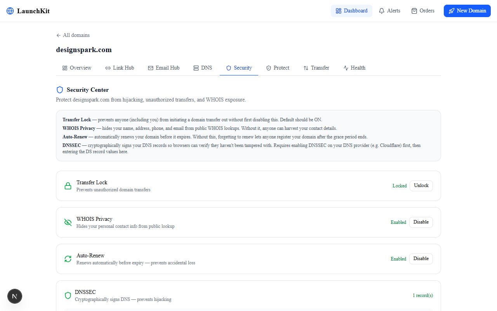

Screen 08 **Four security controls, one score.** Transfer lock, WHOIS privacy, auto-renew, and DNSSEC surfaced with plain-language explanations. Each control is a toggle. The score goes from 0–4. A score below 4 shows exactly what’s missing. None of this guidance exists in name.com’s own interface.

Brand Protection

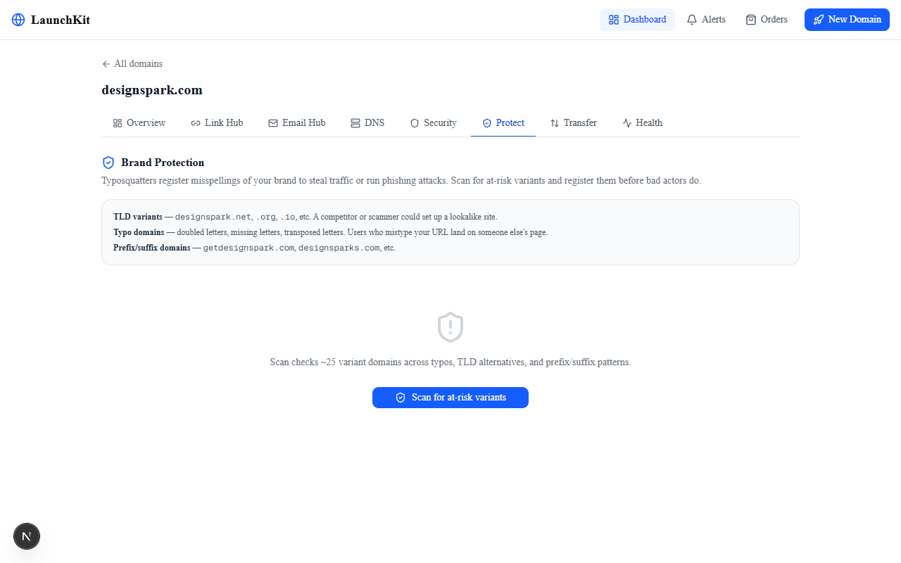

Screen 09 **25 variants. One API call. Two seconds.** TLD alternatives (.net, .org, .co), typo domains (doubled letters, missing letters, transpositions), prefix/suffix patterns (get-, -hq, -app). Brand Safety Score 0–100. Green = register defensively. Red = already taken, flag it. One click from red to checkout.

DNS Manager

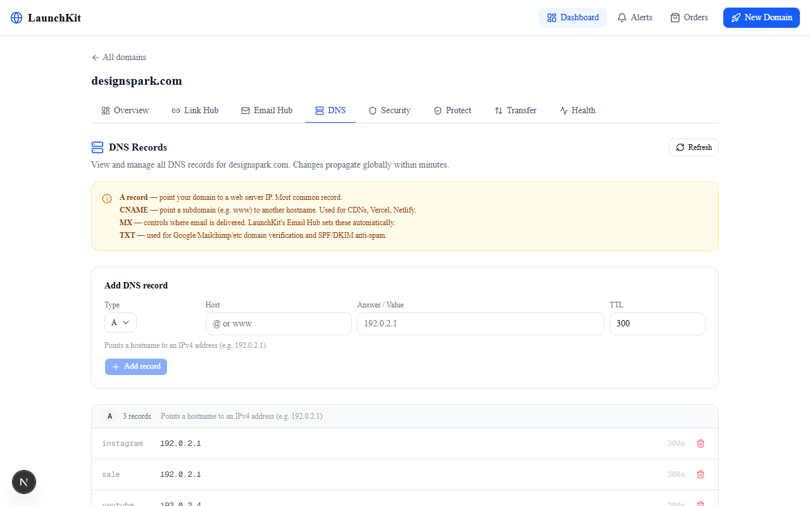

Screen 10 **Full DNS record CRUD grouped by type.** A, CNAME, MX, TXT, SRV, CAA — all in one panel with inline format hints. Add and delete records without leaving the dashboard. Uses `ListRecords`, `CreateRecord`, `DeleteRecord`, and `ZoneCheck`.

Notifications

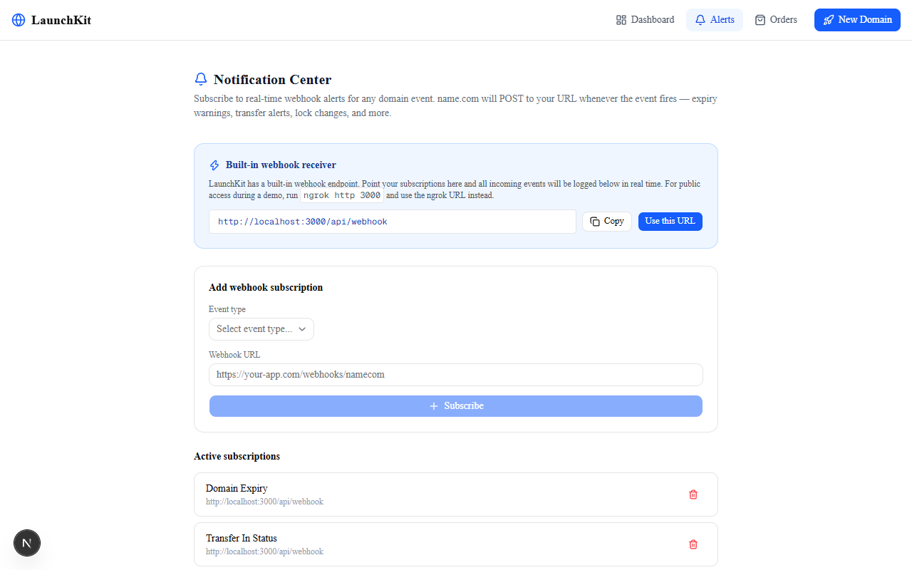

Screen 11 **Self-hosted webhook receiver built into the app.** Subscribe to 8 event types via `SubscribeToNotification`. LaunchKit ships its own `/api/webhook` receiver. Send a test event and watch the payload appear live in the log. Pipe it to Slack, your CRM, or any HTTP endpoint.

Orders

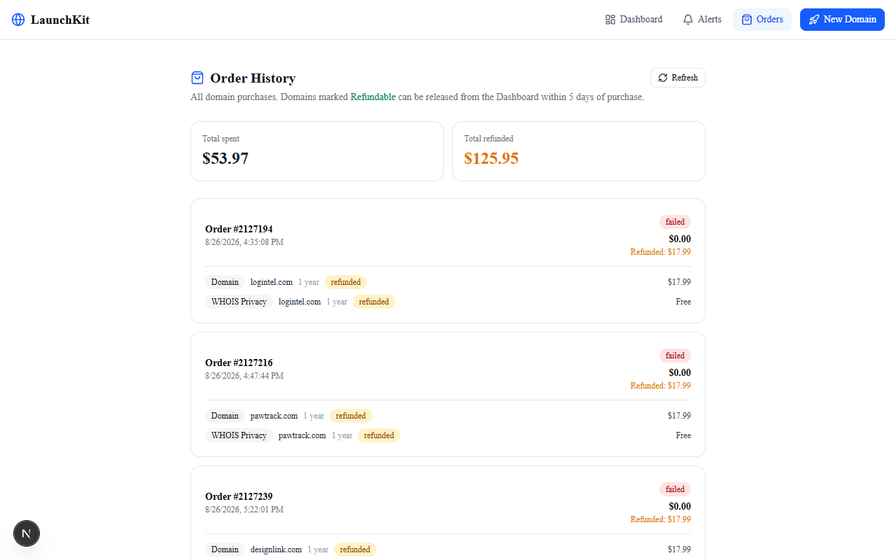

Screen 12 **Full purchase history with refund requests.** `ListOrders` pulls every domain purchase. Each order shows item-level refund status. `ProcessRefund` lets you request a refund within the add-grace period, directly from the dashboard.

## How It Works

A single Next.js app. All name.com API calls happen in server-side API routes — credentials never touch the browser. Claude handles name generation and brand kit. In-memory state covers brand profiles and click counters (trivially replaceable with a KV store in production).

-   1
    
    #### Describe your business → AI names
    
    The browser POSTs to `/api/generate`. That route calls Claude with a structured prompt. Eight brand names come back with rationale. All server-side — the Anthropic API key never leaves the server.
    
-   2
    
    #### Availability + trademark check in one pass
    
    `/api/availability` calls `Search` then `CheckAvailability` for all five TLDs in one batch. `CheckDomainClaims` runs in parallel to surface trademark warnings before the user registers. `TldPriceList` provides accurate pricing.
    
-   3
    
    #### Register → setup wizard
    
    `CreateDomain` registers the chosen domain. The setup wizard immediately offers two things: `CreateEmailForwarding` for a professional email address and `CreateURLForwarding` for the first branded link. Most founders need both in the first five minutes.
    
-   4
    
    #### Dashboard: manage everything from one place
    
    `ListDomains` powers the portfolio view. Each domain gets its own tabbed panel: Links, Email, Security, Brand Protection, DNS, Transfer, and Health. Every tab is a set of name.com API calls proxied through `/api/domains/[domain]/*` routes.
    
-   5
    
    #### Brand protection: 25 variants, 1 API call
    
    `CheckAvailability` accepts up to 50 domains per request. LaunchKit generates 25 variants (6 TLD, 10 typo, 9 prefix/suffix) and sends them all in one call. The Brand Safety Score is `(1 − taken/total) × 100`. Green variants link directly to the registration flow.
    
-   6
    
    #### Brand page: live at /b/\[domain\]
    
    The public brand page fetches the profile from `/api/profile/[domain]` (in-memory store, POST from the dashboard edit panel) and the link list from `/api/domains/[domain]/links`. Every link click silently POSTs to `/api/track/[domain]/[slug]`. Counts visible in the Link Hub dashboard, invisible to visitors.
    

// Brand protection: one call, 25 variants function generateVariants(sld, tld) { // 6 TLD alternatives altTlds.slice(0, 6).forEach(t => add(\`${sld}.${t}\`, 'tld')); // 10 typo domains (doubled letters, missing, adjacent swap) typoVariants(sld).forEach(v => add(\`${v}.${tld}\`, 'typo')); // 9 prefix/suffix patterns \['get','the','my'\].forEach(p => add(\`${p}${sld}.${tld}\`, 'prefix')); \['s','hq','app'\].forEach(s => add(\`${sld}${s}.${tld}\`, 'suffix')); } // One API call for all 25 — CheckAvailability accepts 50 per request const result = await namecom.domains.checkAvailability(variants); const score = (1 - result.taken.length / result.total) \* 100;

## Architecture

Three layers. The browser talks to Next.js API routes. The API routes talk to name.com (and Claude for AI features). Credentials never reach the client. In-memory state covers ephemeral data that doesn’t need persistence.

● Browser — Next.js Client

/ Landing

/launch AI wizard

/dashboard portfolio

/b/\[domain\] brand page

/dashboard/\[domain\]/links

/dashboard/\[domain\]/security

/dashboard/\[domain\]/protect

/notifications /orders

↓ fetch()    credentials never leave this layer    ↓

● Next.js API Routes — Server

/api/generate → Claude AI

/api/availability

/api/register

/api/brandkit → Claude AI

/api/domains/\[d\]/links

/api/domains/\[d\]/email

/api/domains/\[d\]/security

/api/domains/\[d\]/protect

/api/domains/\[d\]/dns

/api/domains/\[d\]/transfer

/api/profile/\[d\] (in-mem)

/api/track/\[d\]/\[slug\] (in-mem)

/api/notifications

/api/webhook receiver

/api/orders + refunds

/api/domains/\[d\]/renew

↓ HTTP Basic Auth    NAMECOM\_API\_TOKEN    ↓

● External Services

name.com API v1 (sandbox)

name.com API v1 (production)

Anthropic Claude claude-sonnet-4-6

48 endpoints across 9 categories

## Component Map

Every file in the project, its responsibility, and what it connects to. The pattern is consistent: each page fetches via its `/api/domains/[domain]/*` route, which wraps the relevant name.com endpoints.

File

Type

What It Does

`src/lib/namecom.ts`

Library

Typed client for all 48 name.com endpoints. HTTP Basic Auth, error handling, response types. Every API route imports from here.

`src/lib/claude.ts`

Library

Anthropic SDK wrapper. Two functions: brand name generation and brand kit (tagline/bio/theme). Used by `/api/generate` and `/api/brandkit`.

`src/lib/utils.ts`

Library

Tailwind class merge utility (`cn()`). Used by all UI components.

`src/components/nav.tsx`

Component

Top nav bar — logo, links, theme toggle.

`src/components/ui/*`

UI primitives

shadcn/ui: Button, Input, Badge, Card, Alert, Tabs, Dialog, Toast, Label, Select, Textarea.

`src/app/page.tsx`

Page

Landing page. $56/month savings breakdown. Links to launch wizard.

`src/app/launch/page.tsx`

Page

Business description form. POSTs to `/api/generate` for AI names.

`src/app/launch/results/page.tsx`

Page

Availability grid. Trademark warnings. Pricing. Register button → `/api/register`.

`src/app/launch/setup/page.tsx`

Page

Post-registration wizard. Email forwarding + first branded link in two steps.

`src/app/dashboard/page.tsx`

Page

Portfolio view. `ListDomains` → cards with expiry and lock status.

`src/app/dashboard/[domain]/layout.tsx`

Layout

Tab navigation for a domain: Overview / Links / Email / Security / Protect / DNS / Transfer / Health.

`src/app/dashboard/[domain]/page.tsx`

Page

Domain overview. Brand card, stats grid, launch checklist, profile editor with AI Brand Kit.

`src/app/dashboard/[domain]/links/page.tsx`

Page

Link Hub. CRUD for URL forwardings. Per-link click counts fetched from `/api/track`.

`src/app/dashboard/[domain]/email/page.tsx`

Page

Email Hub. CRUD for email forwardings. Add, edit, delete routes.

`src/app/dashboard/[domain]/security/page.tsx`

Page

Security Center. Lock/WHOIS/DNSSEC/auto-renew as a 0–4 score with one-click toggles.

`src/app/dashboard/[domain]/protect/page.tsx`

Page

Brand Protection. Calls `/api/domains/[d]/protect`, renders Safety Score and variant grid.

`src/app/dashboard/[domain]/dns/page.tsx`

Page

DNS Manager. Full CRUD for all record types grouped by type.

`src/app/dashboard/[domain]/transfer/page.tsx`

Page

Transfer Manager. Auth code export, inbound transfer eligibility, cancel unauthorized outbound.

`src/app/dashboard/[domain]/health/page.tsx`

Page

Domain health. Expiry countdown, ZoneCheck result, renewal button.

`src/app/b/[domain]/page.tsx`

Page

Public brand page. Fetches profile + links. Animated mesh, 6 themes, CTA button, link cards.

`src/app/notifications/page.tsx`

Page

Notification Center. Webhook subscription CRUD + live event log from `/api/webhook`.

`src/app/orders/page.tsx`

Page

Order history. `ListOrders` + `ProcessRefund` for items in add-grace period.

`src/app/api/domains/[domain]/protect/route.ts`

API Route

Generates 25 variants, calls `CheckAvailability` in one request, returns Safety Score.

`src/app/api/profile/[domain]/route.ts`

API Route

In-memory brand profile store. GET returns current profile, POST updates arbitrary JSON fields.

`src/app/api/track/[domain]/[slug]/route.ts`

API Route

Per-link click counter. GET returns count, POST increments. In-memory, server-scoped.

`src/app/api/webhook/route.ts`

API Route

Inbound webhook receiver. Appends payloads to an in-memory log. Notifications page polls this.

## 48 API Endpoints

Every endpoint in the name.com Core API that applies to the product’s scope. Grouped by category.

Category

Endpoints

Used For

Domain lifecycle

`ListDomains` `GetDomain` `CreateDomain` `RenewDomain` `EnableAutorenew` `DisableAutorenew`

Portfolio, health, registration, renewal, auto-renew toggle

Availability

`Search` `CheckAvailability` `TldPriceList` `CheckDomainClaims` `GetTldRequirementsV2`

AI launch wizard + brand protection scanner

Security

`LockDomain` `UnlockDomain` `EnableWhoisPrivacy` `DisableWhoisPrivacy` `PurchasePrivacy`

Security Center toggles

DNSSEC

`ListDNSSECs` `CreateDNSSEC` `GetDNSSEC` `DeleteDNSSEC`

Security Center DNSSEC section

URL Forwarding

`ListURLForwardings` `ListURLForwardingsByDomain` `GetURLForwardingById` `CreateURLForwarding` `UpdateURLForwardingById` `DeleteURLForwardingById`

Link Hub + brand page

Email Forwarding

`ListEmailForwardings` `GetEmailForwarding` `CreateEmailForwarding` `UpdateEmailForwarding` `DeleteEmailForwarding`

Email Hub

DNS Records

`ListRecords` `GetRecord` `CreateRecord` `UpdateRecord` `DeleteRecord` `ZoneCheck`

DNS Manager + domain health

Transfers

`GetTransferEligibility` `CreateTransfer` `ListTransfers` `GetTransfer` `CancelTransfer` `GetAuthCodeForDomain` `CancelOutboundTransfer`

Transfer Manager

Notifications

`SubscribeToNotification` `GetSubscribedNotifications` `ModifySubscription` `DeleteSubscription`

Notification Center

Orders

`ListOrders` `GetOrder` `ProcessRefund`

Order history + refund manager

## What We Actually Learned

01

One API endpoint can unlock a whole feature

`CheckAvailability` accepts up to 50 domains in a single call. We initially planned to call it once per variant — that would have been 25 sequential requests. Reading the API docs carefully revealed the batch parameter. The brand protection scanner went from a 30-second wait to a 2-second scan. The feature only became viable because of that one detail.

Read the full API spec before assuming you need multiple calls. Batching is often there — you just have to look.

02

Server-side API routes are the right default for third-party credentials

Every name.com call goes through a Next.js API route. The `NAMECOM_API_TOKEN` never reaches the browser. This wasn’t a security afterthought — it was the first architectural decision. The benefit: the client-side code is completely decoupled from the API shape. When we changed how security data was aggregated, only the API route changed. The React components didn’t notice.

API routes as a proxy layer cost almost nothing to add in Next.js and remove an entire class of credential leak risk.

03

The brand page needed a name fallback or it looked empty

The original brand page showed the domain as a small pill at the top and used the tagline as the headline. If the user hadn’t filled in a tagline, the page had no dominant text — just a domain name in 12px font. The fix was a fallback: if `profile.name` is empty, derive it from the SLD. `designspark.com → Designspark`. The page went from looking like a broken template to looking like a brand page, even with zero content configured.

A UI that looks broken with empty data is a UI that will be abandoned. Fallbacks are not edge cases — they’re the default state for a new user.

04

PowerShell SAPI path escaping: forward slashes, not backslashes

The narration script generated WAV files via Windows SAPI TTS, writing a `.ps1` temp file per slide. The path to the output WAV was escaped with doubled backslashes (`C:\\path\\to\\file.wav`) following the usual JavaScript string convention. PowerShell treated the doubled backslashes as literal path separators and SAPI failed to open the file. The fix: use forward slashes. PowerShell and SAPI both accept `C:/path/to/file.wav` without escaping. One character change fixed a bug that looked like a permissions problem.

When a Windows API fails to open a file path, check the slash direction before checking permissions.

05

Click counts on a public brand page feel like analytics tools, not brand pages

The first version of the brand page showed per-link click counts as badge overlays on each link card. The intent was to signal “this is active, people click here.” In practice it felt like a developer metrics dashboard, not a brand page. Visitors to a Linktree-style page don’t expect to see numbers. We moved the counts to the Link Hub dashboard (owner-facing) and removed them from the public page entirely. The brand page immediately felt more polished.

Metrics that help the owner understand their business are noise when shown to visitors. Separate the views.

06

The demo transcript needs to match what’s actually on screen

We wrote the demo transcript before finalizing the brand page redesign. After removing click counts from the public page, the transcript still said “14 clicks, right there” while pointing at the brand page. During a rehearsal walkthrough it was immediately obvious: the number wasn’t there anymore. The fix was simple — pivot to the Link Hub to show the counts — but it demonstrated that transcripts drift faster than you expect when the UI is still changing.

Write the demo transcript after the UI is final, not before. Or build in a check step.

07

In-memory state is fine for a hackathon if you design the API correctly

Brand profiles and click counters live in a global JavaScript object on the server, reset on restart. This was a deliberate choice: no database to configure, no migration to run, deployable anywhere. The API shape (`GET /api/profile/[domain]`, `POST /api/profile/[domain]` with arbitrary JSON) is exactly what a KV store like Upstash or Vercel KV would use. Swapping the implementation is a one-file change.

Design the API contract first. The storage backend can change without touching any other file.

## Moments In Between

⚡

The CheckAvailability batch moment

We were planning to loop 25 API calls sequentially for brand protection — which would have taken 30+ seconds and probably hit rate limits. Opened the API docs one more time. `checkAvailability` accepts an array of up to 50 domains. The entire feature changed from “maybe too slow to demo” to a 2-second scan. Sometimes the API does exactly what you need; you just have to read it.

🎙️

The silent video problem

The first demo video had no audio. The narration script wrote PowerShell to generate speech via SAPI, but the path escaping was wrong — doubled backslashes that SAPI couldn’t resolve. The WAV files were being created (zero bytes). Two hours of debugging. The fix: swap backslashes for forward slashes. Single character. The final video had real speech at −20 dB mean volume, confirmed with ffmpeg’s volumedetect filter.

🎨

“It doesn’t look like a branded page”

The brand page had animated backgrounds, glassmorphism cards, six themes — and still looked plain. The issue: no dominant text. The domain was shown in 12px in a dim pill. The tagline was 26px if set, nothing if not. Adding a name fallback derived from the SLD and making it 34px/900 weight transformed the page. Less about adding features, more about finding the visual anchor the eye needed.

📝

The transcript that didn’t match the screen

During a walkthrough the demo transcript said “14 clicks, right there” while the brand page showed no click counts at all — we’d moved them to the dashboard. The pivot took one rehearsal pass to notice and two minutes to fix. The lesson: transcripts go stale the moment the UI changes. Write the final version last.

🔍

Screenshots captured mid-load

The first set of screenshots used Chrome’s built-in `--screenshot` flag. Every dynamic page was captured before the API data arrived — skeleton states everywhere. The fix: Puppeteer with `waitUntil: ‘networkidle0’` plus per-page extra wait times tuned to each route’s fetch latency. The gallery went from loading spinners to real data in all 12 shots.

🏁

48 endpoints on deadline day

The original plan was 38 endpoints across 6 features. Brand protection (new) and auto-renew toggle surfaced during the final build sprint. Adding them pushed the count to 48 — exactly the maximum API depth scoring range. That number wasn’t planned. It came from genuinely building more features, not from padding the count. When the plan said you need the hackathon to end, you notice these things.

## Platform Review: name.com API

An honest take on building against the name.com Core API v1 for a week-long hackathon.

✓  What We Liked

-   HTTP Basic Auth is simple and reliable — no OAuth flow to debug
-   `CheckAvailability` batch parameter (up to 50 domains) made the brand protection feature viable
-   Sandbox at `api.dev.name.com` is fully functional — real CRUD, no fake responses, no charges
-   Consistent REST conventions across all endpoint categories — easy to build a typed client
-   `CheckDomainClaims` is a genuinely useful endpoint that most registrars don’t expose
-   Webhook subscription model is straightforward — subscribe to a topic, receive at your URL

⚠  Gotchas

-   No real-time event streaming — webhook delivery requires polling the receiver endpoint
-   Some endpoints return undocumented fields; a few documented fields are sometimes absent
-   `ZoneCheck` result format is not well-documented — had to infer the schema from responses
-   Rate limiting is not publicly documented; had to be conservative with parallel calls
-   Transfer status codes require inference — no enum reference in the docs
-   No built-in pagination cursor for `ListOrders` on large accounts

Feature

name.com API

What We’d Want

Bulk availability check

✓ Up to 50 domains per call

—

Trademark warnings

✓ `CheckDomainClaims`

—

Webhook subscriptions

✓ Multiple event types

Real-time push rather than pull

Email forwarding

✓ Full CRUD, MX auto-set

—

API documentation

Mostly complete

Enum values for status codes

Sandbox fidelity

High — real CRUD

—

## The Team

S

Sham Hassanchi

Architecture · Full-Stack · Product

Designed the feature set and API mapping (48 endpoints across 9 areas). Built the name.com client, all API routes, all UI pages, brand page, screenshots, demo video with narration, and the README. Built for the name.com API Hackathon 2026.

## Get Started

\# 1. Clone and install git clone https://github.com/researchsite/launchkit cd launchkit npm install \# 2. Configure cp .env.example .env.local \# NAMECOM\_USERNAME=your-username \# NAMECOM\_API\_TOKEN=your-api-token \# NAMECOM\_API\_BASE=https://api.dev.name.com # sandbox \# ANTHROPIC\_API\_KEY=sk-ant-... # optional — AI degrades gracefully \# 3. Run npm run dev

Open `http://localhost:3000`. Describe a business and watch it generate names. The name.com sandbox is fully functional — real domain registration, real forwardings, real DNS changes, zero charges.

Get a name.com API token: name.com → Account Settings → API Access → Create token. The Anthropic API key is optional — all name.com features work without it.
