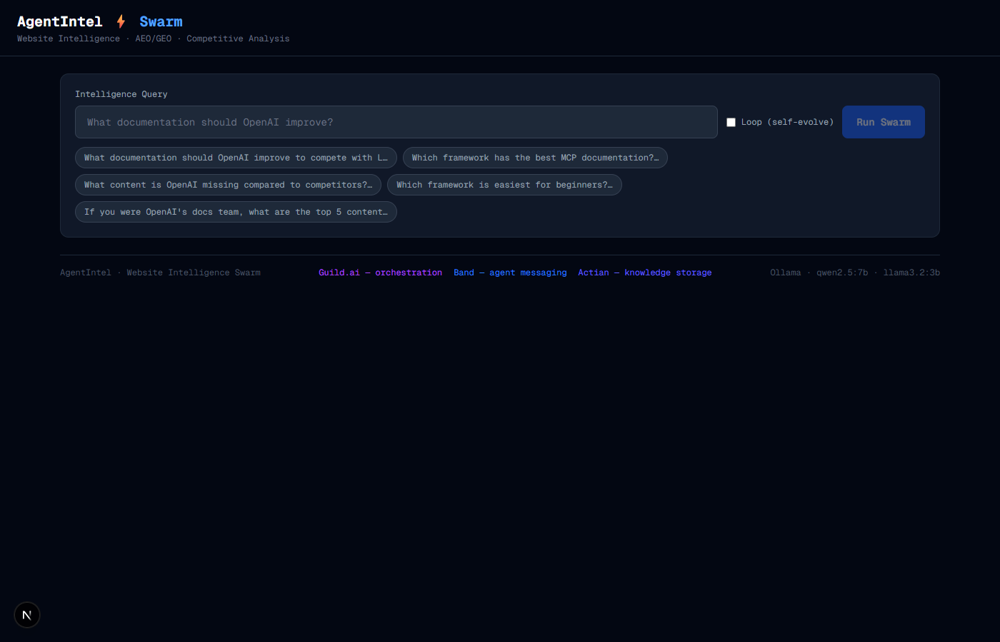
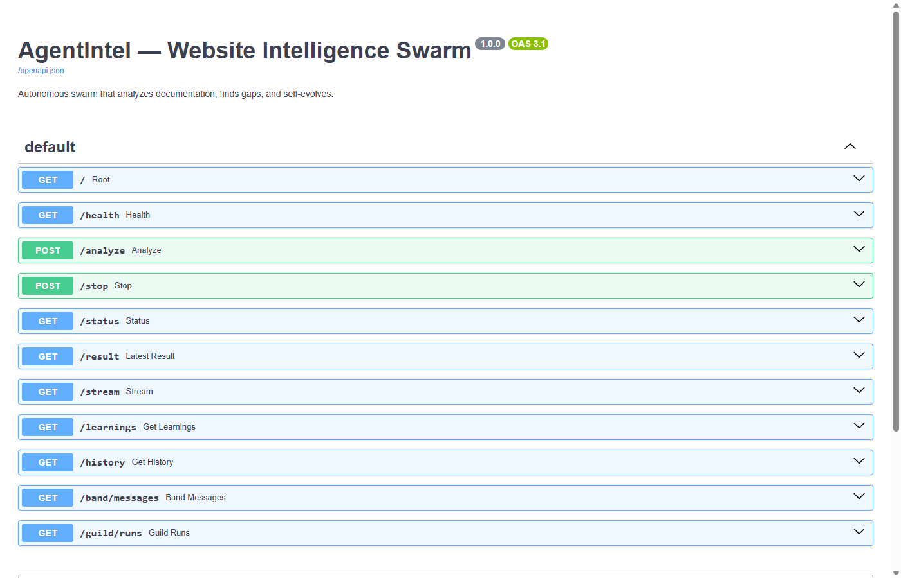

# AgentIntel: I Built a Multi-Agent Swarm to Diagnose AI Visibility

> How I built a 7-agent swarm at a hackathon that scrapes websites, benchmarks competitors, and generates AEO/GEO recommendations — with Band, Guild, and Actian wired in.

## Sections

- The AI visibility gap nobody's measuring
- What AgentIntel actually is
- Architecture overview
- How the swarm works
- Sponsor integrations
- What a real run produces
- Tech stack
- What doesn't work well yet
- Learning log
- Get started

## Content

## The AI visibility gap nobody's measuring

When someone asks ChatGPT, Claude, or Gemini to recommend an agent framework, a SaaS tool, or a vendor — the model answers from its training data and retrieved context. Companies that show up are cited. Companies that don't, aren't. And there's currently no clear way to know which category you're in, or why.

This is sometimes called AEO (AI Engine Optimization) or GEO (Generative Engine Optimization). The names are new but the underlying problem is straightforward: AI models favour content that is structured, factually dense, and directly answers likely questions. Most websites aren't built for that. Most aren't even measured against it.

What most teams currently do

🔍

Guess

Assume Google SEO applies to AI. It mostly doesn't.

📊

No baseline

No score, no benchmark, no comparison to competitors.

🤷

Blind spots

Competitor content gaps are invisible until users switch.

🔁

Reactive

Changes made after AI citations drop, not before.

**The specific gap AgentIntel tries to fill:** an automated way to scrape a target site, benchmark it against competitors, score AI discoverability, identify content gaps, and produce prioritised recommendations — without a human doing all of it manually.

## What AgentIntel actually is

AgentIntel is a hackathon project. It's a multi-agent system with a FastAPI backend, a Next.js frontend, and seven specialised agents that run in parallel to analyse a website. The output is a structured JSON report with GEO scores, knowledge gaps, and ranked recommendations.

It's not a product and it's not a SaaS. The codebase is on GitHub, the sponsors are integrated and live, and the results are real — but there's plenty that doesn't work cleanly yet and the limitations section is honest about that.

🕷️

#### Scrape

Fetches target and competitor URLs via httpx with a disk cache. Subsequent runs skip the network entirely.

🤖

#### Analyse

7 agents run in parallel. Each has a narrow job: knowledge extraction, GEO scoring, gap detection, or recommendation generation.

📋

#### Report

Structured JSON result: GEO scores per page, knowledge graph, competitor gaps, and up to 5 ranked recommendations with citations.

The query interface. Pre-filled example queries, a Loop checkbox for autonomous self-evolution, and the three sponsor connections shown live in the footer bar.

## Architecture overview

The system has four layers: the Next.js frontend talks to a FastAPI backend via Server-Sent Events for real-time streaming. The backend runs the swarm in a thread pool and pushes agent step events to the browser as they happen. Results are stored locally and optionally pushed to the three sponsor integrations.

System layers

UI

Next.js 15 · App Router SSE EventSource Tailwind CSS · TypeScript Port 3000

↕

API

FastAPI · Uvicorn /analyze SSE stream ThreadPoolExecutor Port 8000

↕

Agents

Planner Website Competitor Knowledge GEO Gap Recommendation

↕

Sponsors

Band.ai · Chat Events Guild.ai · Sessions Actian VectorAI · REST

The SSE pattern was a deliberate choice. The swarm takes 30–90 seconds and a blocking HTTP request would either time out or leave the user with a blank screen. With SSE, the frontend gets a `step` event for every agent completion and renders progress in real time. When the `done` event fires, the frontend fetches the full result from `GET /result`.

## How the swarm works

The swarm runs in three phases. Phase 1 is sequential: the planner decides the task breakdown, then website and competitor agents scrape in parallel threads. Phases 2 and 3 hand off to analysis agents that each receive the scraped content and produce structured JSON output via the LLM.

🧭

Planner

Task breakdown and routing

🌐

Website

Scrapes target URLs

🎯

Competitor

Scrapes rival sites in parallel

📚

Knowledge

Extracts citable facts

📍

GEO

Scores AI discoverability

🔬

Gap

Compares vs competitors

💡

Recommend

Ranked improvements

Phase 1 · Ingest

**Planner**Breaks the query into tasks, assigns agents, sets priority order

**Website + Competitor**Run in parallel threads. Content cached to disk — subsequent runs skip the network

→

Phase 2 · Analyse

**Knowledge Agent**Extracts entities, facts, citation candidates, and concept density

**GEO Agent**Scores each page 0–10 on direct answers, FAQs, examples, and citability

**Gap Agent**Finds topics competitors cover that the target site doesn't

→

Phase 3 · Deliver

**Recommendation Agent**Generates up to 5 ranked, cited improvements with effort and expected GEO impact

**Orchestrator**Assembles the full result, streams it to the frontend, logs to sponsors

**On the LLM calls:** every agent sends one structured JSON request via `_llm_openai()`. The `max_tokens` was initially 512 — which silently truncated the JSON output of the knowledge, gap, and recommendation agents, returning empty objects. Raised to 2048 and the problem disappeared. The parser also uses `json.JSONDecoder().raw_decode()` to handle trailing text after valid JSON, which models produce fairly often.

## Sponsor integrations

All three sponsor integrations are live. Each took a meaningful amount of debugging to get working — the docs were incomplete in all three cases, and the API behaviour wasn't what I expected.

🎸

Band.ai

Agent-to-agent messaging

Every agent step is broadcast as a typed `thought` event to a Band chat room. The swarm registers itself as an external agent, creates a chat room on startup, and posts to it throughout the run.

X-API-Key · /me/agents/register · /agent/chats/{id}/events

🏛️

Guild.ai

Session observability

Each swarm run creates a Guild workspace session. Agent steps are posted as user messages for a full audit trail. Auth via device-flow token.

Bearer token · /workspaces/{ws}/sessions · /sessions/{id}/events

🗄️

Actian VectorAI

Knowledge persistence

Scraped page content is chunked and stored as vector embeddings in Actian's Qdrant-compatible REST API. The knowledge and GEO agents do semantic search over this store rather than re-reading raw HTML each time.

Qdrant-compatible · PUT /collections · POST /points/search

🧠

OpenAI (+ Ollama fallback)

LLM reasoning

All 7 agents use `gpt-4.1-nano` via the OpenAI API. A single env variable switches to local Ollama — same prompts, same output structure, roughly 3–4x slower.

gpt-4.1-nano · Chat Completions · Ollama fallback

**Auth discovery note:** Band uses `X-API-Key` not Bearer, and request bodies are nested under a key (`{"agent": {...}}`, not flat). Guild's base URL is `https://app.guild.ai/api` — the documented `https://api.guild.ai/v1` doesn't resolve. Both were found by reading CLI source code, not documentation.

## What a real run produces

This is from iteration 14, run against OpenAI's agent docs compared with LangChain and CrewAI. The numbers aren't particularly surprising — OpenAI scores well on its own docs — but the gap analysis is where the value is.

### GEO scores by page

OpenAI Docs (avg)

5.4

LangChain

6.1

CrewAI

5.8

Score 0–10: direct answer density, FAQ presence, example coverage, citability. Averaged across 5 OpenAI pages.

### Content gaps found

Gap type

Missing from OpenAI

Present in

Multi-step workflow tutorial

No step-by-step workflow composition guide

LangChain, CrewAI

Vector store + RAG integration

Retrieval integration not covered in agent docs

LangChain, CrewAI

Agent architecture visualisation

No diagrams showing internal structure

LangChain

Troubleshooting / common errors

No FAQ or error reference section

LangChain, CrewAI

### Top recommendations generated

-   1
    
    #### Multi-step workflow tutorial — High impact, Medium effort
    
    A step-by-step guide with runnable code showing how to compose multi-step agent workflows. LangChain and CrewAI both have this; the absence is a measurable gap in AI citation coverage.
    
-   2
    
    #### Vector store + RAG integration guide — High impact, Medium effort
    
    How to connect retrieval systems to agents. Currently a blind spot in the docs despite being one of the most common agent patterns in practice.
    
-   3
    
    #### Architecture diagrams — Medium impact, Low effort
    
    Visual diagrams of agent flow and internal structure. LangChain's diagrams appear frequently in AI model answers about agent architecture. OpenAI has none in the current docs.
    
-   4
    
    #### Troubleshooting FAQ — High impact, Low effort
    
    Common errors, debugging tips, and definitions of key terms. Low effort to write, directly addresses AI citability (models favour structured Q&A content).
    

## Tech stack

⚡

#### FastAPI + SSE

Backend API with Server-Sent Events for real-time agent progress streaming. Uvicorn, Python 3.11+.

🖥️

#### Next.js 15

App Router, TypeScript, Tailwind CSS. Connects to the SSE stream via the browser's native `EventSource` API.

🧵

#### ThreadPoolExecutor

Website and competitor agents run in parallel threads. The SSE generator is a Python generator on the main thread — thread-safe step callbacks feed it.

💾

#### Disk cache

Scraped HTML is hashed and cached to `data/scrape_cache/`. Re-running the swarm skips all network calls if the cache is warm.

🦙

#### Ollama fallback

`USE_OPENAI=False` routes all LLM calls through local Ollama. Same prompt structure, same output format — useful for offline development.

🔄

#### Evolution loop

Optional: `POST /loop/start` re-runs the swarm every N seconds autonomously, accumulating results across iterations.

\# Health endpoint — shows live sponsor status GET /health { "status": "ok", "band\_connected": true, "guild\_connected": true, "actian\_connected": true, "loop\_running": false, "iteration": 14 }

All 11 endpoints exposed via the auto-generated Swagger UI at `/docs`. The `/analyze` and `/stop` routes are the primary control surface; `/stream`, `/result`, `/band/messages`, and `/guild/runs` support debugging and the frontend.

## What doesn't work well yet

Being honest about the gaps is more useful than glossing over them.

**GEO scores are heuristic, not ground truth.** The scoring rubric (direct answers, FAQs, examples, citability) reflects reasonable intuitions about what AI models favour, but it's not validated against actual citation rates from real LLMs. Treat scores as directional signals, not measurements.

Data Quality

#### Scraper is basic — JavaScript-heavy sites return empty content

httpx fetches raw HTML only. SPAs and sites that render content in the browser return near-empty pages. A Playwright or Puppeteer integration would fix this but adds complexity.

LLM Variance

#### Recommendation wording changes across runs

The same site analysed twice can produce different recommendation ordering and wording. The underlying gap detection is fairly stable but the generated text isn't deterministic.

Windows Specific

#### Ghost TCP sockets on port 8000 require a reboot to clear

A uvicorn reload race condition leaves a zombie socket that can't be killed by any normal Windows process tool. The only fix found was rebooting. This only affects development restarts, not production.

Actian Integration

#### Vector search is not yet used by all agents

The ingest pipeline stores content in Actian and verifies the connection, but the knowledge and GEO agents currently read from the raw cached content rather than querying the vector store. Wiring this up is the next step.

## Learning log

These are the specific things that went wrong, and how they were fixed. Organised by type: gotchas (bugs that weren't obvious), discoveries (things that work differently than assumed), and wins (patterns that worked well and are worth reusing).

Gotcha · Band.ai

#### X-API-Key, not Bearer — and nested JSON bodies

`Authorization: Bearer band_u_*` returns 401 every time. The correct header is `X-API-Key: band_u_*`. Request bodies are nested: `{"agent": {"name": "..."}}`, not flat. Found by reading the OpenAPI spec at `docs.band.ai/openapi.json`.

Gotcha · Guild.ai

#### api.guild.ai doesn't resolve — use app.guild.ai/api

Every call to `https://api.guild.ai/v1` fails with a DNS error — the host doesn't exist. Correct base URL is `https://app.guild.ai/api` with no version prefix. Found by searching the `@guildai/cli` JavaScript source in the npx cache.

Gotcha · OpenAI

#### max\_tokens=512 silently truncates JSON output

Knowledge, gap, and recommendation agents returned empty `{}` with no error. The LLM was cutting off mid-JSON at 512 tokens. Raised to 2048 and added `json.JSONDecoder().raw_decode()` to handle trailing text after valid JSON.

Gotcha · Band.ai

#### Band agent key must be persisted — 409 on every restart

Band issues the `band_a_*` key once on registration. Re-registering the same name returns 409 with no key in the response. Fixed by writing `BAND_AGENT_KEY` to `.env` immediately after first registration and reusing it on restarts.

Gotcha · PowerShell

#### $pid is a reserved automatic variable in PowerShell

`$pid` always holds the current PowerShell session's own process ID. Assigning `$pid = $conn.OwningProcess` silently fails — the variable snaps back. `Stop-Process -Id $pid` was trying to kill the shell itself. Renamed to `$processId`.

Gotcha · Windows

#### localhost resolves to IPv6 on Windows — use 127.0.0.1

Windows 10/11 resolves `localhost` to `::1` (IPv6) first. If uvicorn or Actian listens on `0.0.0.0` (IPv4 only), the connection fails silently even though the service is running. Hardcoded `127.0.0.1` everywhere in startup scripts.

Gotcha · PowerShell 5.1

#### ?? null-coalescing operator doesn't exist in PowerShell 5.1

Windows ships with PowerShell 5.1 by default and never auto-upgrades. `??` was introduced in 7.0. The startup script silently failed on first run. Replaced with `if ($x) { $x } else { $default }`.

Gotcha · Startup

#### 20s backend startup timeout too short when sponsors connect at init

Band, Guild, and Actian each make outbound HTTP calls in `__init__`. On a cold start this totals 30–45 seconds. The startup script was reporting "backend not ready" and launching the frontend before the backend finished initialising. Extended wait to 60 seconds.

Gotcha · Python

#### Don't access private attributes — use return values

The orchestrator called `guild.start_run()` then later read `guild._current_run_id` directly. After the guild.py rewrite, that attribute could hold a stale ID from a previous run. Fixed by capturing the return value: `guild_run_id = guild.start_run(...)`.

Discovery · Git

#### .gitignore inline comments silently break pattern matching

Writing `.env # API keys` makes the whole string including the comment part of the pattern. `.env` was never ignored and appeared in every `git add`. Git only supports comments on their own dedicated line.

Discovery · Git

#### A nested .git directory causes submodule confusion

The Next.js frontend was scaffolded with its own `.git/`. The root repo treated `frontend/` as an unregistered submodule and refused to track files inside it. Fixed by deleting `frontend/.git`, then `git rm --cached -f frontend`, then re-staging.

Win · Architecture

#### SSE streaming is the right pattern for long-running agent jobs

A blocking HTTP request times out or leaves the user with nothing for 90 seconds. SSE lets the backend push each agent completion event as it happens. Pattern: run in thread → stream events → client fetches full result on `done`. Works cleanly in the browser with no WebSocket complexity.

Win · API Discovery

#### When docs are incomplete, read the CLI source code

Both Band and Guild had incomplete or wrong documentation. The definitive source was the CLI JavaScript bundles in the npx cache — they contain the exact endpoint paths, request shapes, and auth headers used in production. `grep -r "X-API-Key\|/sessions" ~/.npm/_npx/` saved hours.

## Get started

Prerequisites: Python 3.11+, Node 18+, and an OpenAI API key. The sponsor integrations are optional — the swarm runs without them.

-   1
    
    #### Clone and set up the backend
    
    `git clone https://github.com/researchsite/AgentIntel.git && cd AgentIntel/backend`  
    `python -m venv .venv && .venv/Scripts/activate`  
    `pip install -r requirements.txt`
    
-   2
    
    #### Configure .env
    
    Copy `.env.example` to `.env`. The only required key is `OPENAI_API_KEY`. Everything else — Ollama fallback, Band, Guild, Actian — is optional and the system runs without any of them.
    
-   3
    
    #### Ingest content
    
    `python ingest.py` — scrapes the configured target and competitor URLs and stores content. Takes ~30 seconds on a cold cache.
    
-   4
    
    #### Start all services
    
    Windows: `.\start_all.ps1` — starts Actian if installed, waits for the backend to be ready (up to 60s), then starts the Next.js frontend. Or start each manually: `uvicorn main:app --port 8000` and `cd frontend && npm run dev`.
    
-   5
    
    #### Check health and run
    
    `curl http://127.0.0.1:8000/health` should return `{"status":"ok"}`. Open **http://localhost:3000**, enter a target URL, and watch the swarm run.
    

**Note on localhost vs 127.0.0.1:** on Windows, use `127.0.0.1` explicitly in curl and the startup script. `localhost` can resolve to IPv6 and fail to connect to services listening on IPv4.

[View on GitHub →](https://github.com/researchsite/AgentIntel) [Learning log ↑](#learnings)
