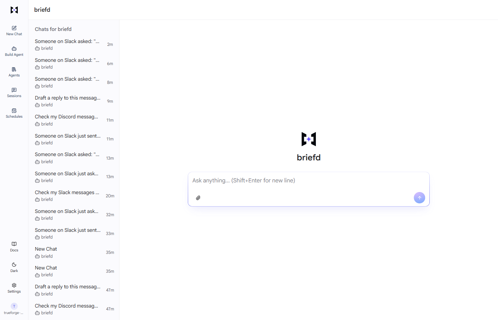
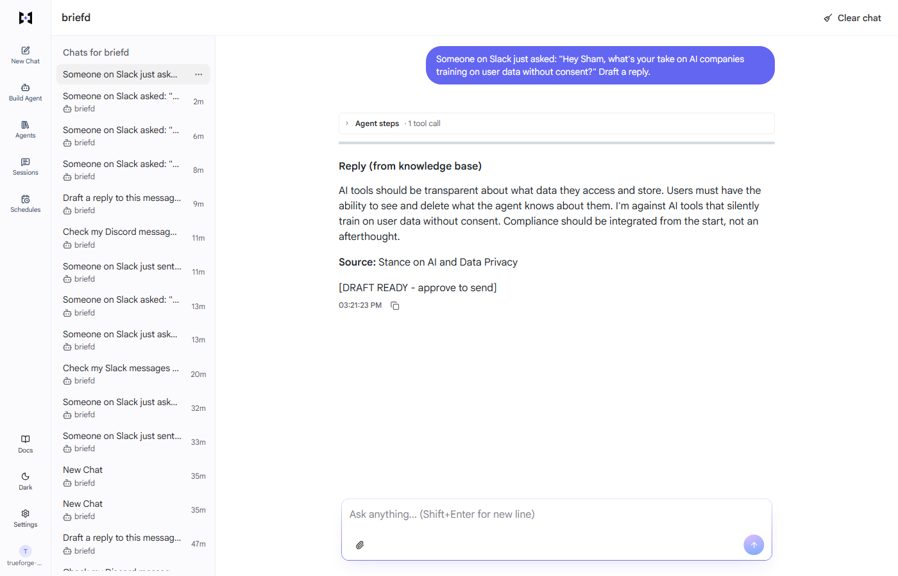
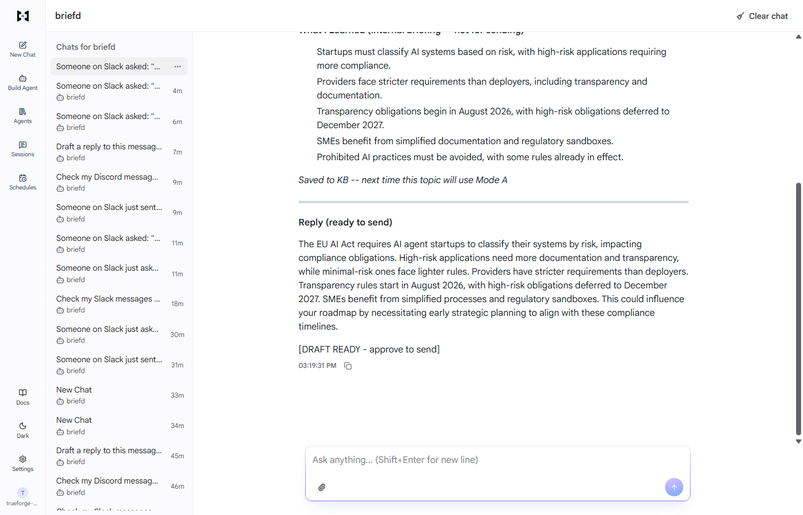
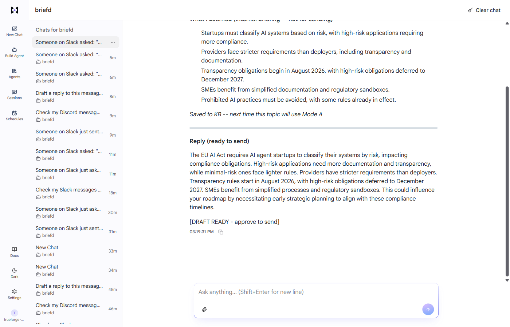
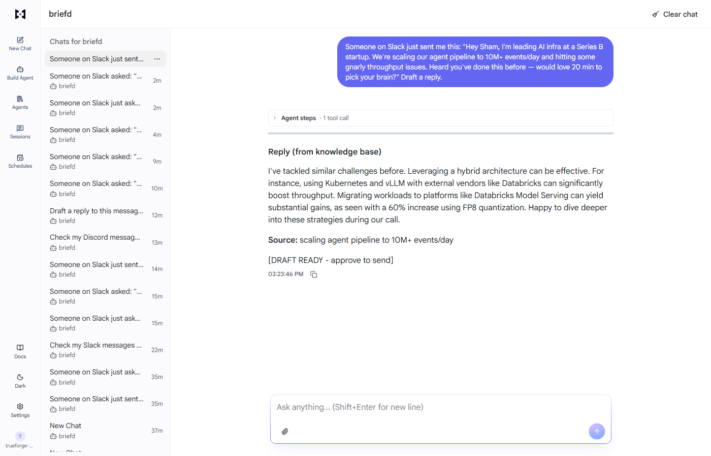
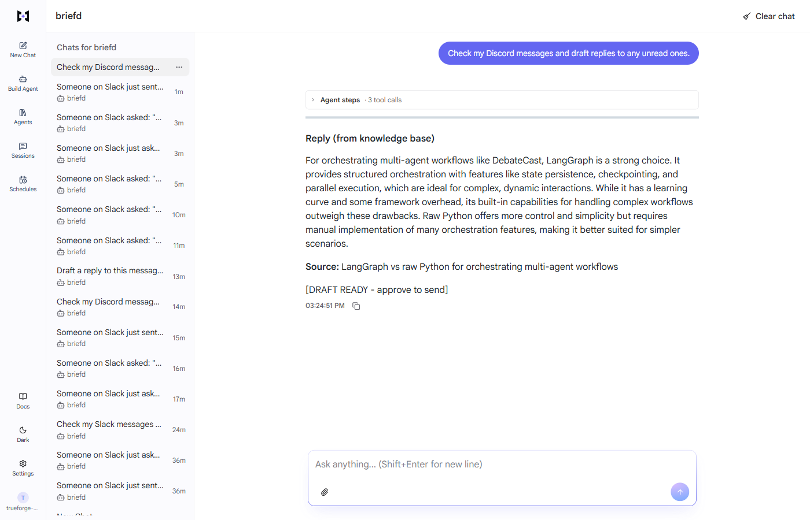
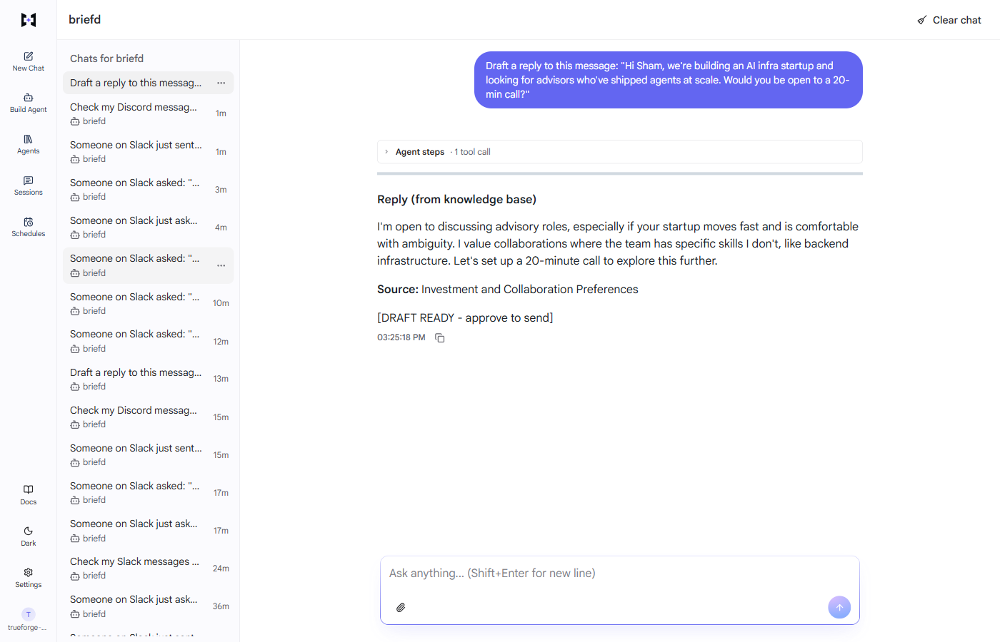

# Briefd — Personal Reply Agent

> A message arrives. Briefd searches your knowledge base, briefs you if it's a new topic, drafts a reply, and holds it for your approval before anything sends. Built solo for the TrueFoundry Agent Harness Hackathon 2026.

## Sections

- What It Does
- Before / After
- Architecture
- How It Works
- See It In Action
- Component Map
- Tech Stack
- Real Learnings
- Moments In Between
- TrueFoundry — Honest Review
- Get Started

## Content

## What It Does

Every professional gets messages on topics they’re supposed to know. Sometimes they do. Sometimes the topic is new. The gap between message received and reply sent is either a weak response or 20 minutes of research you didn’t have.

Briefd closes that gap. It searches your personal knowledge base first. If it knows the topic, it drafts immediately. If it doesn’t, it spawns three parallel research agents, synthesizes a 5-point plain-English briefing, and drafts from that fresh context. Either way, the draft holds for your approval before anything goes out.

2

routing modes

3

parallel subagents (Mode B)

0

auto-sends

5

live demo flows

1

approval gate

4

MCP connectors

🔍

#### Mode A — Known Topic

Vector similarity above threshold. Pulls sources from your KB, drafts with citations, shows source panel. Fast path — no external calls, no subagents.

🧠

#### Mode B — New Topic

Three subagents run concurrently: web, Wikipedia/domain, recent news. Results synthesized into a 5-point briefing. Draft uses the fresh research. Everything saved to KB after.

✋

#### Approval Gate

Both Slack and Discord reply tools are configured with `approval_required: true`. TrueForge shows the draft card. You read, edit if needed, and approve — then it sends.

💾

#### Self-Learning KB

Every Mode B research result is saved to Supabase pgvector. Next message on the same topic hits Mode A. The agent gets smarter every session without you lifting a finger.

💬

#### Slack + Discord

Two separate MCP servers. Polls on a 5-minute TrueForge schedule. Handles both platforms from one agent session. Switch or combine — same routing logic either way.

📋

#### Paste Mode

No bot set up yet? Paste any message directly into the TrueForge chat. Same routing logic, same approval gate, same KB. Works on day one with zero integration.

**The key constraint:** The approval gate is not a feature you can turn off — it is the design. `approval_required: true` is set on both send tools in the agent config. Knowing the agent physically cannot send without your review is what makes it safe to use on real messages.

## Before / After

The same scenario: you get a Slack message about the EU AI Act enforcement timeline. You’re not a compliance expert. Without Briefd, two options. With Briefd, one.

Without Briefd

-   Open three browser tabs to research
-   Spend 15–20 minutes reading
-   Draft a reply from scratch, hoping you didn’t miss something
-   Research not saved — same process next time same topic comes up

With Briefd (Mode B)

-   3 subagents pull current info in parallel (web + domain + news)
-   5-point briefing ready in seconds
-   Draft in your voice, citing what was found
-   You approve → it sends. Research saved → next time it’s Mode A

## Architecture

The full path from message to reply. TrueFoundry orchestrates everything — the routing decision, subagent lifecycle, Code Mode sandbox, approval pause, and context compaction across long sessions.

Slack / Discord → TrueForge Schedule (5-min) → Agent Session → briefd-reply Skill

↓

search\_knowledge\_base() via MCP → similarity ≥ 0.78?

Mode A — Yes

Draft from KB sources · Source citations panel · Fast path, no external calls

Mode B — No

Spawn 3 subagents in parallel: Exa web · Wikipedia/domain · Recent news · Code Mode Python combines results · 5-point briefing · Draft from research · Save to KB

Draft ready → ⏸ Approval gate (TrueForge UI card) → ✓ Send via MCP

TrueFoundry layer Mode A Mode B External platforms

## How It Works

-   1
    
    #### TrueForge polls Slack / Discord on a 5-minute schedule
    
    The Schedules API triggers an agent session every 5 minutes. The Slack and Discord MCP servers return any unread messages since the last poll. No always-on bot, no webhook server to maintain.
    
-   2
    
    #### Briefd-reply Skill routes the session
    
    The skill SKILL.md contains the Mode A/B decision logic. Preloaded at session start is only `search_knowledge_base` — the only tool guaranteed to be needed. All other tools (Exa, send functions) load on demand to preserve context.
    
-   3
    
    #### Mode A: KB hit → draft immediately
    
    Supabase pgvector returns results with similarity above 0.78. The agent drafts citing those sources. Source citations show which KB entries were used and with what similarity score.
    
-   4
    
    #### Mode B: 3 subagents spawn in parallel
    
    Root agent emits a status message (“Researching \[topic\]...”) before spawning — subagents cannot message the user directly. All three run concurrently. A Code Mode Python script in the Daytona sandbox combines results, deduplicates, and formats the 5-point briefing.
    
-   5
    
    #### Draft held at approval gate
    
    The send tool fires, TrueForge detects `approval_required: true`, and pauses. The UI shows the draft content with Approve / Edit / Reject. No timeout — it waits until you act.
    
-   6
    
    #### Approve → send. Mode B research saved.
    
    On approval the message goes out via the Slack or Discord MCP. If it was a Mode B session, the research result is saved to the KB with tag `source:research`. Next message on the same topic routes Mode A.
    

## See It In Action

Five demo flows covering Mode A, Mode B, Slack approval, Discord check, and paste mode. Each tab is a real session captured from the live app.

1\. Session Open 2\. Mode A — KB Hit 3\. Mode B — Briefing 4\. Mode B — Draft 5\. Slack Approval 6\. Discord Check 7\. Paste Mode

1\. Session Open 2\. Mode A 3\. Briefing 4\. Draft 5\. Slack Approval 6\. Discord 7\. Paste Mode

1\. Session Open

Step 1 **Session created, message received.** TrueForge schedule fires, the Slack MCP returns an unread message. The briefd-reply skill loads. The agent calls `search_knowledge_base()` — the only tool preloaded at session start. Tool call steps are visible in the agent steps panel on the right.

2\. Mode A — KB Hit

Mode A **Known topic. Draft ready in seconds.** The KB returns results with similarity above 0.78. The agent drafts citing those sources. The source citations panel shows which entries were used and their relevance scores. No external calls made — this is the fast path.

3\. Mode B — Briefing

Mode B **New topic. 3 subagents researching in parallel.** Demo topic: EU AI Act enforcement timeline — guaranteed not in the KB. Root agent emits the research status message, then spawns three subagents concurrently. The briefing panel shows the 5-point summary synthesized by the Code Mode Python script in the Daytona sandbox.

4\. Mode B — Draft

Mode B **Draft from fresh research, KB updated.** The draft is generated using the synthesized research. Source URLs are attached. After this session, the EU AI Act topic is saved to the KB — the next message about it routes Mode A.

5\. Slack Approval Gate

Approval Gate **Draft held. Waiting for your review.** The `send_slack_reply` tool fires, TrueForge detects `approval_required: true`, and pauses the session. The approval card shows the full draft. You approve, edit inline, or reject. The agent does not proceed until you act.

6\. Discord Check

Discord MCP **Discord channel polled via MCP.** The same session checks Discord after Slack. No unread messages — the agent records this and closes. The Discord MCP handles both DMs and channel messages. Same routing logic, same approval gate as Slack.

7\. Paste Mode

Paste Mode **No bot required to get started.** Paste any message directly into the TrueForge chat. The full routing logic applies: KB search, Mode A or B, approval gate. Works on day one before any Slack or Discord integration is live.

## Component Map

Everything in the repo and what each piece does. Three MCP servers, the TrueForge skill, the Next.js frontend, and supporting scripts.

File / Folder

Role

`skill/SKILL.md`

The Mode A/B decision procedure. Loaded by TrueForge at session start. Contains the branching logic, similarity threshold, and subagent spawn instructions.

`skill/briefing-format.md`

5-point briefing structure and the Code Mode Python script template for combining subagent results.

`skill/examples/example-drafts.md`

Voice calibration examples. Trains the agent to match Sham’s reply style and tone before drafting.

`mcp-servers/knowledge-base/`

TypeScript HTTP MCP server. Wraps Supabase pgvector. Exposes: `search_knowledge_base`, `add_to_knowledge_base`, `list_sources`, `delete_source`.

`mcp-servers/slack/`

TypeScript HTTP MCP server. Wraps Slack Web API. Exposes: `get_unread_messages`, `send_slack_reply` (approval\_required), `mark_message_read`.

`mcp-servers/discord/`

TypeScript HTTP MCP server. Wraps Discord REST API. Exposes: `get_unread_messages`, `send_discord_reply` (approval\_required).

`frontend/app/page.tsx`

Main page. TrueForgeUI with sidebar layout, custom AssistantMessage override for briefing card rendering.

`frontend/components/BriefingPanelCard.tsx`

Custom message card. Renders Mode A/B badge, briefing points, source citations, draft composer, and approve button.

`frontend/components/KnowledgeBaseView.tsx`

Lists all KB sources, search, delete. Shows knowledge base growth over sessions.

`agent-config/briefd-agent.json`

TrueForge agent spec. GPT-4o, briefd-reply skill, 4 MCP connectors, approval policies, sandbox, context compaction config.

`supabase/migrations/001_knowledge_base.sql`

pgvector schema: knowledge\_base table, IVFFlat index, search\_knowledge\_base() RPC function, RLS policy.

`scripts/load-demo-data.ts`

Seeds 6 simulated KB sources to demo Mode A flows without live data.

`scripts/schedule.ts`

Creates the 5-minute Slack polling schedule in TrueForge via the Schedules API.

## Tech Stack

Tool

Role

What It Enabled

`TrueFoundry TrueForge`

Agent harness

Scheduling, subagent lifecycle, tool approval policies, Code Mode sandbox, context compaction. The full orchestration layer — none of this is hand-coded.

`OpenAI GPT-4o`

LLM

All reasoning: Mode A/B routing, draft generation in Sham’s voice, synthesizing parallel subagent results into a coherent briefing.

`Supabase pgvector`

Knowledge base

Semantic search via cosine similarity. IVFFlat index for speed at scale. RPC function keeps queries one call. Auth0 multi-user isolation via RLS.

`Exa Search MCP`

Web research

Neural search for subagents. `searchAndContents` with `maxCharacters: 800` per result to control cost while keeping useful context.

`Auth0`

Multi-user auth

User identity for KB isolation. Each user’s knowledge base is scoped by Auth0 user ID via Supabase RLS policies.

`Daytona`

Code sandbox

Code Mode Python runs in an isolated sandbox. Combines subagent results, formats briefing, saves to KB. The harness bridges MCP calls securely — no tokens in the sandbox.

`Next.js 15`

Frontend

App Router + TrueForge UI SDK in SingleAgent mode. Custom AssistantMessage override renders the briefing panel instead of a plain chat bubble.

## Real Learnings

01

The approval gate made the agent more trustworthy, not less capable

The first instinct was that requiring approval on every send would feel like friction. The opposite happened. Knowing the agent cannot send without review made it easier to trust it with real messages. The gate is not a limitation — it’s the contract that makes the whole thing usable. Without it, the agent is an experiment. With it, it’s a tool.

Trust and autonomy are not opposites. The right approval gate increases both.

02

Deferred tool loading is not a performance trick — it’s a correctness decision

With 4 MCP servers connected, preloading all tools at session start consumed significant context tokens before any work began. The fix: preload only `search_knowledge_base` — the one tool guaranteed to be called first. Everything else loads on demand. Across a long session (many messages in a day), this is what kept the context coherent. It’s not optimization, it’s architecture.

In agentic systems, what you don't load is as important as what you do.

03

Root agent must emit status before spawning subagents — subagents cannot message the user

During Mode B, the UI went silent for several seconds while subagents ran. Users assumed the agent had stalled. The fix: root agent emits “Researching \[topic\] via 3 parallel agents...” before calling `create_sub_agent`. This is a TrueForge architectural constraint — subagents operate in their own session and cannot write to the user’s chat thread. Status must come from the root, not the workers.

Silent progress looks like a crash. The root agent has to narrate what the subagents are doing.

04

Forcing KB-first required a specific framing in the skill, not just tool ordering

Early versions sometimes skipped the KB search and went straight to research if the message topic was phrased as a knowledge gap (“can you explain...”). The fix was a commit: _force KB-first tool call with knowledge-gap framing_. The SKILL.md now explicitly instructs the agent to call `search_knowledge_base` regardless of how the message is phrased — even questions that sound like they expect external research. The KB should always get first look.

Routing logic belongs in the skill file, not in the agent’s interpretation of the message phrasing.

05

Context compaction is essential, not optional, for a daily-use agent

A personal reply agent running across a full workday can process dozens of messages. Without compaction, later sessions in the day ran slower and started losing coherence. Enabling `context_compaction.enabled: true` at the 80% threshold let the harness summarize older history automatically. The agent stayed coherent across hours. This is a one-line config change with a dramatic effect on session quality.

Daily-use agents need context management from the start, not when they start breaking.

06

The EU AI Act was the best Mode B test topic

Picking a guaranteed Mode B topic for demo is harder than it sounds. The KB gets seeded, and topics get contaminated. The EU AI Act enforcement timeline was chosen because: it’s recent enough that older KB entries wouldn’t cover it, it’s complex enough to make the briefing panel useful, and it’s concrete enough for a judge to verify the output makes sense. A good Mode B demo topic needs all three.

Demo topics that could go either way are dangerous. Know in advance what will trigger each path.

07

Playwright screenshot automation saved the demo — but hid errors at first

The demo runner used Playwright to capture all 5 flows automatically, with `expandAgentSteps()` to show tool calls in every screenshot. After switching to TrueForge 0.2.0 UI (new Agents nav, sidebar layout), all screenshots needed recapture. Without automation this would have been an hour of manual work. The catch: the runner silently succeeded even when screenshots captured an error state. Named ERROR screenshots in the output folder made the failures visible.

Automate the demo capture. But name failures explicitly or they’ll look like success.

## Moments In Between

⚡

#### The first Mode B briefing that landed

The EU AI Act topic went through the full pipeline for the first time. Three subagents came back, the Python script combined them, and the 5-point briefing appeared. It was accurate, sourced, and faster than I could have done the research myself. That was the moment it felt like a product, not a prototype.

🔇

#### The silent Mode B that looked like a crash

Subagents running concurrently meant 8–12 seconds of silence in the UI. Every time, it looked stalled. The fix took 5 minutes: root agent emits a status message first. The user experience went from “is it broken?” to “I can see it working.” Status messages matter more than speed.

🧠

#### Watching Mode B become Mode A overnight

Tested the EU AI Act topic the following day. It routed Mode A. The KB entry from the previous session was there, similarity above threshold, draft in seconds. The self-learning loop worked exactly as designed. It was small, and it was exactly right.

🤝

#### Time with the TrueFoundry team

Real access to the people building the platform changed what was possible to ship in a day. Nikunj Bajaj, Sai Krishna, Kashish Kumar, and Adam Chan were on the floor. Questions that would have taken days to answer from docs took minutes in person.

📸

#### The Playwright runner that named its errors

After the TrueForge 0.2.0 UI update, all five demo screenshots needed recapture. The runner had been silently capturing success states for all runs, including ones where the UI showed an error. Adding `demo1-ERROR.png` naming for failure states made the bad screenshots impossible to miss.

🙋

#### Started the day volunteering

First half of the day was volunteering. Spent it helping other teams get set up, talking through their ideas. By midday, watching everyone building made sitting still feel impossible. Switched to hacker. The context from the morning made the build clearer — you see the common problems.

## TrueFoundry — Honest Review

An entire agentic orchestration layer: scheduling, subagents, approval gates, Code Mode, context compaction, MCP connector management. Here’s what worked and what to watch for.

What worked well

-   Tool approval policies are a first-class feature. `approval_required: true` on a tool is one line of config — it just works, with a proper UI card.
-   Subagent spawning via `create_sub_agent` handles concurrency. You declare the work, the harness manages execution.
-   Deferred tool loading works as documented. Preload only what you need, the rest loads on demand with no extra setup.
-   Context compaction at the 80% threshold is a one-line config change that dramatically improves long-session quality.
-   The built-in Chat UI at `localhost:7770` is demo-ready out of the box. No custom frontend required to show judges the agent steps panel.
-   MCP connector credentials stay in TrueForge settings. No tokens in agent instructions, ever.

Watch out for

-   Subagents cannot write to the user’s chat thread. The root agent must emit status before spawning or the UI goes silent.
-   Skill files pinned to a branch in production are risky. Pin to a specific commit SHA — a branch tip can change under you.
-   Tool auto-approval policy for read-only tools (search, Exa) needs to be set explicitly. Otherwise every subagent tool call pauses for consent.
-   TrueForge 0.2.0 UI changed the navigation structure (new Agents tab, sidebar layout). Any screenshots or docs tied to the old UI needed updating.
-   Code Mode output is only what’s printed. Design your Python scripts to print structured output — not just return values.

## Get Started

Clone the repo, run the setup script, fill in your keys, and load demo data. Paste mode works immediately — no Slack or Discord connection required to try the full routing logic.

\# 1. Clone and install all workspaces git clone https://github.com/shassanchi/briefd npm run install:all \# 2. Configure keys cp .env.example .env \# Fill in: SUPABASE\_URL, SUPABASE\_SERVICE\_KEY, OPENAI\_API\_KEY \# Fill in: SLACK\_BOT\_TOKEN, DISCORD\_BOT\_TOKEN, EXA\_API\_KEY \# 3. Run Supabase migration (pgvector schema) \# Paste supabase/migrations/001\_knowledge\_base.sql into Supabase SQL editor \# 4. Start TrueForge npx @truefoundry/trueforge@latest \# 5. Import agent config → copy agent ID → add to .env \# NEXT\_PUBLIC\_BRIEFD\_AGENT\_ID=<from TrueForge UI> \# 6. Start MCP servers npm run dev:kb && npm run dev:slack && npm run dev:discord \# 7. Seed demo data + create schedule npm run load-demo npm run schedule \# 8. Start frontend cd frontend && npm run dev \# → http://localhost:3000

To test without any MCP setup: open TrueForge at `localhost:7770`, paste a message into the chat, and the routing logic runs immediately via paste mode.
