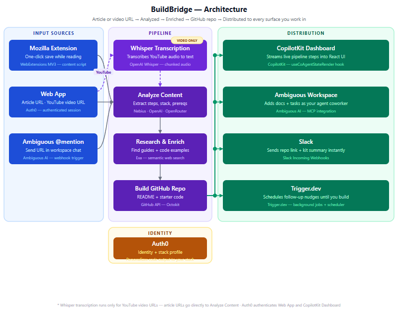
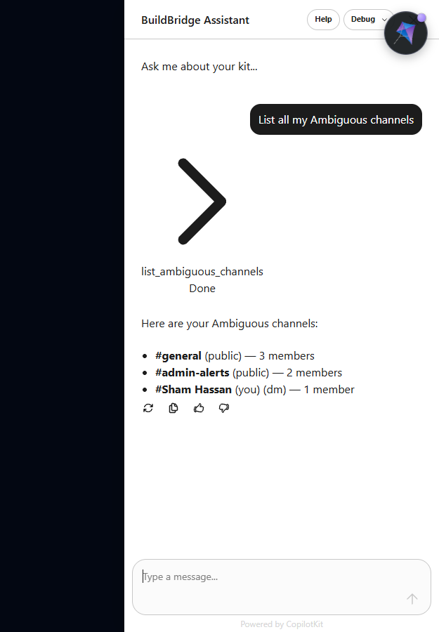

# BuildBridge — Article to GitHub Repo in 30s

> Paste any technical article or YouTube video. BuildBridge extracts every step, lets you edit, then creates a GitHub repo, Slack notification, Ambiguous task, and a follow-up reminder — in one click. Built solo for a hackathon in one day.

## Sections

- The Problem
- What It Does
- How It Works
- Architecture
- The CopilotKit Fix
- Build Story
- Key Learnings
- Moments In Between
- Platform Review
- Team

## Content

### In this page

1.  [The Problem](#section-problem)
2.  [What It Does](#section-what)
3.  [How It Works](#section-how)
4.  [Architecture](#section-architecture)
5.  [The CopilotKit Fix](#section-copilotkit)
6.  [Build Story](#section-story)
7.  [Key Learnings](#section-learnings)
8.  [Moments In Between](#section-moments)
9.  [Platform Review](#section-platforms)
10.  [Team](#section-team)

## The Problem

The gap between reading and building

You bookmark 10 tutorials a week. You build maybe one a year. Not because you're lazy — because the gap between _reading a great article_ and _creating a repo, setting up the structure, and typing the first command_ is just large enough to kill momentum every single time.

The article is right there. The steps are all listed. But getting from "that looks useful" to "I have a working folder open" takes 15–20 minutes of copy-paste, file creation, and hunting for that one dependency version. By then you've lost the energy that made you want to do it.

"The problem isn't finding good tutorials. It's that the gap between reading one and building from it is just large enough to kill the momentum every time."

— The insight that kicked this off

BuildBridge closes that gap. Paste the URL. In under 30 seconds, you have a GitHub repo with the full implementation kit — every step, every command, every prerequisite — ready to clone and start. The article stays open. The momentum doesn't die.

## What It Does

Six things in one click

<30s

Article to repo

0.5s

Cached instant load

6

Parallel outputs

3

Entry points

📄

#### Article → Kit

Paste any technical article URL. LLM extracts title, stack, prerequisites, and every numbered step with commands.

🎬

#### Video → Kit

Paste a YouTube URL. Whisper transcribes the audio first, then the same pipeline runs. Source type doesn't matter.

✏️

#### Human-in-the-loop

You see and edit every extracted step before anything gets created. The LLM suggests; you approve.

🐙

#### GitHub Repo

One click creates a named repo with a README, all steps, and starter structure. You just need to clone it.

💬

#### Workspace Notify

Ambiguous gets a channel message, a task, and a searchable document — all simultaneously.

⏰

#### Follow-up Nudge

Trigger.dev schedules a reminder 2 days later. If you haven't started, it nags you before the repo collects dust.

**The idea field changes everything.** Same FastAPI article + different idea ("build this with JWT auth and bcrypt") → completely different kit. One generic REST tutorial. One with OAuth2, bcrypt password hashing, and bearer tokens throughout.

### Three ways to trigger it

Web AppPaste URL, optionally describe your idea

Firefox ExtensionOne-click from any article you're reading

Ambiguous @mentionDrop a URL in a channel, agent replies with the kit

## How It Works

The pipeline from URL to six outputs

1

**You paste a URL** Article or YouTube video. Optionally describe what you want to build from it. That context shapes the entire kit — the LLM recontextualises the source for _your_ goal, not the generic one.

2

**Content fetch (Exa / Whisper)** Articles: Exa fetches the full text via semantic search. YouTube videos: Whisper downloads and transcribes the audio in chunks first. Either way, the next step receives clean text.

3

**LLM analysis (Nebius → OpenRouter fallback)** The text goes to Llama-3.3-70B on Nebius AI (or gpt-4o-mini via OpenRouter if quota is tight). It extracts: title, difficulty, estimated time, tech stack, prerequisites with install commands, and up to 18 implementation steps — each with a command block.

4

**You review and edit** The kit is shown to you before anything is committed. You can edit the title, remove steps, change the stack tags, or adjust the time estimate. The LLM is a first draft; you're the editor.

5

**One click — six outputs** GitHub repo created via Octokit API. Slack webhook fires. Ambiguous gets a channel message + task + document simultaneously. Trigger.dev schedules a follow-up reminder.

6

**AI sidebar — plain English control** The CopilotKit sidebar connects to your Ambiguous workspace. Type `"List my channels"`, `"Create a task with high priority"`, or `"Search messages about FastAPI"`. It calls the live API and returns real data.

## Architecture

Three input sources, one pipeline, six outputs



Three things can trigger the pipeline: the web app, the Firefox extension, or an Ambiguous @mention (via a Next.js webhook route). YouTube URLs take a detour through Whisper transcription before hitting the main pipeline. Everything else goes straight to Analyze Content.

The distribution layer fires all six outputs simultaneously — not sequentially. GitHub repo creation, Slack notification, and the three Ambiguous actions (channel message, task, document) all go out in parallel using `Promise.all`. Trigger.dev schedules the follow-up separately via its background job API.

### Key files

File

Role

src/lib/pipeline.ts

Core pipeline — Exa fetch, LLM call, GitHub repo creation, all output actions

src/app/api/process/route.ts

SSE streaming endpoint — streams pipeline steps to the UI in real time

src/components/BuildBridgeApp.tsx

Main UI — URL input, kit display, step editor, CopilotKit sidebar integration

src/app/api/copilotkit/route.ts

CopilotKit server endpoint — OpenAI-compatible adapter (Nebius / OpenRouter)

src/app/api/ambiguous/route.ts

Proxy to Ambiguous API — keeps the key server-side, handles GET and POST

src/app/api/webhook/ambiguous/route.ts

@mention webhook — receives channel triggers, runs pipeline for cached URLs

src/data/cached-kits.json

Pre-analyzed kits for demo URLs — instant 0.5s response, no API calls

## The CopilotKit Fix

The hardest bug in the build — a silent protocol mismatch

The AI sidebar was supposed to be the easiest part. CopilotKit provides a prebuilt sidebar component — you register tools with `useCopilotAction`, the LLM calls them, and you're done. Except in v1.71.1, that's not how it works anymore. And nothing in the docs tells you that.

**The symptom:** Every tool call returned a blank response. The sidebar showed the user message, then nothing. Meanwhile the browser console logged: `"Tool result is missing for tool call call_Wd0IYniA6n94YOlXqasmbfwS"`. The LLM was calling the tool three times before giving up silently.

The root cause: CopilotKit v1.71.1 uses the **ag-ui v2 protocol** internally, which tracks tool calls by ID and expects a `TOOL_RESULT` event to be emitted back into the stream. The old `useCopilotAction` hook runs the handler but never emits that event. So the runtime keeps waiting. The LLM retries. No response ever arrives.

```comment
// ❌ Old (v1) — handler runs but result never reaches ag-ui stream
useCopilotAction({
  name: "list_ambiguous_channels",
  parameters: [{ name: "channelId", type: "string" }],  // array format
  handler: async () => { ... }
});

// ✅ New (v2) — result emitted through ag-ui TOOL_RESULT event
import { useFrontendTool, useDefaultRenderTool } from "@copilotkit/react-core/v2";
import { z } from "zod";

useDefaultRenderTool();  // required — handles rendering for all tools

useFrontendTool({
  name: "list_ambiguous_channels",
  parameters: z.object({ channelId: z.string() }),  // Zod schema required
  handler: async ({ channelId }) => { ... }
}, []);
```

Three things change: the import path (`@copilotkit/react-core/v2` not the main package), the `parameters` format (Zod schema instead of a plain array), and the addition of `useDefaultRenderTool()` once in the component. After that, the sidebar works — tool calls, results, text responses, all of it.



Live tool call — "List all my Ambiguous channels" → real workspace data, no blank screen.

**If you're using CopilotKit v1.71+:** `useCopilotAction` is silently broken with the ag-ui v2 protocol. Migrate all your tools to `useFrontendTool` from `@copilotkit/react-core/v2` and add `useDefaultRenderTool()`. Zod is a required peer dep.

## Build Story

One day, solo, hackathon deadline pressure

The hackathon was announced with a 24-hour window. The theme: _Agents, Everywhere — Bots, Channels & More_. Sponsors: Ambiguous, Nebius AI, CopilotKit, Exa, Trigger.dev. The challenge was to build something that lived inside a workspace environment, not just notified it.

The core pipeline — URL to GitHub repo — came together in the first few hours. Exa's API is straightforward; the LLM prompt required three iterations to get reliable step extraction. GitHub repo creation via Octokit was four lines. Slack took ten minutes. Ambiguous was where things got interesting.

The Ambiguous integration had three parallel goals: post a channel message, create a task, create a searchable document. All three fire simultaneously on every "Build Kit" click. That part worked cleanly. What didn't work was the @mention webhook — Ambiguous's cloud servers can't POST to localhost, which requires either ngrok or the Ambiguous CLI dev tunnel. The webhook code is complete but the demo runs via the web UI and direct API calls instead.

The CopilotKit sidebar was the last thing built and the last thing fixed. The "Tool result is missing" error appeared 2 hours before the deadline. The fix — migrating from `useCopilotAction` to `useFrontendTool` — took 45 minutes to identify and 10 minutes to apply once the cause was clear.

The demo video was assembled with `ffmpeg` and Puppeteer in 20 minutes. No audio — a walkthrough script was written instead. The submission went in with 15 minutes to spare.

## Key Learnings

Seven honest takeaways — including the failures

1

**Pre-cache your demo URLs the night before**

Live LLM calls take 8–30 seconds depending on quota and model. A `cached-kits.json` file with pre-analyzed versions of your demo URLs makes the difference between a compelling demo and a waiting screen. The cache shows "Analyzed in 0.5s" and the pipeline log says "instant cache hit". Judges see speed; they don't need to watch 15 seconds of loading.

2

**CopilotKit v1 / v2 split is completely undocumented**

`useCopilotAction` silently fails with the ag-ui v2 protocol. The handler runs. The result disappears. The sidebar shows nothing. There is no error in the console until you know to look for "Tool result is missing." The fix is in the source types but not in any guide, example, or changelog. Budget time to read the TypeScript declaration files.

3

**The "optional idea" field is the most interesting UX decision**

When you let users describe what _they_ want to build from the article — not what the article is about — the output becomes genuinely personalised. Same FastAPI URL, different idea field → two completely different kits with different auth, different structure, different commands. That single input changes the product from "article summariser" to "implementation partner."

4

**YouTube + Whisper + same pipeline = zero extra work**

Adding video support required one extra pipeline step: Whisper transcription before the LLM call. The rest of the pipeline doesn't change — it just receives text. A 3-hour course transcribes to ~18 implementation steps that the LLM extracts cleanly. The pipeline genuinely doesn't care whether the text came from an article or a video.

5

**Ambiguous @mention needs a public URL — localhost isn't enough**

The webhook code is complete, but Ambiguous's cloud servers can't POST to `localhost:3000`. You need ngrok, the Ambiguous CLI dev tunnel, or a deployed URL. In a hackathon context, this is easy to miss until the last hour. The web UI demo covers the same pipeline, but the @mention flow is the strongest criterion-2 argument and it never got shown live.

6

**GitHub repo name collisions are silent 422 errors**

If a repo with the same slug already exists, GitHub returns a 422 with "already exists" in the message — not a meaningful error code. The fix: catch the 422, append a 4-digit timestamp suffix, retry once. This took 5 minutes to write and saved the demo from failing silently on the second run.

7

**Moving tools client-side (useFrontendTool) fixes the blank screen completely**

Server-side tool registration in CopilotKit v1.71+ will swallow the entire LLM text response if no client renderer is registered. Moving all tools to `useFrontendTool` on the client — including UI tools like `markStepDone` — makes everything work: tool calls, text responses, and the rendered sidebar. There is no middle ground in the current version.

## Moments In Between

The small things that actually stuck

🔇

#### Three retries, no output

Watching the CopilotKit sidebar call the same tool three times and return nothing — not an error, just silence — was deeply confusing. The protocol was eating the results. It took reading the TypeScript source of `@copilotkit/react-core/v2` to understand why.

⚡

#### "Instant cache hit" in the log

When the pipeline panel showed "Loading pre-analyzed kit (instant cache hit)..." and the whole kit appeared in 0.5s — that exact label made the demo feel real. The app looked fast because it _was_ fast. That one string changed the feel completely.

🎓

#### 18 steps from a 3-hour course

Running the OpenClaw course through Whisper overnight and waking up to 18 clean implementation steps covering everything from install to building a community manager — it worked better than expected. The pipeline was designed for articles. The video didn't care.

📡

#### The Zoom that didn't happen

Tried to set up a call with the Ambiguous team during the hackathon to figure out the @mention webhook flow. The internet had other ideas. The integration got built anyway — just tested differently. They'll see the working version eventually.

🎬

#### 5 minutes to make a video

With 5 minutes before submission, the demo video was assembled with `ffmpeg` — audio from one recording, video from another, merged blind. No sync check. It didn't perfectly sync. But it showed the app working, and that was what mattered.

## Platform Review

Honest takes on six integrations

### Ambiguous

#### Liked

**Three simultaneous actions** — channel message, task, and document all from one API call pattern. Most workspace tools are single-action per integration.

**Document API** — creates searchable docs, not just messages. Useful for kits that need to be found later.

**Webhook concept** — the @mention trigger is a strong design. The agent lives in the workspace, not outside it.

#### Gotcha

**API response format** — returns `{ data: [...], total, has_more }` not a raw array. Docs show a raw array. Cost 30 minutes.

**@mention webhook needs public URL** — can't test locally without ngrok or the CLI tunnel. Not mentioned in the quickstart.

### CopilotKit

#### Liked

**Sidebar component** — out of the box, no CSS work needed. Fits dark themes with minimal override.

**Context sharing** — `useCopilotReadable` lets the LLM know about the current kit state. The AI can reference what's loaded without you wiring it explicitly.

#### Gotcha

**v1/v2 API split is silent** — `useCopilotAction` works in v1, fails silently in v1.71+ with ag-ui. No error, no warning, no doc note.

**Zod is a required peer dep** — `useFrontendTool` requires a StandardSchemaV1 (Zod schema) for parameters. Not documented. Find it in the TypeScript types.

**useDefaultRenderTool() required** — must be called once in the component or all tool renders are silently skipped.

### Nebius AI (LLM) + OpenRouter (fallback)

#### Liked

**OpenAI-compatible API** — swap the base URL and key, same code. Zero changes to the LLM call logic when switching providers.

**Llama-3.3-70B** on Nebius is fast and cheap. Good step extraction quality for structured output tasks.

#### Gotcha

**Quota surprises** — Nebius quota ran low during heavy testing. The OpenRouter fallback (gpt-4o-mini) saved the demo. Build the fallback chain from the start.

### Exa

#### Liked

No surprises. Semantic content fetch works exactly as described. Returns clean text, respects the `contents` option, handles most article formats. The one integration that just worked from the first test.

## Team

Solo build — tried to form a team, didn't happen

Attempted to recruit on UX and backend before the hackathon. Didn't come together in time. The full stack — frontend, pipeline, integrations, demo video, submission — was built solo.

S

Sham Hassan

Everything — design, pipeline, integrations, CopilotKit debugging, video

[View on GitHub](https://github.com/researchsite/buildbridge) Next.js 16 TypeScript Hackathon 2026 Open Source
