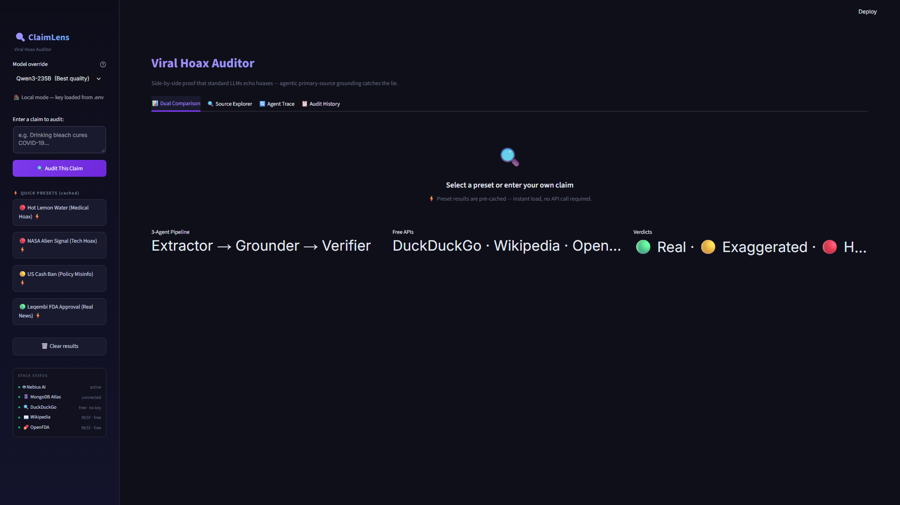
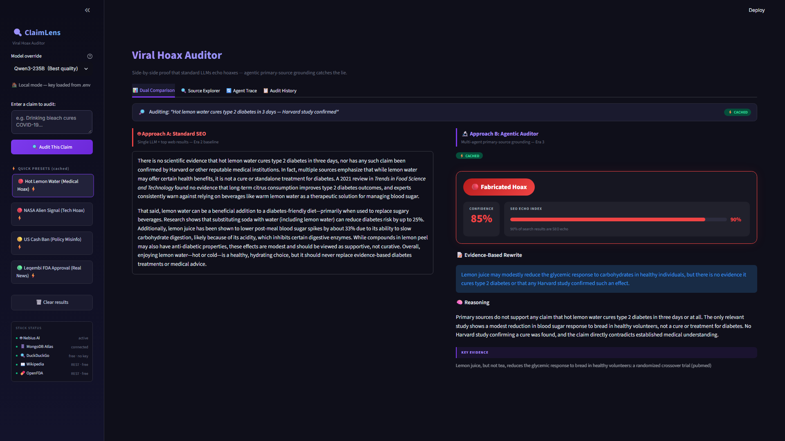

# ClaimLens — 3-Agent Fact-Checker

> A 3-agent pipeline that shows exactly where a standard AI echoes viral hoaxes. Claim Extractor, Grounder, Verifier. Built in Python and Streamlit after an AI Camp session on grounded agentic pipelines.

## Sections

- What It Does
- See It In Action
- Architecture
- How It Works
- Components
- Real Learnings
- Moments In Between
- Platform Review
- Built By
- Get Started

## Content

## What It Does

When viral health claims spread, the top 10 search results are often SEO blogs repeating each other. A standard AI reads those, writes a confident paragraph, and echoes the hoax — what the AI Camp session called “fluent prose fraud.” ClaimLens puts the standard AI and the 3-agent pipeline on the same screen so the gap is impossible to miss.

3

agents

4

presets

87%

echo index  
(lemon water)

4

UI tabs

### App Features

⚖️

#### Dual Comparison

Approach A (single LLM, no grounding) and Approach B (3-agent pipeline) side-by-side. Same claim, same search results — shows exactly where standard AI goes wrong.

📚

#### Source Explorer

Every DuckDuckGo result classified: **PRIMARY SOURCE** (.gov, .edu, PubMed, WHO, NASA) or **SEO ECHO** (blog, aggregator). The Echo Index bar shows the ratio visually.

🔍

#### Agent Trace

Step-by-step execution log showing each agent — model name, input, output, and duration in milliseconds. Full transparency on why the verdict was reached.

🗃️

#### Audit History

MongoDB Atlas stores every run. Each card shows claim, verdict badge, confidence %, Echo Index, and timestamp. “Load in Comparison” replays any past result.

⚡

#### 4 Presets & Model Selector

Lemon Water, NASA Signal, Cash Ban, Leqembi — instant load from pre-computed cache, no API key required. Switch models: Qwen3-235B, Qwen3-30B, DeepSeek-V4-Flash.

📊

#### Stack Status Panel

Live status of all 5 components: Nebius AI, MongoDB Atlas, DuckDuckGo, Wikipedia, OpenFDA. Green dot = live. Grey = missing config. DuckDuckGo, Wikipedia, OpenFDA are always free and keyless.

Key design rule

**Absent evidence is not the same as contradiction.** The verifier only returns FABRICATED when primary sources directly contradict a claim. If no evidence exists, the verdict is EXAGGERATED. Direct contradiction required for Fabricated — this is the difference between a useful fact-checker and a false accusation machine.

## See It In Action

Select a preset claim, then switch between the four app tabs to see how ClaimLens handles each one. All screenshots are from the live Streamlit app.

Home view — sidebar (claim input, presets, model selector, Stack Status) · 4 tabs (Dual Comparison, Source Explorer, Agent Trace, Audit History)

🔴 Lemon Water 🔴 NASA Signal 🔴 Cash Ban 🟢 Leqembi

Dual Comparison Source Explorer Agent Trace Audit History

“Harvard study proves hot lemon water cures diabetes in 30 days — doctors won’t tell you this!” 🔴 FABRICATED 87% echo index Dual Comparison

## Architecture

Two approaches run on every claim. Same 10 search results feed both. Approach A shows what a standard AI returns. Approach B is the 3-agent grounded pipeline.

Approach A — Baseline

Viral Headline

↓

DuckDuckGo Searchtop 10 results

↓

Single LLM Promptno source classification

↓

“Harvard study confirms…”echo chamber output

reads SEO blogs as evidence · no primary source check

Approach B — 3 Agents

Viral Headline

↓

Claim Extractor (Qwen3-30B)3–5 falsifiable sub-claims

↓

Grounder (Qwen3-235B).gov · .edu · PubMed · FDA · Wikipedia

↓

Verifier (Qwen3-235B)claim × evidence → verdict

↓

Verdict + Echo Index + Rewritten Claim

confidence 0–100 · primary source citations · MongoDB audit

### Test Presets

Claim

Verdict

Echo Index

Why

“Harvard study proves hot lemon water cures diabetes in 30 days”

FABRICATED

~90%

No Harvard study; NIH shows minor animal model effects only

“NASA confirms alien radio signal detected from Mars”

FABRICATED

100%

No NASA press release; traces to an ESA simulation misrepresented in tabloids

“US government passes law banning cash payments over $50”

FABRICATED

100%

Federal law (CASH Act) actually _requires_ businesses to accept cash — exact opposite

“FDA grants full approval for Leqembi as Alzheimer’s treatment”

VERIFIED

~60%

FDA full approval Jul 2023; clinical trials confirmed by FDA.gov, alzheimers.gov, .edu sources

## How It Works

-   1
    
    #### Claim input & DuckDuckGo search
    
    User enters a headline or clicks a preset. `DDGS().text()` returns the top 10 results. These are passed unmodified to both Approach A and the 3-agent pipeline — same raw material, different handling. Preset results load from pre-computed cache for instant demo without an API key.
    
-   2
    
    #### Claim Extractor (Qwen3-30B) decomposes the headline
    
    `extract_claims(headline)` calls a small, fast model with a structured-output prompt. Returns a JSON list of 3–5 sub-claims, each independently verifiable. “Harvard study cures diabetes in 30 days” becomes: “a Harvard study exists,” “lemon water reverses type 2 diabetes,” “effect confirmed in 30 days.” Each sub-claim becomes a separate grounding target visible in the Agent Trace tab.
    
-   3
    
    #### Grounder (Qwen3-235B) hunts primary sources
    
    `find_primary_sources()` filters DuckDuckGo results by a domain whitelist (`.gov`, `.edu`, `pubmed`, `fda.gov`, `who.int`, `nasa.gov`, `wikipedia`), then expands with direct calls to the Wikipedia REST API and OpenFDA API. Every result is classified PRIMARY SOURCE or SEO ECHO. The Echo Index is the ratio of echoes in the original 10 — shown as a visual bar in the Dual Comparison and Source Explorer tabs.
    
-   4
    
    #### Verifier (Qwen3-235B) checks claims against evidence
    
    `verify_claim()` receives the original claim, all sub-claims, and the grounded sources. Conservative calibration: absent evidence → EXAGGERATED; direct contradiction required for FABRICATED. Outputs: verdict, confidence 0–100, key evidence bullets, primary source citations, and a rewritten headline that matches what the evidence actually says.
    
-   5
    
    #### Approach A runs as baseline comparison
    
    `stream_approach_a()` sends the original claim plus raw DuckDuckGo results to a single LLM with no grounding instructions. Response streams live via `st.write_stream()`. For the lemon water claim, Approach A produces a confident health summary citing “a Harvard study” — because that’s what the top 9 SEO blogs say.
    
-   6
    
    #### Audit trail stored in MongoDB (with session fallback)
    
    Every run is written to MongoDB Atlas: claim, sub-claims, all source classifications, verdict, confidence, reasoning, and rewritten headline. If no MongoDB URI is configured, the app falls back to Streamlit session state automatically. The pipeline always runs; the audit trail is optional and clearly separated from the core logic.
    

\# orchestrator.py — full pipeline in one async call async def run\_audit(claim, search\_results): sub\_claims = await extract\_claims(claim) \# Qwen3-30B · step 2 grounding = await find\_primary\_sources( \# Qwen3-235B · step 3 claim, sub\_claims, search\_results) verdict = await verify\_claim( \# Qwen3-235B · step 4 claim, sub\_claims, grounding) echo\_index = calculate\_echo\_index(search\_results) \# ratio of SEO echoes return {"verdict": verdict, "echo\_index": echo\_index, "grounding": grounding, "sub\_claims": sub\_claims}

## Components

File

Role

Key function

`agents/orchestrator.py`

Pipeline coordinator

`run_audit()` — calls all 3 agents in sequence, returns full result

`agents/claim_extractor.py`

Sub-claim decomposition

`extract_claims(headline)` → JSON list via Qwen3-30B, structured output

`agents/grounder.py`

Primary source hunting

`find_primary_sources()` — domain whitelist + Wikipedia REST + OpenFDA API

`agents/verifier.py`

Evidence-based verdict

`verify_claim()` → verdict, confidence 0–100, rewritten\_claim, reasoning

`approach_a.py`

Baseline LLM (no grounding)

`stream_approach_a()` → streaming single-prompt response for comparison

`utils/echo_index.py`

Search space quality metric

`calculate_echo_index(results)` → % not primary sources, 0–100

`presets.py`

4 pre-loaded test claims + cache

lemon\_water · nasa\_signal · cash\_ban · leqembi — instant load, no API key

`app.py`

Streamlit entry point

Sidebar, 4 tabs, streaming output, verdict card, source classifications, Stack Status

## Real Learnings

01

Fluent prose fraud is visible the moment you run the first test

Approach A returned a confident health article citing a Harvard study that doesn’t exist. The model didn’t lie — it summarised what the blogs said. They were all echoing the same unsourced claim. The pipeline makes the mechanism visible: 9 of 10 results were the same bad claim copied 9 times, and the AI read those as evidence.

The pipeline didn’t catch a lie. It showed where the lie came from.

02

The Echo Index wasn’t in the plan — it showed up in debugging

While wiring up the Grounder, I printed a source classification breakdown: 9 of 10 DuckDuckGo results for the lemon water claim were SEO blogs with no primary source links. That ratio turned out to be more informative than the verdict itself — a _pre-verdict signal_ about whether the search space is already contaminated. An Echo Index of 100% means the AI can only read echoes, no matter how sophisticated its reasoning.

The most useful metric was an accident from a debug print.

03

Conservative verdict calibration is where the tool earns or loses trust

The first verifier called anything without primary evidence “fabricated.” That was wrong. Absence of evidence is not contradiction. The fix was one logic change: `absent → EXAGGERATED`, `contradiction → FABRICATED`. Without that distinction, the tool is a false accusation machine. The cash ban preset also revealed a subtler problem: the real law is the exact _opposite_ of the claim. The verifier had to correctly identify “inverted claims” as Fabricated with high confidence.

absent evidence ≠ fabrication — this rule is the entire verifier.

04

Structured output between agents removes an entire class of bugs

Early versions let the Extractor return free-form text and tried to parse it downstream. The Grounder would fail silently when the format shifted. Switching to JSON-only structured output meant the pipeline either returned a valid list of sub-claims or raised an explicit error. No silent failures, no format negotiations at runtime.

Structured output is the contract that makes the pipeline reliable.

05

The verified case matters as much as the fabricated ones

The Leqembi preset (FDA-approved Alzheimer’s drug) was added to test the other direction. If the verifier returns FABRICATED on a claim backed by FDA approval and peer-reviewed trials, the tool is worse than useless. Getting VERIFIED right — low echo index (~60%), three primary source confirmations — was as important as catching the hoaxes. The 60% echo on a real claim (vs 90–100% on hoaxes) is itself diagnostic.

A fact-checker that only catches falsehoods is a bias machine.

06

DuckDuckGo rate limits quietly on consecutive runs

Running through all four presets quickly triggers DDGS rate limiting — the search returns fewer results with no error code. Invisible in single-run testing. Fix: 1-second sleep between consecutive search calls in demo mode. Rate-limited APIs that fail silently are a trap you only discover under load.

Always test consecutive runs, not just single runs.

## Moments In Between

🐛

The accidental Echo Index

Added a debug print to see what the Grounder was classifying. Saw “9/10 SEO” for lemon water. Decided to surface it in the UI as a visual bar. It became the most-discussed element in every demo.

📄

Approach A wrote a Harvard study

First full test run. Approach A returned a confident paragraph citing “a Harvard study.” No such study exists. Approach B: “No Harvard study found.” That side-by-side was the moment the tool made sense to show to people.

⚖️

Fabricated → Exaggerated

Changed two lines of verifier logic. The NASA preset started returning sensible verdicts. Realised the distinction between those two verdicts was the core product judgment, not an implementation detail.

🗃️

MongoDB went down at 3am

Atlas free tier cold start during a late demo prep. Session memory fallback kicked in without any user-visible errors. Built the fallback as an afterthought. It saved the run.

✅

Leqembi passed

When the FDA-approved drug returned VERIFIED with echo index ~60% and three primary source citations, the tool felt trustworthy for the first time — not just clever at catching hoaxes.

## Platform Review

✓ Liked

✓**DDGS** — no API key, no setup. `DDGS().text(query, max_results=10)` just works. Fastest path from claim to search results.

✓**Streamlit `st.write_stream()`** — one line for a live typing effect on Approach A output. Zero frontend code.

✓**OpenFDA API** — free, no key, structured JSON for drug approvals. The Leqembi VERIFIED verdict needed it.

✓**Nebius AI OpenAI-compatible endpoint** — swap Qwen3-235B in as a drop-in for the OpenAI client. Zero code change, large model, free tier.

✓**MongoDB Atlas free tier** — JSON audit records require no schema. Zero-config for append-only storage; graceful offline fallback.

⚠ Gotcha

⚠**DDGS rate limiting** — quiet failure, returns fewer results with no error code. Add a 1-second sleep between consecutive calls.

⚠**Streamlit + async** — mixing `st.write_stream()` with async agent calls needs careful session state management. The natural Streamlit pattern is synchronous.

⚠**MongoDB Atlas cold start** — free tier sleeps after inactivity. First demo request can take 10–15 seconds. Run a warm-up query before showing the app.

⚠**Wikipedia API disambiguation** — returns the most-viewed article for a keyword, not the most relevant for the medical context. Needs domain-specific query construction.

## Built By

SH

Sham HC

Architecture · Pipeline · Streamlit UI

Designed the 3-agent pipeline after the AI Camp session on Google’s Co-Scientist architecture. Built the Claim Extractor, Grounder, Verifier, Echo Index metric, 4-tab Streamlit UI, and side-by-side comparison. The Echo Index appeared during debugging and stayed because it was more useful than expected.

What sparked this

The pipeline design came directly from [Shadab Hussain’s](https://shadabhussain.com/) session at AI Camp on Google’s Co-Scientist multi-agent architecture — specifically the finding that grounded pipelines produce 0% phantom citations versus 21% for baseline LLMs. ClaimLens applies the same idea at smaller scale: a Grounder that refuses to trust SEO blogs, and a Verifier that checks claims against primary evidence rather than fluent prose.

[Read the session notes →](../blog/aicamp-coscientist.html)

## Get Started

Try the live app with no setup — all 4 presets load from cache with no API key. Or clone the repo and run locally with your own Nebius AI key.

### Live Streamlit App

4 presets, instant load, no API key required. Full pipeline runs with your own Nebius key.

[Try Live App →](https://claimlens-xh52zvqh5z3xrstpzcvyoo.streamlit.app/) [GitHub →](https://github.com/researchsite/claimlens)

\# Clone and install git clone https://github.com/researchsite/claimlens pip install -r requirements.txt \# Configure — Nebius AI key for live runs; MongoDB optional cp .env.example .env \# NEBIUS\_API\_KEY=... (or any OpenAI-compatible endpoint) \# MONGODB\_URI=... (optional; app uses session state if unset) \# Run streamlit run app.py
