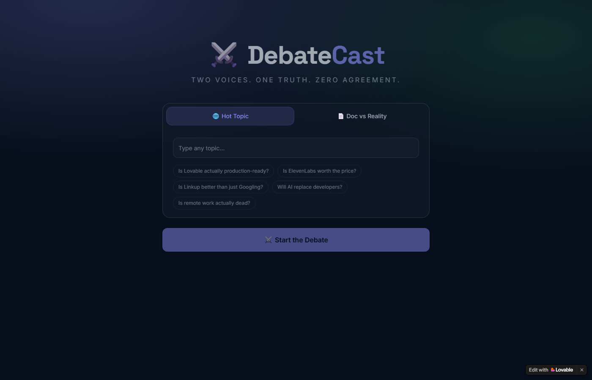

# DebateCast — Two AI Voices. One Live Debate.

> How I built DebateCast in 2 hours at a hackathon — an app where two AI voices debate any topic using live web data. Built with Lovable, ElevenLabs, and Linkup.

## Sections

- The Idea
- What It Does
- The Build
- Architecture
- Screenshots
- Real Learnings
- Moments In Between
- Platform Review
- Team

## Content

## The Idea

The First Non-Tech Buildathon at AWS Builder Loft gave every team the same starting point: Lovable, ElevenLabs, and Linkup. Three sponsors. Two hours. Make something real with all three.

I was paired with Mahima — her first hackathon. The first thing we talked through wasn't what to build. It was a more useful question: **what makes these three tools interesting together, not just separately?** That's the harder question, and the right one to start with.

Linkup searches the live web. ElevenLabs makes text audible. Lovable ships a working app in minutes. You could string all three in sequence without any of them doing anything the others couldn't replace — a search summary, read aloud, deployed. That's the trap. Three tools, one workflow, nothing new.

So the brainstorm kept circling one constraint: what's only possible when all three are working in the loop at the same time? Real search feeding real audio, deployed instantly — not a summary tool, not a podcast, but something that generates a live voice experience from live data, on any topic, on demand.

That constraint led to DebateCast. Two AI voices arguing both sides of any topic — Voice A the optimist, Voice B the skeptic — using Linkup results as their facts, ElevenLabs as their voices, and Lovable as the stage.

**The boldest move:** The demo topics are the sponsors' own tools. "Is Lovable actually production-ready?" — searched live on Linkup, voiced by ElevenLabs, running inside a Lovable-built app, in front of the Lovable team. If the stack works under those conditions, it works.

## What It Does

DebateCast takes any topic or document, searches both sides using live web data, and has two AI voices argue it out loud with a synchronized scrolling transcript.

🌐 Mode 1

Hot Topic

Type any topic or pick a preset. Linkup searches real web for supporting evidence and counterarguments. Two voices debate it live.

Topic → Linkup × 2 → Script → ElevenLabs × 6 → Play

📄 Mode 2

Doc vs Reality

Paste any document or policy. Voice A reads what it claims. Voice B reads what Linkup found in 2026. The document gets fact-checked out loud.

Document → Extract claims → Linkup search → ElevenLabs × 6 → Play

### Preset Topics

The presets aren't random — they're the sponsors' own pain points, chosen to prove Linkup is finding real current data:

🏗️

#### Is Lovable production-ready?

The boldest one. Real Reddit and ProductHunt complaints voiced back in front of the Lovable team.

🎙️

#### Is ElevenLabs worth the price?

Debated using ElevenLabs itself. The irony was the point.

🔍

#### Is Linkup better than Googling?

Linkup searches both sides of its own value proposition.

🤖

#### Will AI replace developers?

Safe opener for the demo. Real data, strong opinions on both sides.

🏠

#### Is remote work actually dead?

Timely, divisive, and Linkup finds real 2026 RTO data.

## The Build

The entire UI was built in Lovable from a single prompt. No manual coding. I described the screens, the API logic, the playback behavior, and the template — Lovable generated a full working React app.

-   1
    
    #### Write the prompt
    
    Described both screens, both modes, all API integrations, and the exact debate template. One shot.
    
-   2
    
    #### Lovable generates the app
    
    Full React app — dark theme, two tabs, preset chips, loading bar, transcript bubbles, audio player. Took under 5 minutes.
    
-   3
    
    #### Wire in the APIs
    
    Linkup search, ElevenLabs TTS (6 sequential calls), optional OpenAI script upgrade — all described in the prompt, generated correctly.
    
-   4
    
    #### Deploy
    
    Lovable deployed directly to a public URL. Live at [debate-spark-duel.lovable.app](https://debate-spark-duel.lovable.app/) within minutes.
    
-   5
    
    #### Rehearse the demo
    
    Two runs. First safe topic, then the bold one. Timed the silences. Practiced stopping talking when the audio played.
    

### The Prompt

This is the exact prompt I used to build the app in Lovable. One input. Everything below came out of it.

// Lovable prompt — Sep 4, 2026 Build a dark-themed web app called DebateCast with tagline "Two voices. One truth. Zero agreement." Design: background #07101f · accent A: indigo #818cf8 accent B: green #4ade80 · fonts: Space Grotesk + Inter SCREEN 1 — HOME Tab 1 — Hot Topic: text input + 5 preset chips: "Is Lovable actually production-ready?" "Is ElevenLabs worth the price?" "Is Linkup better than just Googling?" "Will AI replace developers?" "Is remote work actually dead?" Tab 2 — Doc vs Reality: Textarea: paste any document or policy Label: "Voice A reads what the doc claims. Voice B reads what's true now." Full-width button: ⚔️ Start the Debate SCREEN 2 — DEBATE OUTPUT Loading bar cycling: "Searching the web…" → "Building arguments…" → "Waking up the voices…" Three sections: Research panel — two columns, Linkup pro/con Audio player — avatars A and B, topic, progress Transcript — chat bubbles, A indigo, B green LOGIC Step 1 — Linkup: two searches per topic (FOR + AGAINST) Step 2 — Build script from template: A: "Look, the evidence is clear. \[pro0\]. I don't know why we're even having this conversation." B: "Adorable. \[con0\]. But please, continue." A: "\[pro1\]. The data doesn't lie. You're welcome." B: "\[con1\]. I've seen stronger arguments in a fortune cookie." A: "Final point. \[pro2\]. Case closed." B: "\[con2\]. I think we both know how this ends." Step 3 — ElevenLabs TTS: 6 calls, alternating VOICE\_A / VOICE\_B Step 4 — Playback: sequential, 400ms gap, bubbles highlight in sync OPTIONAL: if OPENAPI\_API\_KEY exists, call GPT for funnier script

## Architecture

Four services chain together. Each one hands off to the next. Lovable built the shell that wires them all.

💬

User Input

topic or doc

→

🔍

Linkup

2× search

→

🧠

OpenAI

optional script

→

🎙️

ElevenLabs

6× TTS

→

▶️

Playback

sequential

### Open APIs

Service

Endpoint

Method

Key header

What it returns

Linkup

api.linkup.so/v1/search

POST

Authorization: Bearer

{ answer, sources } — real web results

ElevenLabs

api.elevenlabs.io/v1/text-to-speech/{voice\_id}

POST

xi-api-key

audio/mpeg binary blob

OpenAI

api.openai.com/v1/chat/completions

POST

Authorization: Bearer

Funnier debate transcript

Linkup's `outputType: sourcedAnswer` returns a clean structured answer with citations — no scraping or parsing needed. ElevenLabs uses model `eleven_turbo_v2_5` for fast generation. The six audio blobs are stored as URL objects and played sequentially.

### Live Output — "Is Lovable actually production-ready?"

This is real output from running the demo topic live. Linkup searched both sides of the argument, the script was generated, ElevenLabs voiced it. Nothing below was written by a human.

🔵 The Case For

Generates code that is **90% production-ready** — one custom utility function needed for CSV export logic.

Subscription checkout flows reach **95% completion** with minor adjustments.

Production-ready for low-volume B2B SaaS, internal tools, and validation MVPs.

🟢 The Case Against

Not fully production-ready for all use cases — significant limitations for high-traffic consumer apps, regulated industries, and complex financial applications.

Research found **10 database security vulnerabilities** in generated code for complex use cases.

🔵 THE OPTIMIST (Voice A)

"Lovable is nearly there! With 90% production-ready code, you only need one little utility function for CSV export — what's a minor tweak among friends?"

🟢 THE SKEPTIC (Voice B)

"Ah yes, 'nearly there,' like a car that runs on three wheels. Let's not forget it's still not fully production-ready for all use cases in 2026."

🔵 THE OPTIMIST (Voice A)

"But for low-volume B2B SaaS and internal tools, it's practically a miracle! 95% completion for subscription checkout flows is a steal."

🟢 THE SKEPTIC (Voice B)

"Sure, if you enjoy navigating significant limitations and potential database security vulnerabilities. Who doesn't love a little thrill in their tech stack?"

🔵 THE OPTIMIST (Voice A)

"A little risk is just part of the innovation game! Besides, think of the exciting MVPs you could validate with Lovable."

🟢 THE SKEPTIC (Voice B)

"Exciting indeed, as long as you don't mind your app crashing during tax season. Sounds like a fun time to me."

↑ Real Linkup data. Real ElevenLabs voices. Zero human-written lines.

## Screenshots

Home screen — dark background, ⚔️ DebateCast title, two tabs (Hot Topic / Doc vs Reality), 5 preset chips, Start the Debate button.

🎭

Demo Mode — Coming Soon

Demo mode with pre-generated real debates (Linkup data + ElevenLabs audio bundled as static files) is being added. Screenshot will be updated once Lovable credits are refreshed and the update is deployed.

🔴

Live Mode — Settings Panel

Settings drawer showing 5 API key fields (Linkup, ElevenLabs, Voice A, Voice B, OpenAI). Screenshot pending next Lovable update.

## Real Learnings

LEARNING 01

The demo topic IS the proof

Debating "Is Lovable actually production-ready?" in front of the Lovable team, using Linkup to find real complaints, voiced by ElevenLabs — that's not just a demo. It's proof the whole stack works under adversarial conditions. Pick a topic that makes the judges nervous and then run it. That's how you're remembered.

LEARNING 02

ElevenLabs API key ID ≠ API key

The ElevenLabs dashboard shows a key ID (a long hex string). That is not your API key. The actual key starts with `sk_`. Spent real time on this during the build. Always check the format before assuming the key is wrong.

LEARNING 03

Lovable builds fast — credits run out faster

The initial build from one prompt was clean. But iterating — adding new modes, tweaking the layout, fixing edge cases — burns credits quickly. For a 2-hour hackathon that's fine. For a production app, budget your iterations or use GitHub to hand off to a real codebase.

LEARNING 04

Linkup query design changes everything

Generic queries return generic answers. `"[topic] supporting evidence data statistics 2026"` returns very different (and better) results than just the topic. The year matters — Linkup finds current data, so anchoring to 2026 stops it from surfacing outdated results.

LEARNING 05

Two voices beat one — dialogue creates tension

A single AI voice summarizing both sides is a summary. Two voices arguing is a show. The format forces listening. People in the room stopped talking when the audio started. That almost never happens at hackathon demos.

LEARNING 06

The name has to encode the idea

Early names were RecapCast, Briefcast, DemoCast — none of them said what made it interesting. DebateCast says it in one word: debate + broadcast. When the name already tells the story, you don't have to explain it before showing it.

LEARNING 07

Stop talking when the demo runs

The hardest discipline in a live demo: shut up. When ElevenLabs voices are playing, any narration competes with them. The silence during the audio is what lets the product speak. The demo script has "STOP TALKING" written in caps three times. It needs to be that explicit.

## Moments In Between

🔑

The key that wasn't a key

ElevenLabs gave me a hex string in the dashboard. Pasted it in. Error: "API key ID used as API key — only valid API keys can be used." The actual key starts with `sk_` and lives under a different settings tab. Found it on the second search.

😬

Running the Lovable debate live

Typing "Is Lovable actually production-ready?" into a Lovable-built app, in front of the Lovable sponsor team, and then waiting for Linkup to return real Reddit complaints — that moment of not knowing what it would say was the realest thing in the demo.

📄

The 2023 policy vs 2026 reality

The Meridian document was fake — but realistic. When Voice B read 2026 Linkup data against a claim that AI isn't suitable for professional work, the gap did the work. Nobody needed to explain the joke. The data just won.

💡

The name pivot

RecapCast, Briefcast, DemoCast all felt close. "DebateCast" came late in the ideation — and it immediately felt like the one. The idea of two voices literally broadcasting a debate was in the name. Everything else snapped into place after that.

⚡

Lovable hit its credit limit mid-build

During iteration, Lovable ran out of credits. Switched to building locally with Claude. Then realized the Lovable version was cleaner and better hosted. Deleted the local version. Sometimes the cloud tool wins over the custom build.

## Platform Review

Lovable

✓ Liked

Ships a real deployed URL in under 5 minutes from a single prompt

GitHub integration — push to repo, full codebase is yours

Generated multi-screen React app with working API calls from one description

The prompt language is natural — describe UI and behavior together

⚠ Gotcha

Credit limits hit during iteration — each prompt change costs tokens

Complex edge cases need multiple prompt rounds

Harder to debug when the generated code breaks silently

ElevenLabs

✓ Liked

`eleven_turbo_v2_5` generates fast — 6 sequential calls completed in seconds

Voice character is real — The Optimist and The Skeptic sound genuinely different

Binary blob response is easy to store as URL objects for playback

⚠ Gotcha

Key ID in dashboard ≠ API key. The actual key starts with `sk_`

6 TTS calls per debate adds up — cache or pre-generate for demo mode

Header is `xi-api-key`, not `Authorization: Bearer`

Linkup

✓ Liked

`outputType: sourcedAnswer` returns clean structured text — no parsing

Results are genuinely current — 2026 data, real Reddit threads, real research

Two searches (FOR + AGAINST) is all you need for a complete debate

⚠ Gotcha

Query wording matters — include the year and search intent for better results

Generic topics return generic answers — be specific in the query

## Team

SH

Sham Hassanchi

idea · design · build · demo

Came up with DebateCast, wrote the Lovable prompt, wired the APIs, built the demo script, and presented on stage. The whole arc from idea to shipped happened on September 4th.

MR

Mahima Raja

paired at the hackathon

First hackathon. Paired together for part of the build — a good reminder that new people show up and participate and that's what these events are for.

Built at the **First Non-Tech Buildathon**, AWS Builder Loft, 525 Market St, San Francisco — September 4, 2026. Sponsors: Lovable · ElevenLabs · Linkup.
