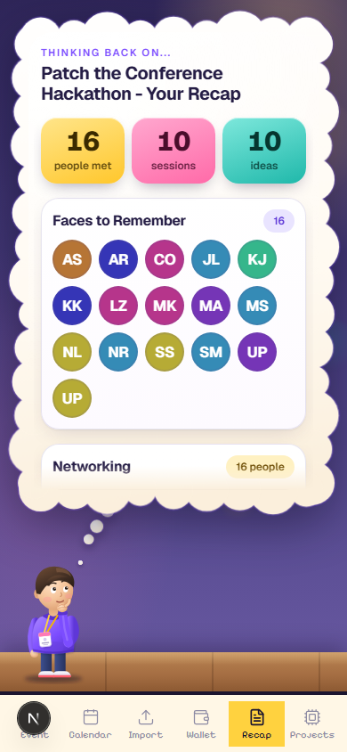
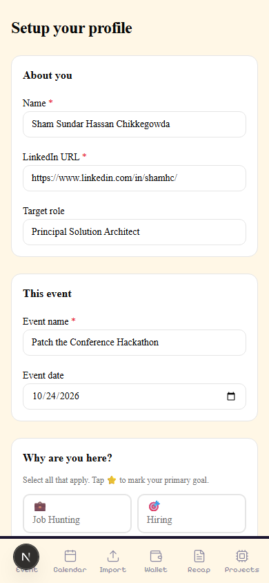

# Debrief — 9 Hours, 1 Graph, 14 People Remembered · RawWeights

> We built a conference networking app at the same hackathon where we needed it. FalkorDB, Bright Data, Qodo — here's exactly what happened, hour by hour.

## Sections

- 9:00 AM.WE HAD THE PROBLEMWE WERE ABOUTTO SOLVE.
- THE TOOLSIN THE STORY
- FROM URL TORANKED MEET PLANIN 30 SECONDS
- THE RECOMMENDATIONIS THE PATH
- 9 HOURS.10 MILESTONES.
- THINGS WENTWRONG. GOOD.
- THE CONFERENCE.SCREEN BY SCREEN.
- HOW EACH TOOLHELD UP
- 57 TEAMS.ONE PROBLEM.

## Content

5:30 PM  ·  October 24, 2024  ·  San Francisco

# THE DEMO  
JUST RAN.

14 meaningful conversations logged. 10 sessions attended. 10 ideas captured. 2,307 nodes in a FalkorDB graph — all from the same conference happening _right outside this room._ There were 200+ people in that building. We talked to 14 of them deeply enough to remember why it mattered. Every one of those 14 is in the graph. Forever.

▶   Same Day  ·  1 min 45 sec Made with AdaL

0

FalkorDB nodes

0

graph relationships

0

deep conversations  
logged in graph

30s

URL → meet plan

0

tests green

FREE

sponsor credits  
hackathon day

↺   9 HOURS EARLIER

Built with FalkorDB Bright Data Qodo WeMakeDevs

Scene 02 — The Problem

## 9:00 AM.  
WE HAD THE PROBLEM  
WE WERE ABOUT  
TO SOLVE.

Every conference, every time

-   200 people in the building. You had deep conversations with 14. You remember 4 of their names a week later.
-   Notes scattered across 3 apps, 2 voice memos, and 1 napkin.
-   LinkedIn searches that take 3 hours before the event even starts.
-   Follow-up emails written from memory — wrong details, wrong tone.
-   Ideas that sparked in a session, gone by the commute home.

What we decided to build by 9:01 AM

-   One graph that remembers everyone, every session, every idea.
-   30-second event import — URL to ranked meet plan.
-   Notes linked to people + sessions in the graph, immutable.
-   AI follow-up drafts from _your_ notes, not their bio.
-   Every idea traceable to the talk that sparked it. Forever.

Watch it get built

Scene 03 — The Cast

## THE TOOLS  
IN THE STORY

Every tool played a specific role. Here's who did what, when it mattered most.

🕸️

The Memory

FalkorDB

graph database

Nodes: **2,307**  
Rels: **2,677**  
Critical scene: **Meet Plan scoring**  
Signature: **allShortestPaths()**

📡

The Intel

Bright Data

web intelligence

Profiles: **11 enriched**  
Tools: **3 APIs used**  
Critical scene: **Event import**  
Signature: **30s pipeline**

🔍

The Auditor

Qodo

AI code review

PRs reviewed: **26**  
Bugs caught: **2 critical**  
Critical scene: **PR #2 intent flag**  
Signature: **never tired**

🌐

The Stage

WeMakeDevs

community · host

Role: **Hackathon host**  
Community: **builders + makers**  
Critical scene: **The problem itself**  
Signature: **the reason we built**

Scene 04 — The Pipeline

## FROM URL TO  
RANKED MEET PLAN  
IN 30 SECONDS

Paste one URL. This is everything that happens before you finish reading this sentence.

🔗

Input

Event URL

Conference schedule page — JS-rendered, behind anti-bot

you paste it

→

📡

Bright Data

Web Unlocker

Renders JS, bypasses protection, returns clean HTML

**~3s**

→

🤖

OpenAI

gpt-4o-mini

Extracts sessions, speaker names, abstracts, topics

**~5s** · 8 sessions · 12 speakers

→

🔎

Bright Data

SERP API

Structured JSON — finds LinkedIn URLs for each speaker

**~8s** · 11 of 12 found

→

👤

Bright Data

LinkedIn Datasets

Full profile enrichment — async 202 + snapshot polling

**~10s** · 11 profiles

→

🕸️

FalkorDB

5-Signal Score

Shared employer, school, intent fit, connection, warm intro

**~1s** · PLANS\_TO\_MEET

⚡

**Result: ranked meet plan in under 30 seconds.** Before Bright Data, this was 2–3 hours of manual LinkedIn searching per event. With three Bright Data products working in sequence, it's one URL and a coffee.

Scene 05 — The Graph

## THE RECOMMENDATION  
IS THE PATH

Most apps say "you should meet X" and give you a score. Debrief shows you the graph path that IS the reason.

Who to meet? Warm intro path Ideas from the day Full network

PLANS\_TO\_MEET score:14 · opener:✓ CONNECTED MET MET

Me

S.C.

#1 · 14pts

J.M.

C.T.

E.G.

QUERY: WHO SHOULD I MEET?

5-signal Cypher scoring

Shared employer +3 · shared school +2 · intent fit +3 · direct connection +5 · warm intro +4. All five signals in one `OPTIONAL MATCH`. Lizz Zhang scores 14 — highest of any speaker. OpenAI generates a personalised opener from the shared graph context.

CONNECTED WORKS\_AT WORKS\_AT

Me

J.M.

bridge

BD

S.C.

QUERY: HOW ARE WE CONNECTED?

allShortestPaths — 3 hops

Me → \[CONNECTED\] → Jordan → \[WORKS\_AT\] → Bright Data ← \[WORKS\_AT\] ← Sam. Jordan is the bridge. Debrief found this path in one `allShortestPaths()` call — and showed it to us in the "Why?" view. The recommendation IS the path, not a score hiding one.

SAW SAW SPARKED SPARKED

Me

Talk A

Talk B

💡

💡

💡

💡

QUERY: WHAT SPARKED IDEAS TODAY?

SAW → Session → SPARKED → Idea

10 ideas from one day. Each linked to the session that sparked it via a `SPARKED` edge. "Agent-to-agent communication" traces back to the multi-agent talk. "One Dollar Computer" to the maker session. 6 months from now, you'll still know where each idea was born.

Me

J.M.

S.C.

C.T.

E.G.

M.R.

A.P.

Talk

Talk

💡

💡

FDB

THE FULL PICTURE

14 deep conversations · 10 sessions · 10 ideas — one graph

Every node is queryable. Six months later: "Show me everyone I met at Patch 2024 who works in AI infrastructure." One Cypher query — instant. The graph doesn't expire. This is what a relational database with foreign keys can't easily give you: a first-class relationship as the answer.

↑ UP NEXT · Warm intro path

Scene 06 — Hour by Hour

## 9 HOURS.  
10 MILESTONES.

00:00

Foundations

FalkorDB client, lib wrappers, Next.js app shell, vitest, gitignore, .env.example

FalkorDB SDK wired up

01:30

Setup + Me Node

Intent picker, LinkedIn archive import, Me node write. Qodo caught intent flag bug — primary flag on node, not edge.

Qodo PR #2 — first save

02:45

Connections Import

Connections.csv → CONNECTED edges. Custom parser skips LinkedIn's "Notes:" preamble. Idempotent MERGE.

MERGE on linkedin\_url

04:00

Add Person + Research

LinkedIn enrichment, fire-and-forget research, 7-day freshness gate. Bright Data SERP returns structured JSON — no HTML parsing needed.

Bright Data SERP active

05:30

Import Anything + Wallet

Classify slide / coupon / QR / transcript. ZXing WASM for QR codes. Coupon list with copy button.

OpenAI vision classifier

06:45

Event Import + Meet Plan

Full 30-second pipeline live. Web Unlocker → extract → SERP → LinkedIn Datasets → Cypher score → opener.

All 3 Bright Data products

08:00

Transcript Import

VTT parse, 90-second gap split, 45-second merge pass. Review screen before save. Conversation graph written on confirm.

Conversation nodes → FalkorDB

09:30

Talk Notes + Today

Slide photo → OpenAI vision → session match. SAW / SPARKED edges. UNION timeline query.

UNION query — one call for full day

11:00

Recap + Why?

Counts, faces, ideas by topic, follow-up drafts, force-graph visualization. 119 tests green.

allShortestPaths — the explainability layer

17:30

Live Demo

Demoed Debrief at Patch the Conference — the event it was built for. The graph had data from the actual day.

14 real people · 2,307 nodes

26 PULL REQUESTS — each bar is one PR, color = category

FalkorDB / Graph

Bright Data / Enrichment

UI / Features

Tests / Infra

Qodo caught bug

Scene 07 — The Plot Twists

## THINGS WENT  
WRONG. GOOD.

Every bug that hit us under pressure is a lesson we won't forget. These three were the most expensive.

01

325 wrong HAS\_NOTE links

A 5-minute window linked everyone's notes to everyone nearby at the same timestamp. One person who only talked about multi-agent AI got linked to 7 unrelated conversations. The graph had 325 bad relationships before we caught it.

Fix: deleted 325 edges by timestamp range, re-imported from CSV. Added a person reference check before every HAS\_NOTE write. **Lesson: always include entity ID in edge creation, never just a timestamp.**

02

The silent params bug — 1 hour gone

`graph.query(cypher, params)` vs `graph.query(cypher, { params })`. Both return without error. One writes nothing to the graph. No stack trace. No warning. Just 0 nodes created.

Found it by counting nodes after each write. Wrapped in one `lib/graph.ts q()` function. **Lesson: one SDK call site, no exceptions.**

03

Qodo PR #2 — intent flag on the wrong thing

`primary: true` was on the `Intent` node, not the `HAS_INTENT` edge. Works fine for one user. Breaks the moment a second user sets a different primary — they'd overwrite each other's node property. Caught before it ever merged.

**Qodo flagged this on the second PR of the day.** Moved the flag to the relationship. Lesson: flags that vary per-user belong on the edge, not the shared node.

Scene 08 — The App

## THE CONFERENCE.  
SCREEN BY SCREEN.

A day at Patch the Conference, seen through the app that was built for it — while it was happening.

7:00 AM

Setup

Before the conference — import your LinkedIn archive, set your primary intent, write your Me node into FalkorDB. Takes 60 seconds. The graph is ready.

Scene 09 — The Verdict

## HOW EACH TOOL  
HELD UP

Under time pressure, with real data, at the event we were building for.

🕸️

FalkorDB

Graph DB — The Memory

Fit for this problem0.0 / 10

✅Cypher makes every recommendation self-documenting — the path IS the reason

✅Docker + Cloud seamless; GCP instance shared across team all day with zero config

⚠️`shortestPath()` fails in SDK; use `allShortestPaths()`. Cost an hour.

"A relational DB would need recursive CTEs and three self-joins for what Cypher expresses in one sentence."

📡

Bright Data

Web Intelligence — The Intel

ROI for conference use case0.0 / 10

✅3 hours of manual research → 30 seconds. That's the only metric that matters.

✅SERP API returns structured JSON — no HTML scraping, no regex, just array access

⚠️LinkedIn Datasets is async (202 + polling) — not obvious from docs, confused us initially

"2–3 hours of manual Googling before a 30-speaker event becomes 30 seconds. One URL and a coffee."

🔍

Qodo

AI Code Review — The Auditor

Value for hackathon pace0.0 / 10

✅Caught the intent flag schema bug on PR #2 before it ever merged — saved hours

✅26 PRs, consistent feedback, never rushed — the extra reviewer who never skips

⚠️Didn't know the FalkorDB SDK's `{ params }` quirk — some SDK-specific bugs slipped through

"The two catches on day 1 alone saved more time than the tool took to set up."

Scene 10 — The Field

## 57 TEAMS.  
ONE PROBLEM.

Debrief wasn't alone. Here's some of what was built alongside it at Patch the Conference Hackathon — a room full of people trying to solve the same conference experience problem, from completely different angles.

Paraverse

Joshua Levy

Bright DataQodo

[GitHub →](https://github.com/jlevy/paraverse)

ConferenceOS — explainable shortlisting

L-G G

Bright DataFalkorDBQodo

[GitHub →](https://github.com/liviaguo/patchconference-conferenceOS)

Spo8ted

Bikram B

Bright DataFalkorDBQodo

[Live →](https://bikrambrar.com/spo8ted)[GitHub →](https://github.com/Bikz/spo8ted)

Serendipity — conference matchmaking

Serendipity team

Bright DataFalkorDB

[Live →](https://williaminla.github.io/serendipity-ptc/)[GitHub →](https://github.com/williaminla/serendipity-ptc)

NetCues

Sphoenix X

FalkorDB

[Live →](https://netcue.vercel.app/demo)[GitHub →](https://github.com/SphoenixAI/NetCues)

Backstage

Hatem Elsisi

Bright DataFalkorDBQodo

[Live →](https://backstage-live.fly.dev/)[GitHub →](https://github.com/elsisiem/backstage)

AfterTalk

Rohan A

FalkorDB

[Live →](https://aftertalk.wysdm.ai/)[GitHub →](https://github.com/rvabraham/aftertalk)

Coco — AI Conference Buddy

Bhavani Kalisetty

Bright DataFalkorDBQodo

[Live →](https://coco-companion-web.vercel.app/)[GitHub →](https://github.com/bhavanikalisetty/coco)

ezcon

Katie Leong

Bright DataFalkorDBQodo

[Live →](https://ezcon-six.vercel.app/)[GitHub →](https://github.com/heykatie/ezcon)

Audience Atlas

Aymen AZOUI

Bright DataFalkorDBQodo

[GitHub →](https://github.com/azouiaymen/audience-atlas)

Inference Badge

Pri Krishiyer · Sriram R Iyer

Bright DataFalkorDB

[GitHub →](https://github.com/sriramr-repo/inference-badge)

conferge

Mannan Shukla

Bright DataFalkorDB

[Live →](https://conferge-fx6pnv.spwt.app/)[GitHub →](https://github.com/spicyx9/PatchConferenceHack)

patchwork

Hayk Sargsyan

Bright DataFalkorDB

[GitHub →](https://github.com/haaaaaaaaaayk/patchwork-github-universe-2026)

Meaningful

Yahya Alhinai

Bright DataFalkorDB

[GitHub →](https://github.com/yhinai/meaningful)

stratcom

Chris McKenzie

Bright DataFalkorDBQodo

[Live →](https://9ol.es/stratcon-video)[GitHub →](https://github.com/kristopolous/stratcon)

15 of 57 submissions shown · [See all 57 on WeMakeDevs →](https://www.wemakedevs.org/hackathons/ptc/projects/all)

Scene 10 — Credits

OPEN SOURCE.  
SHIP IT.

Debrief is open source. If you go to conferences and forget people, this is for you. One URL, 30 seconds, never forget a face again.

[GitHub →](https://github.com/researchsite/debrief) [Full blog post →](debrief.html)

[

Sham Hassan Chikkegowda

Graph · API · Pipeline

](https://www.linkedin.com/in/shamhc/)

[

Madhu Koseka

Data Platform · Backend

](https://www.linkedin.com/in/madhu-koseka/)

[

Madhughnea Adabala

UX · Mobile · Frontend

](https://www.linkedin.com/in/madhughnea-adabala/)

#FalkorDB #BrightData #Qodo #WeMakeDevs

Patch the Conference Hackathon · San Francisco · October 2024

Related

[Debrief — Full Technical Deep Dive](http://127.0.0.1:18765/usecase/debrief.html)

  Read the full article on LinkedIn

[View on LinkedIn →](https://www.linkedin.com/in/shamhc/)

✕
