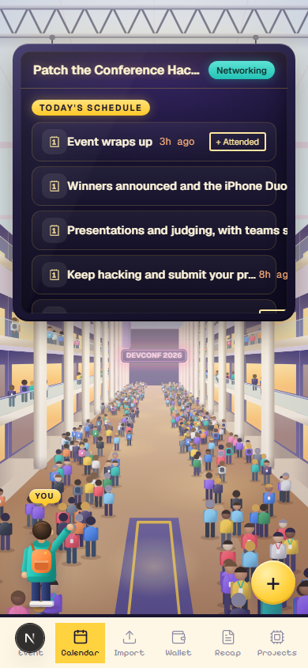
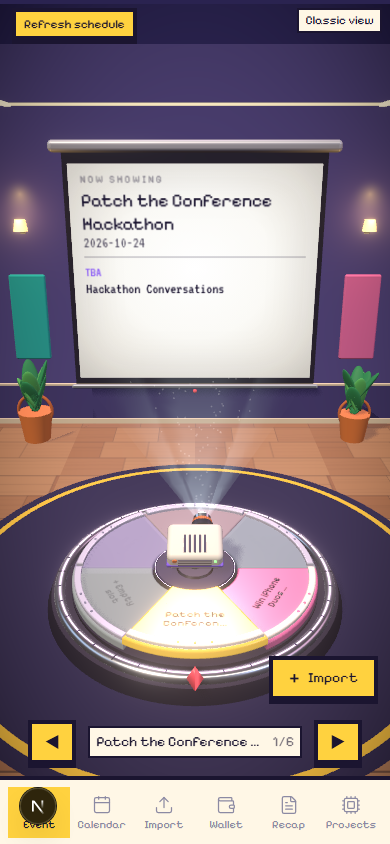
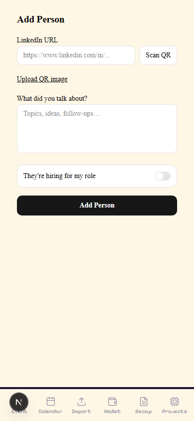
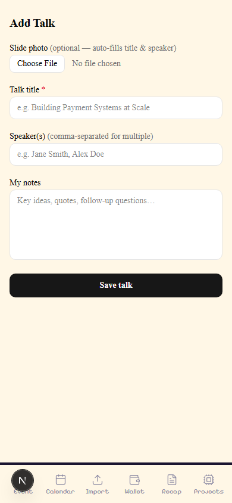

# Debrief — Conference Memory & Networking Intelligence

> We built Debrief at the same conference where we had the problem. A mobile-first graph-powered app that remembers every person, session, and idea from your conference day. Built at Patch the Conference Hackathon 2024 with FalkorDB, Bright Data, and Qodo.

## Sections

- What It Does
- App Screens
- Architecture
- How It Works
- Build Timeline
- Components
- Real Learnings
- Moments In Between
- Platform Review
- Team

## Content

## What It Does

Debrief is the networking layer you build once and run at every conference. The data in the app the day after the hackathon was from the hackathon itself — real people, real conversations, real ideas. We ate our own food and found the gaps in real time.

26

PRs raised

119

tests

14

people tracked

30s

event import

2,307

graph nodes

<$2

API spend

⚡ Before the event

-   Paste the event URL
-   Bright Data fetches all speakers
-   Graph scores who to meet and why
-   Ranked meet plan with AI openers in 30 seconds

📸 During the event

-   Snap a slide photo → session identified
-   Notes linked to person + session + idea
-   Add anyone via LinkedIn URL or QR
-   Live schedule refresh if organiser changes it

🧠 After the event

-   Full day timeline — sessions, people, ideas
-   Faces to Remember with avatar grid
-   AI follow-up drafts from your actual notes
-   Everything queryable via Cypher forever

🕸️

#### Graph Path Explainability

Every recommendation shows the path: Me → CONNECTED → Alex → WORKS\_AT → Stripe. You see exactly why someone was ranked.

🔌

#### Mock Mode — Zero API Keys

`USE_MOCK_DATA=true` returns fixture JSON on every route. Full demo without FalkorDB, OpenAI, or Bright Data credentials.

👥

#### Shared Graph State

All teammates point to one FalkorDB Cloud instance. One person adds a speaker — everyone's meet plan updates immediately.

📂

#### Import Anything

Slide photos, coupons, business cards, QR codes, Zoom VTT transcripts. All classified and saved to the right graph node.

🔄

#### Idempotent Schedule Refresh

The event URL is stored. One tap re-fetches the live page and MERGEs new sessions — no duplicates, no data loss.

🤫

#### Your Notes Stay Yours

`HAS_NOTE` is always CREATE, never overwritten. AI context lives in a separate `Context` node. Your words and the AI's words never mix.

## App Screens

Mobile-first at 390px. Every page loads against real data from the hackathon day.

**Today — Timeline**Sessions, people, ideas in order. Floating + button opens Add Person or Add Talk.

**Recap — Full Day**Stat chips + Faces to Remember grid. Tap a face → note + follow-up draft.

**Event — 3D Theater**Event name on the projector. Dial spins to show sessions. Classic View shows the ranked meet plan.

**Add Person**LinkedIn URL or QR scan. Note + hiring toggle. Background research fires without await.

**Add Talk — Slide Match**Optional slide photo auto-fills session title. Notes linked to session + person in graph.

**Setup — First Run**LinkedIn archive import, intent picker (star one primary), event date. Writes Me node to FalkorDB.

**All screenshots use real hackathon data** — the graph running live on GCP FalkorDB with 2,307 nodes and 2,677 relationships from the actual Patch the Conference Hackathon day. Nothing is mocked up or fabricated for the screenshots.

## Architecture

Three layers: a mobile-first Next.js frontend, external enrichment services, and FalkorDB as the memory and computation engine. The graph is not just storage — it's where all recommendations, paths, and scores are computed.

User

Mobile Browser (390px) · Next.js 16 App Router · TypeScript · Tailwind 4 · shadcn/ui

↕ HTTP / fetch

App — API Routes

/event/plan

/today

/recap

/person

/research

/followup

/import

/setup

↕ calls

External Services

Bright Data  
Web Unlocker · SERP · LinkedIn Datasets

OpenAI gpt-4o-mini  
text + vision · event · slide · openers

Qodo  
26 PRs reviewed

↕ read / write via falkordb SDK

Data Layer

FalkorDB Cloud (GCP us-central1) · graph: `debrief` · 2,307 nodes · 2,677 relationships · Cypher queries · allShortestPaths

### Graph Schema

The schema is the product. Every relationship is a first-class citizen. When the app says "meet this person", the reason IS a graph path — not a heuristic, not a score in a row.

(Me)\-\[:HAS\_INTENT {primary:true}\]->(Intent)// networking / hiring / learning / fundraising

(Me)\-\[:ATTENDED\]->(Event)\-\[:HAS\_SESSION\]->(Session)

(Me)\-\[:MET\]->(Person)

(Me)\-\[:CONNECTED\]->(Person)// from LinkedIn Connections.csv

(Me)\-\[:SAW\]->(Session)

(Me)\-\[:PLANS\_TO\_MEET {score, opener}\]->(Person)

(Person)\-\[:WORKS\_AT\]->(Company)

(Person)\-\[:HAS\_NOTE\]->(Note)// your words — always CREATE, never overwritten

(Person)\-\[:HAS\_CONTEXT\]->(Context)// AI research — separate label, separate code path

(Session)\-\[:SPARKED\]->(Idea)

// 3-hop warm intro: Me → my connection → shared company ← speaker

(Me)\-\[:CONNECTED\]->(bridge)\-\[:WORKS\_AT\]->(co)<-\[:WORKS\_AT\]-(speaker)

All node labels: `Me` `Person` `Company` `School` `Skill` `Topic` `Session` `Idea` `Note` `Context` `Event` `Intent` `Role` `FollowUp` `Coupon` `Asset` `Transcript` `Conversation`

## How It Works

-   1
    
    #### Setup — import your LinkedIn archive
    
    Upload `Profile.csv`, `Positions.csv`, `Education.csv`, `Skills.csv`. Set your intent (star one primary). Writes a `Me` node — the anchor for every graph path.
    
-   2
    
    #### Event import — 30-second pipeline
    
    URL → Bright Data Web Unlocker renders JS-heavy page → OpenAI extracts sessions + speakers → Bright Data SERP finds LinkedIn URLs → Bright Data LinkedIn Datasets enriches all profiles. One URL, full intel.
    
-   3
    
    #### Meet Plan — 5-signal Cypher scoring
    
    Shared employer **+3**, shared school **+2**, intent fit **+3**, direct LinkedIn connection **+5**, warm intro via shared company **+4**. All five signals in one OPTIONAL MATCH query. OpenAI generates a conversation opener per person from their shared context.
    
-   4
    
    #### Slide match — photo to session in seconds
    
    Snap any slide. OpenAI vision extracts keywords and fragments. FalkorDB scores keywords against every `Session` title and abstract. Top 5 matches returned — tap to confirm, write notes, saved to graph linked to session + person.
    
-   5
    
    #### Add person — fire-and-forget enrichment
    
    POST `/api/person` saves immediately and returns. `fetch('/api/research').catch(()=>{})` fires without await. Polls `Context.fetched_at` — skips if under 7 days old. Person-save is instant; context card appears in the background.
    
-   6
    
    #### Today timeline — one UNION query
    
    `MATCH (me)-[:SAW]->(s:Session)` UNION `MATCH (me)-[:MET]->(p:Person)` UNION `MATCH (s)-[:SPARKED]->(i:Idea)` — unified by timestamp, sorted chronologically. The whole day in one call.
    
-   7
    
    #### Recap follow-ups — from your words, not their bio
    
    OpenAI drafts follow-up messages from the `HAS_NOTE` text you wrote — not from the `HAS_CONTEXT` AI research. The user's note is the input; the bio is never mixed in. Your trust in the output depends on the distinction.
    

## Build Timeline

One day. Ten milestones. Three people. All PRs reviewed by Qodo as they shipped.

M0 · 00:00

Foundations

FalkorDB client, lib helpers, Next.js app shell, vitest setup, `serverExternalPackages` for BigInt, gitignore, .env.example.

M1 · 01:30

Setup + My Profile

Intent picker, LinkedIn archive import (Profile / Positions / Education / Skills CSVs), Me node write. Qodo caught intent primary flag bug on first PR review.

M2 · 02:45

Connections Import

LinkedIn Connections.csv batched upload, CONNECTED edges, idempotent. Custom `parseLinkedInCsv()` to skip the "Notes:" preamble line LinkedIn adds.

M3 · 04:00

Add Person

LinkedIn URL enrichment, common-ground badges (shared company / school / skill), fire-and-forget research, manual fallback. Bright Data mock mode validated.

M4 · 05:30

Auto Research

SERP + OpenAI context bullets, 7-day freshness gate on Context.fetched\_at, person page split view (My Note vs Researched). Fire-and-forget pattern locked in.

M5 · 06:45

Import Anything + Wallet

Classify slide / coupon / card / QR / transcript. ZXing WASM for QR. Coupon list with copy button. pdf-parse added to `serverExternalPackages`.

M6 · 08:00

Event Import + Meet Plan

Full pipeline: Bright Data Web Unlocker → OpenAI extract → SERP → LinkedIn Datasets → 5-signal Cypher scoring → opener generation. 30-second end-to-end.

M7 · 09:30

Transcript Import

VTT parse, 90-second gap split, minimum-chunk merge pass (45s threshold), review screen before anything saves. Conversation graph written on confirm.

M8 · 11:00

Talk Notes + Today Timeline

Slide photo → OpenAI vision → session match. SAW / SPARKED / Idea graph nodes. Live today timeline with UNION query. react-force-graph-2d wrapped with `ssr:false`.

M9 · 13:00

Recap + Why?

Counts, intent cards, ideas by topic, follow-up drafts, force-graph path visualization. All 119 tests green. Demo at the event it was built for at 5:30 PM.

## Components

File

Role

lib/graph.ts

FalkorDB client — new handle per request, avoids "ERR invalid graph version" on hot reload. Typed `q()` wrapper enforces `{ params }` syntax.

lib/graph-reads.ts

All read queries: recap counts, today timeline UNION, meet plan scoring, person detail, idea list, path queries.

lib/graph-writes.ts

All write helpers: writePerson, writeSession, writeNote (always CREATE), writeIdea, writeFollowUp, writeConversation.

lib/brightdata.ts

Web Unlocker fetch, SERP search, LinkedIn Datasets async poll (202 + snapshot\_id). Reads fixture files when `BRIGHTDATA_MOCK=true`.

lib/event-extract.ts

Full event import pipeline: fetch → strip HTML → OpenAI extract → SERP lookup → profile enrich → write to graph.

lib/classify.ts

Document classifier: detects image/PDF/QR/URL using OpenAI vision and ZXing WASM. Returns a typed result with extracted data.

lib/vtt-splitter.ts

Split Zoom .vtt transcripts on 90-second silence gaps. Merge pass absorbs chunks shorter than 45 seconds into their nearest neighbour.

lib/research.ts

Background enrichment: SERP company news + OpenAI context bullets. Freshness gate on `Context.fetched_at` (7-day TTL).

app/today/

Timeline: UNION query of SAW sessions, MET people, SPARKED ideas — sorted by timestamp. Floating + button.

app/recap/

Counts, Faces to Remember grid, ideas by topic, AI-drafted follow-up cards per person.

app/event/

3D theater view + Classic view. Event import form. Meet Plan: ranked speakers with score, reasons, opener text.

app/add-talk/

Slide photo → OpenAI vision → session match → confirm → note form → saves to graph.

app/why/

Force graph (react-force-graph-2d, `ssr:false`) rendering `allShortestPaths` between Me and any person.

fixtures/mock/

Full fixture JSON for every API route — fictional personas, no real personal data committed.

scripts/record-demo.mjs

Playwright script: navigates all key pages with realistic timing, records at 390×844, converts to MP4 via ffmpeg.

## Real Learnings

Not best-practice advice. Things that actually surprised us, slowed us down, or saved us during a one-day build.

01

#### Flags that vary per user belong on the edge, not the node

`primary:true` on an `Intent` node breaks the moment user 2 sets a different primary. Put it on `HAS_INTENT`. Qodo caught this on PR #2 before it shipped.

02

#### MERGE root nodes at the top of every write helper

`MATCH (me:Me)` returns 0 rows silently if the node doesn't exist. Always start with `MERGE (me:Me {linkedin_url:$url})` — downstream MATCHes are then guaranteed.

03

#### FalkorDB SDK: `{ params }` not bare object

`graph.query(cypher, { params })` works. `graph.query(cypher, params)` throws a silent "Missing parameters" error. No stack trace. Wrap once in `lib/graph.ts`.

04

#### Notes must be immutable. AI context is a separate node

`HAS_NOTE` is always CREATE. The `Context` node is written by a separate code path. Users trust what they wrote — they'd be unsettled if AI research overwrote their words silently.

05

#### Fire-and-forget + freshness gate = snappy UX

POST /api/person saves and returns instantly. Research fires without await. A `fetched_at` timestamp on `Context` prevents redundant OpenAI calls within 7 days.

06

#### react-force-graph-2d must use `ssr:false`

It calls `window` at module load time. Any SSR path crashes. Wrap in a component with `dynamic(...,{ssr:false})` and never import the raw package elsewhere.

07

#### Mock mode is a first-class design requirement

Build it from day one. `BRIGHTDATA_MOCK=true` and `USE_MOCK_DATA=true` let you build all 10 milestones without keys, run CI, and demo if Wi-Fi fails. One env-var to go live.

08

#### `fileParallelism:false` is mandatory for graph tests

Concurrent test files corrupt each other's FalkorDB state. Set it in `vitest.config.ts`. Slower but deterministic. 119 tests, 0 spurious failures.

## Moments In Between

💥

#### 325 wrong HAS\_NOTE links

A 5-minute window repair linked everyone's notes to everyone nearby at the same time. One person who only talked about agent-to-agent AI got linked to 7 unrelated conversations. Deleted 325 relationships, re-imported from CSV.

🔇

#### The silent params bug — an hour gone

`graph.query(cypher, params)` vs `graph.query(cypher, { params })`. Both return no error. One writes nothing. Found it by counting nodes after each write. Now it's one wrapper function and it never happens again.

🐳

#### Local Docker exit under rapid queries

Running diagnostic scripts back-to-back sent too many sequential queries. Docker container exited silently. `docker restart falkordb` in 3 seconds. The GCP instance was more resilient — which is a strong argument for the cloud product.

💡

#### "Pathetic ideas" — and they were right

The first AI-generated ideas were generic summaries. Feedback was blunt. Deleted all 12. Re-created 10 specific ones: agent-to-agent communication, One Dollar Computer for a kid's robotics project, AgentGlass, Spawnpoint — one per actual conversation. Ideas from notes, not from AI summaries.

## Platform Review

Honest take — used live, under time pressure, with real data, at the event itself.

🕸️

FalkorDB

Graph DB — relationships as first-class citizens

Core to product

✓

What worked

✅Graph model fits conference networking perfectly — relationships ARE the data, not a foreign key afterthought

✅Cypher reads like a sentence: `(me)-[:CONNECTED]->(bridge)-[:WORKS_AT]->(co)` — self-documenting queries

✅Docker setup is one command. FalkorDB Browser on port 3000 is excellent for live graph exploration during demos

✅`allShortestPaths()` makes every recommendation explainable — the path IS the reason

✅GCP Cloud instance stable all day. Shared across all teammates in real time with zero configuration

⚠

Watch out for

⚠️`shortestPath()` fails in the Node.js SDK with a confusing error. Always use `allShortestPaths()` — cost an hour

⚠️`RETURN path` doesn't deserialize in the SDK. Use `nodes(path)` and `relationships(path)` explicitly

⚠️No TypeScript types for path results — you're casting to `unknown`. A typed path type would help a lot

⚠️Hot reload triggers "ERR invalid graph version". Had to remove graph handle caching entirely — one handle per request

⚠️`graph.query(cypher, { params })` not `graph.query(cypher, params)` — silent failure, nothing in the docs highlights this

Verdict — The right tool for this problem. A relational DB would need recursive CTEs and three self-joins for what Cypher expresses in one sentence. The SDK needs polish but the graph model is correct.

📡

Bright Data

Three APIs solving three genuinely hard web data problems

Event pipeline

✓

What worked

✅SERP API returns structured `organic[]` JSON — no HTML parsing, no regex. Just array access

✅Web Unlocker handles JS-heavy conference pages transparently — same interface as a plain fetch, but it just works

✅LinkedIn Datasets API handles all anti-bot protection. What would take months to build reliably is a single POST

✅Mock mode with fixture files: zero API spend during development, full integration test coverage, demo-safe if Wi-Fi fails

✅Zone-based architecture is clean: one API key, different zones per use case (unlocker / SERP / datasets)

⚠

Watch out for

⚠️LinkedIn Scraper is async (202 + `snapshot_id` polling) but the sync response shape isn't documented — first call looks like a bug

⚠️Zone names (`serp_api1`) are easy to mistype. "Zone not found" error doesn't list your active zones — friction during setup

⚠️`format:"raw"` silently returns an empty body instead of erroring. Had to discover `format:"json"` wraps the body correctly

⚠️No real-time cost visibility during the hackathon. A running spend counter or webhook would reduce anxiety significantly

Verdict — 2–3 hours of manual Googling before a 30-speaker event becomes 30 seconds. That's the ROI in one sentence. The API roughness is real but the capability is irreplaceable for this use case.

🔍

Qodo

AI PR review — 26 PRs, across one hackathon day

PR review

✓

What worked

✅Caught the intent primary flag bug on PR #2 — before it ever merged. Exactly the kind of subtle data-model error a rushed review misses

✅Caught MERGE-before-MATCH ordering — would have caused silent 0-row writes on nearly every write helper

✅26 PRs reviewed throughout the day with consistent, actionable feedback — not just style comments

✅No noise. Suggestions were specific enough to act on immediately without second-guessing

⚠

Room to improve

💬Some suggestions assumed patterns from the broader web that didn't match the FalkorDB SDK's specific quirks — harder to distinguish general advice from project-specific correctness

💬No awareness of `graph.query({ params })` vs bare params — the most expensive bug of the day wasn't caught by review; it required runtime debugging

Verdict — Worth having on every PR. The two catches on day 1 alone saved more time than the tool took to set up. An extra reviewer that never gets tired, never rushes, never skips the edge cases.

## Team

Built at Patch the Conference Hackathon, San Francisco, October 2024. Three people. One day. The conference was both the context and the subject.

[

#### Sham Hassan Chikkegowda

Graph schema · API routes · Event import pipeline · Meet plan scoring

](https://www.linkedin.com/in/shamhc/)

[

#### Madhu Koseke

Data platform architecture · Backend reliability · The rigour behind the build

](https://www.linkedin.com/in/madhu-koseka/)

[

#### Madhughnea Adabala

UX design · Mobile frontend · Backend support · Made it feel right to use

](https://www.linkedin.com/in/madhughnea-adabala/)

Powered by **FalkorDB** · **Bright Data** · **Qodo** · **OpenAI** · **Patch the Conference**  ·  [GitHub →](https://github.com/researchsite/debrief)
