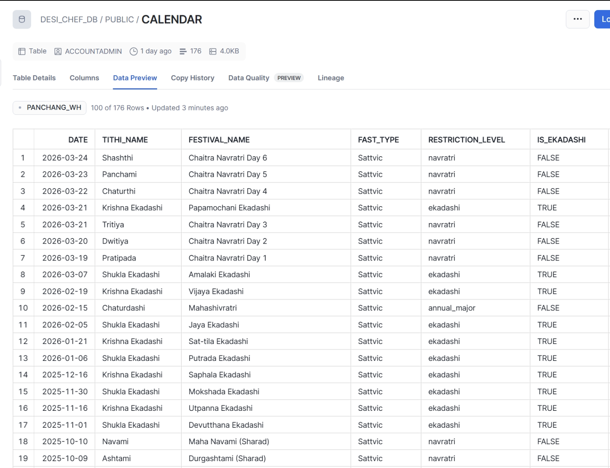
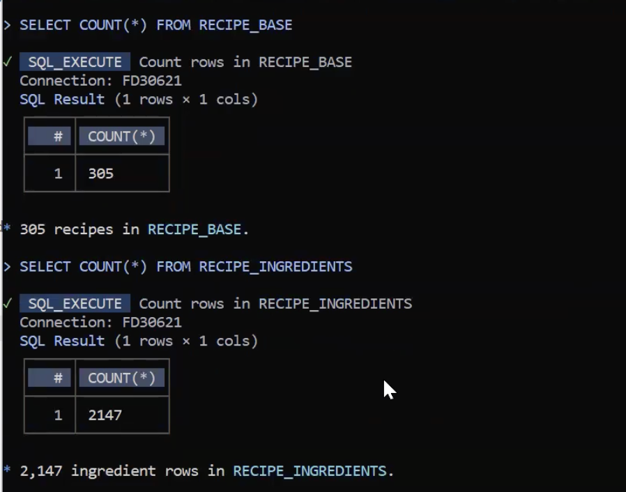
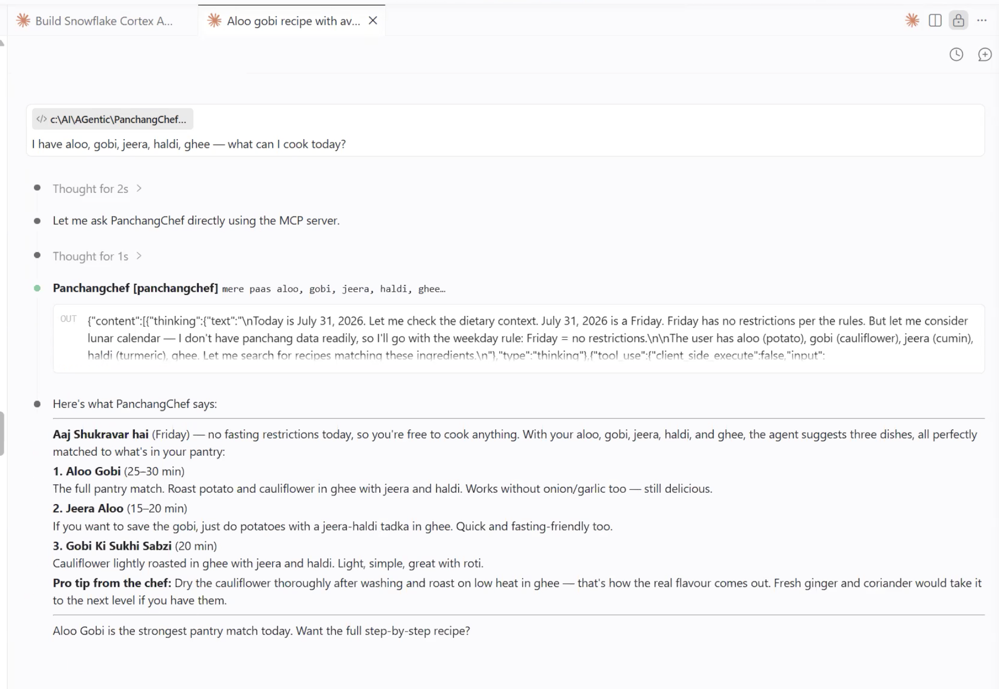
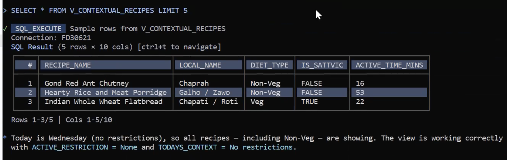
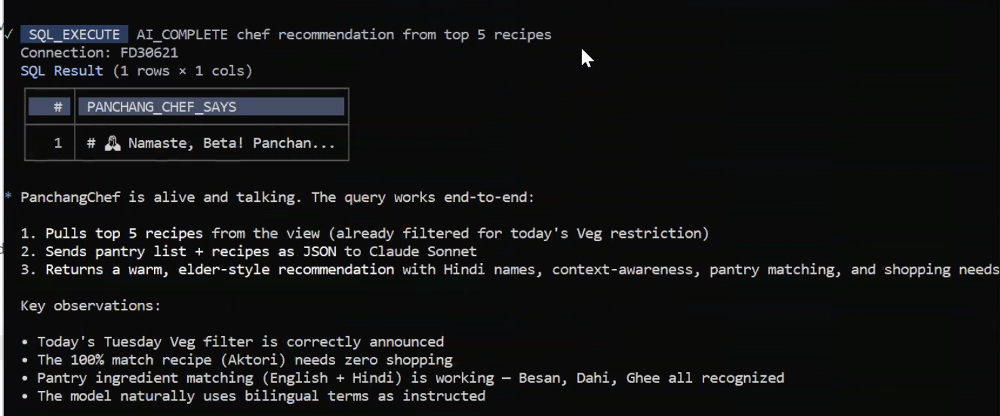
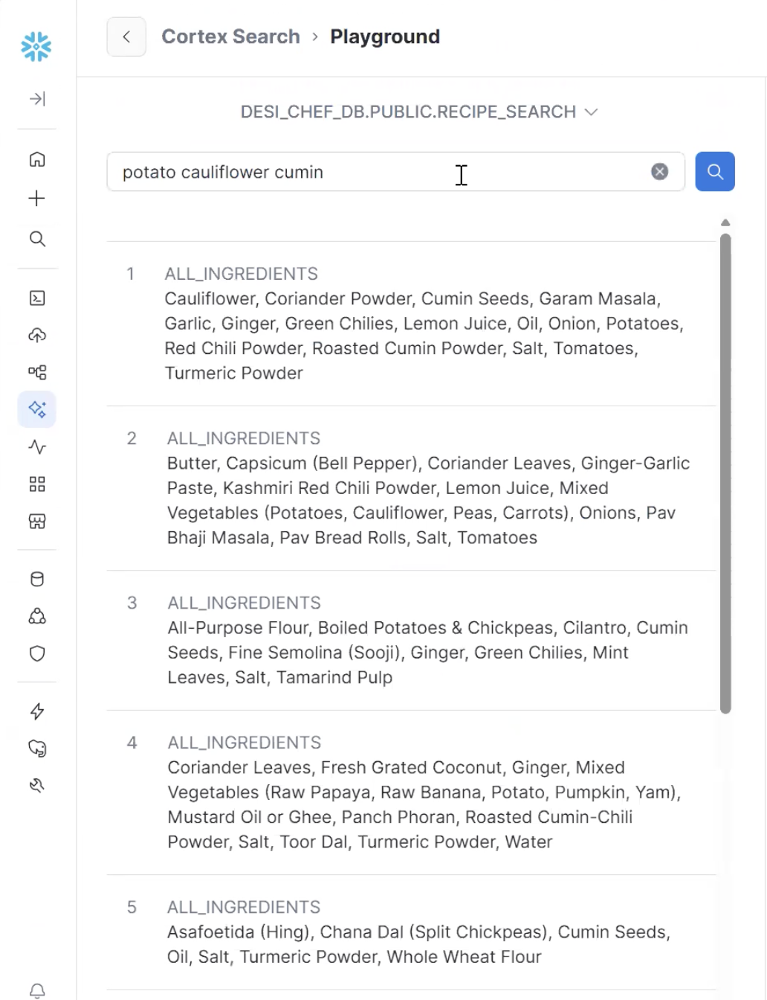

# PanchangChef: Calendar-Aware Indian Recipe AI on Snowflake

> How I built an AI chef that reads the Hindu ritual calendar, enforces Sattvic fasting rules, and matches your pantry to 305 Indian recipes — inside Snowflake Cortex.

## Sections

- What It Does
- The Data
- Architecture
- The Build
- Live Results
- 7 Things I Learned
- Get Started

## Content

## What It Does

Six things happen automatically, in the right order, every time you ask a question.

You ask in plain English or Hindi. PanchangChef handles the calendar, the dietary rules, and the pantry matching before it says a word.

Six Snowflake objects, each calling the next. The interesting part is how `DAYOFWEEK()` and a 176-row calendar table do the work of what most apps build into application logic.

This is a live view → materialized table → vector index → agent pipeline, fully SQL-native. No orchestration framework, no containers.

1

#### Calendar check

DAYOFWEEK() + CALENDAR table detects today's fast — Ekadashi, Navratri, or weekly (Mon/Tue/Thu/Sat).

2

#### Dietary filter

Sattvic removes onion/garlic/non-veg. Veg removes non-veg only. Unrestricted shows all 305.

3

#### Pantry match

MY\_PANTRY (30 bilingual items) scored against each recipe's LISTAGG'd ingredients. 100% = cook now.

4

#### Semantic search

Cortex Search (arctic-embed-m-v1.5) handles "aloo" ≈ "potato" without an explicit synonym map.

5

#### Warm response

AI\_COMPLETE wraps results in bilingual Hindi-English with the "Namaste, Beta!" format and what to buy.

6

#### MCP endpoint

DESI\_CHEF\_MCP exposes everything to Claude Desktop or Cursor via OAuth. One natural language query.

## The Data

Four tables. Two are from a public GitHub dataset — no Kaggle login needed.

Think of CALENDAR as the almanac and MY\_PANTRY as your fridge list. You edit the pantry CSV to match your kitchen — everything else runs on its own.

This is relational data — not flat CSVs. RECIPE\_BASE + RECIPE\_INGREDIENTS joined via RECIPE\_ID forces you to learn GROUP BY + LISTAGG, the core SQL pattern this whole project depends on.

The 3-table recipe schema forces a LISTAGG aggregation. That aggregated string is simultaneously the Sattvic-detection surface (LIKE '%onion%') and the Cortex Search payload — two problems solved by one GROUP BY.

Table

Rows

Source

Key Columns

`RECIPE_BASE`

305

GitHub: War004/food-eaten-in-india

RECIPE\_ID, name (EN + local), IS\_NON\_VEG, cook time

`RECIPE_INGREDIENTS`

2,147

Same

RECIPE\_ID, NAME, AMOUNT, UNIT

`CALENDAR`

176

Custom CSV

DATE, festival\_name, fast\_type, restriction\_level

`MY_PANTRY`

30

Edit to match your kitchen

INGREDIENT\_NAME, HINDI\_NAME, category

65% Vegetarian 35% Non-Veg MIT License Salt appears in 214/305 recipes Turmeric in 70 · Ginger in 53



**CALENDAR table** — 176 fasting dates (2024–2027). Ekadashi, Navratri, Mahashivratri. restriction\_level drives the diet filter in V\_CONTEXTUAL\_RECIPES.

## Architecture

Six layers. Every one stays inside Snowflake.

Your question flows in from Claude Desktop. The answer comes back with the fast context already applied. You never touch SQL.

V\_CONTEXTUAL\_RECIPES is a live view — recalculates on every query. RECIPE\_SEARCH\_BASE is the only snapshot (needs a daily Task to stay current).

Two read paths: semantic retrieval (RECIPE\_SEARCH → RECIPE\_SEARCH\_BASE snapshot) and real-time context (V\_CONTEXTUAL\_RECIPES live join). The agent uses both on each query.

USER CLIENT MCP AGENT TOOLS VIEW DATA YOUR KITCHEN "mere paas aloo, gobi, jeera hai…" MCP CLIENT Claude Desktop / VS Code OAuth MCP SERVER DESI\_CHEF\_MCP CORTEX AGENT DESI\_CHEF\_AGENT orchestration: auto CORTEX SEARCH RECIPE\_SEARCH BUILT-IN TOOL data\_to\_chart via RECIPE\_SEARCH\_BASE LIVE VIEW · ALWAYS CURRENT V\_CONTEXTUAL\_RECIPES CALENDAR (176 fasting dates) RECIPE\_BASE + INGREDIENTS MY\_PANTRY (bilingual, 30 items)

## The Build

CoCo (Cortex Code) writes the SQL from English prompts. Six steps, blank account to live MCP server.

You won't run these steps yourself — but this is how the agent was built. Skip ahead to [Live Results](#results) to see what it produces.

Every CoCo prompt is pre-written in `docs/STEP_BY_STEP_GUIDE.md`. The gotcha callouts below show exactly where I hit walls and how CoCo recovered.

Steps 5 and 6 are where Cortex's architecture constraints surface. The CTE→materialized table pattern and the Agent DDL quoting issue are the two things you need to know before starting.

### Step 0 — AGENTS.md + CoCo CLI

0

Create AGENTS.md — CoCo reads this every session

Includes account ID, warehouse, bilingual ingredient map (aloo=potato, jeera=cumin…), and dietary constraint rules. Under 200 lines for best compliance. Launch with `cortex` from project root.

Foundation

### Step 1 — Load Data

1

Stage → COPY INTO → 4 tables

Upload 4 CSVs via Snowsight → Data → Add Data → Load Into Stage. Then COPY INTO RECIPE\_BASE (305), RECIPE\_INGREDIENTS (2,147), CALENDAR (176), MY\_PANTRY (30).

~5 min

Gotcha — 0 files processed

CoCo assumed `.gz` (compressed). Files were plain CSV. Fix: run `LIST @STAGE` first — see actual filenames — then re-run COPY INTO without the suffix.

Schema note

RECIPE\_BASE PARTIALLY\_LOADED (306 parsed, 305 loaded, 1 skipped = empty trailing newline). Normal — not a data error. The `FIELD_OPTIONALLY_ENCLOSED_BY = '"'` file format is essential for commas inside ingredient unit strings.



**Data loaded.** RECIPE\_BASE = 305 rows. RECIPE\_INGREDIENTS = 2,147 rows. PARTIALLY\_LOADED on RECIPE\_BASE is normal — one trailing empty line in the CSV, not a data error.

### Step 3 — V\_CONTEXTUAL\_RECIPES

3

The core view: calendar check + pantry scoring

Three CTEs: (1) join recipes + ingredients via LISTAGG → all\_ingredients string, (2) check CALENDAR + DAYOFWEEK() → dietary filter, (3) count pantry matches per recipe. Result: ranked list always reflecting today.

Core Logic

Gotcha — Pantry match over 100%

First attempt scored 125%. Bug: `LIKE '%wheat%'` matched two pantry items ("Whole Wheat Flour" + "Buckwheat Flour") against one recipe ingredient. Fix: count distinct recipe ingredients matched (not pantry item hits). CoCo iterated three times to nail the logic.

Sattvic detection pattern

`LOWER(all_ingredients) NOT LIKE '%onion%' AND NOT LIKE '%garlic%' AND NOT LIKE '%shallot%'` on the LISTAGG string. Weekly fasts: `CASE WHEN DAYOFWEEK(CURRENT_DATE()) IN (2,3,5,7) THEN 'Veg' END`. Replaces 208+ stored calendar rows per year.

### Step 4 — AI\_COMPLETE

4

LLM call inside SQL — warm bilingual response

`AI_COMPLETE('claude-sonnet-4-6', CONCAT(...))` sends top-5 recipes inline. Model announces fasting context, gives Hindi + English names, notes what to buy. Stays inside Snowflake.

LLM in SQL

**Use AI\_COMPLETE — not CORTEX.COMPLETE.** CORTEX.COMPLETE is deprecated (EOL end of 2026). Different function signatures. 2024-era tutorials show the old form.

**Model selection:** The prompt passes the full filtered + scored recipe list as a JSON string. The LLM adds warmth and bilingual framing. The ranking logic is entirely in SQL — the LLM only formats and narrates.

### Step 5 — Cortex Search + Agent

5

Materialize → Search index → Agent

Create RECIPE\_SEARCH\_BASE (materialized table), enable CHANGE\_TRACKING, create RECIPE\_SEARCH Cortex Search on it. Then create DESI\_CHEF\_AGENT with recipe\_search + data\_to\_chart tools.

Cortex AI

Critical Discovery — Cortex Search rejects CTE views

Pointing Cortex Search at V\_CONTEXTUAL\_RECIPES directly fails: _"Change tracking is not supported on queries with VALUES."_ Root cause: CTEs block change tracking. Fix: `CREATE TABLE RECIPE_SEARCH_BASE AS SELECT * FROM V_CONTEXTUAL_RECIPES` → `ALTER TABLE ... SET CHANGE_TRACKING = TRUE` → point Search at the table. Not in official docs — you find it by hitting the wall.

Gotcha — Agent DDL dollar quoting

Use `$$` (double dollar) for the YAML spec block. `$spec` causes a parse error. The error message doesn't tell you this.

Architecture implication

RECIPE\_SEARCH\_BASE is a point-in-time snapshot. Search results reflect the dietary context at the time of the last materialization. Use a Snowflake Task to refresh at midnight. Without it, search is frozen at the last manual refresh — the view stays current but the search index doesn't.

### Step 6 — MCP Server

6

Expose the agent to Claude Code / Claude Desktop

Create DESI\_CHEF\_MCP (MCP Server object) + DESI\_CHEF\_MCP\_OAUTH (Security Integration). Create a dedicated non-admin user + role for OAuth. Wire up `.mcp.json` with `mcp-remote@latest`. PanchangChef appears as a tool in Claude Code.

✓ Live

This step had the most gotchas of the entire build. The SQL is two lines. The connection is where it gets interesting.

Gotcha — ACCOUNTADMIN is permanently blocked for OAuth

Snowflake blocks ACCOUNTADMIN, ORGADMIN, and SECURITYADMIN for all custom OAuth integrations — hardcoded, cannot be unblocked. Fix: create a dedicated non-admin role and user. Run as ACCOUNTADMIN:

```
CREATE ROLE IF NOT EXISTS DESI_CHEF_ROLE;
GRANT USAGE ON WAREHOUSE PANCHANG_WH TO ROLE DESI_CHEF_ROLE;
GRANT USAGE ON DATABASE DESI_CHEF_DB TO ROLE DESI_CHEF_ROLE;
GRANT USAGE ON SCHEMA DESI_CHEF_DB.PUBLIC TO ROLE DESI_CHEF_ROLE;
GRANT SELECT ON ALL TABLES IN SCHEMA DESI_CHEF_DB.PUBLIC TO ROLE DESI_CHEF_ROLE;
GRANT SELECT ON ALL VIEWS IN SCHEMA DESI_CHEF_DB.PUBLIC TO ROLE DESI_CHEF_ROLE;
GRANT USAGE ON CORTEX SEARCH SERVICE DESI_CHEF_DB.PUBLIC.RECIPE_SEARCH TO ROLE DESI_CHEF_ROLE;
GRANT DATABASE ROLE SNOWFLAKE.CORTEX_USER TO ROLE DESI_CHEF_ROLE;

CREATE USER DESI_CHEF_USER
  PASSWORD = 'StrongPassword!' DEFAULT_ROLE = DESI_CHEF_ROLE
  DEFAULT_WAREHOUSE = PANCHANG_WH MUST_CHANGE_PASSWORD = FALSE;
GRANT ROLE DESI_CHEF_ROLE TO USER DESI_CHEF_USER;
```

Gotcha — The MCP endpoint URL is not what CoCo derives

CoCo suggests `/api/v2/cortex/mcp/DB.SCHEMA.SERVER` — returns 404. The actual working path is `/api/v2/databases/{DB}/schemas/{SCHEMA}/mcp-servers/{SERVER}`. Unauthenticated requests return 404 (not 401), so it looks like a wrong URL when it's actually an auth issue.

Gotcha — Claude Code uses .mcp.json, not settings.json

`mcpServers` in `.claude/settings.json` is rejected with a schema error. MCP servers go in `.mcp.json` at the project root. Add `"enableAllProjectMcpServers": true` to `settings.json` to auto-approve without prompting.

**Security:** OAuth generates CLIENT\_ID and CLIENT\_SECRET. The `client-info.json` and `data/output` files contain these credentials — both are in `.gitignore`. Never commit them.

**mcp-remote@latest is the required bridge.** Snowflake's MCP Server doesn't expose a raw SSE endpoint Claude can call directly. `mcp-remote` handles the browser OAuth flow locally, caches the token, and proxies MCP protocol to Snowflake. Specify port 15734 and pass OAuth URLs as arguments alongside a `--static-oauth-client-info` JSON file.



**PanchangChef live in Claude Code.** panchangchef appears as an active MCP tool. Natural language in → fasting context + ranked recipes out. Zero SQL typed by hand.

## Live Results

July 29, 2026 — a Tuesday. `DAYOFWEEK()` returned 3, Vegetarian filter triggered, 107 Non-Veg recipes removed automatically.

It's Tuesday. The agent already knew. You just asked what to cook — it handled the rest.

No code change to apply the filter. The view recalculated with `CURRENT_DATE()` and DAYOFWEEK checked the day. This is the payoff of the date-logic-in-SQL approach.

107 rows filtered at the view layer before any scoring or LLM call. The filter predicate runs on Snowflake's query engine — not in application code, not in the agent's system prompt.

V\_CONTEXTUAL\_RECIPES · Mangalvar Vrat (Tuesday) · Veg filter active

#1

Buckwheat or Wheat Flour Crepes

Aktori / Patande  Sattvic

9 min100%

#2

Gram Flour Dumplings in Yogurt Gravy

Gatte ki Sabzi  Veg

52 min87.5%

#3

Carrot Pudding

Gajar ka Halwa  Sattvic

56 min83.3%

#4

Rice Pudding

Kheer  Sattvic

49 min80%

#5

Potato and Cauliflower Stir-fry

Aloo Gobi  Veg

37 min75%

AI\_COMPLETE response · claude-sonnet-4-6🙏 Namaste, Beta! PanchangChef here. Today is Tuesday — Mangalvar Vrat day. I've kept only vegetarian options for you. 1. Aktori / Patande (Buckwheat Crepes) \[Sattvic\] Perfect match — every ingredient already in your kitchen! Cook time: 9 minutes. Make them fresh while chai is brewing. 2. Gajar ka Halwa (Carrot Pudding) \[Sattvic\] You have everything. Cook time: 56 min — start it first. 3. Kheer (Rice Pudding) \[Sattvic\] Perfect for an offering and a meal together. Nothing to buy. Kal ke liye socho — if Wednesday is unrestricted, the chicken can wait.



**V\_CONTEXTUAL\_RECIPES** — live view. todays\_context = today's fast. pantry\_match\_pct ranks every recipe by what you actually have.



**AI\_COMPLETE output** — "🙏 Namaste, Beta!" Bilingual names, fasting context announced first, 100% pantry match suggested first.

## 7 Things I Learned

The things that weren't in the docs — discovered by building.

The big one: the agent figured out it was Tuesday by itself. No one told it. That's DAYOFWEEK() in the SQL doing the work.

Items 1, 4, 6, and 7 are the ones that would have blocked me without this list. Save them before you start.

Item 1 is the critical architecture constraint. Items 3 and 5 are Cortex-specific patterns that differ from standard SQL/ML tool conventions.

01

#### Cortex Search needs a table, not a view

CTE-based views can't have change tracking. Materialize to `*_BASE` table first, enable tracking, then point Search at the table.

02

#### LISTAGG solves two problems at once

Aggregates per-recipe ingredient rows into one string. Same string detects non-Sattvic (LIKE) AND serves as the Cortex Search payload.

03

#### DAYOFWEEK() beats 208 stored calendar rows

Compute weekly fasts live via `DAYOFWEEK(CURRENT_DATE())`. Only store the 176 irregular festival dates. View stays current with zero annual refresh.

04

#### AI\_COMPLETE ≠ CORTEX.COMPLETE

`AI_COMPLETE` is current. `CORTEX.COMPLETE` is deprecated (EOL 2026). Different signatures. Don't copy 2024-era tutorials.

05

#### AGENTS.md is CoCo's long-term memory

Keep under 200 lines. Include account, warehouse, constraints, bilingual maps. CoCo reads it every session and stops asking the same setup questions.

06

#### orchestration: auto beats pinning a model

Snowflake picks the best model and upgrades automatically when new ones ship. No spec update required.

07

#### $$ not $spec in Agent DDL

Snowflake Agent DDL uses `$$` for the YAML spec block. `$spec` is a parse error. The error message won't tell you why.

### Cortex vs. the broader stack

PanchangChef Layer

Snowflake Object

Industry Equivalent

Relational joins

`RECIPE_BASE + INGREDIENTS`

OLTP normalized schema

Flattened view

`V_CONTEXTUAL_RECIPES`

Star schema fact view / dbt model

Materialized snapshot

`RECIPE_SEARCH_BASE`

Materialized view / pre-computed table

Vector search index

`RECIPE_SEARCH`

Elasticsearch / Pinecone / pgvector

Agent with tools

`DESI_CHEF_AGENT`

LangChain / LangGraph agent

API endpoint

`DESI_CHEF_MCP`

REST API / OpenAI-compatible endpoint



**Cortex Search — semantic match.** "potato cauliflower cumin" → Aloo Gobi, cosine similarity 0.557. No synonym mapping written. arctic-embed-m-v1.5 handles aloo ≈ potato automatically.

## Get Started

Three steps. Free account, free tier CLI, one clone.

You'll need a free Snowflake account and to edit one CSV with your pantry items. That's the only configuration.

After Step 3, follow `docs/STEP_BY_STEP_GUIDE.md` — every CoCo prompt is pre-written. Paste → run → move to the next step.

The checkpoints in `checkpoints/CHECKPOINTS.sql` let you skip CoCo entirely and run raw DDL in Snowsight if you prefer to own the SQL directly.

❄️

Step 1

#### Free Snowflake Account

AWS · US East Ohio · AI Data Cloud. No credit card. $400 credits, 30 days.

`signup.snowflake.com → AI Data Cloud for Enterprise → Get your account identifier`

→

🤖

Step 2

#### Install CoCo CLI

Snowflake's AI coding agent. Writes SQL from English prompts.

`# Windows PowerShell irm https://ai.snowflake.com/ static/cc-scripts/install.ps1 | iex # macOS / Linux curl -LsS https://ai.snowflake.com/ static/cc-scripts/install.sh | sh`

→

🍛

Step 3

#### Clone + Launch

Edit `data/my_pantry_sample.csv` to match your kitchen. Then run.

`git clone github.com/ your-username/PanchangChef cd PanchangChef cortex # CoCo reads AGENTS.md # Follow STEP_BY_STEP_GUIDE.md`

**Stuck?** Every step has a fallback in `checkpoints/CHECKPOINTS.sql` — paste any checkpoint directly into a Snowsight SQL Worksheet and run it manually. CoCo is optional.

[View on GitHub →](https://github.com/researchsite/PanchangChef) [CoCo CLI Guide](https://www.snowflake.com/en/developers/guides/getting-started-with-coco-cli/)
