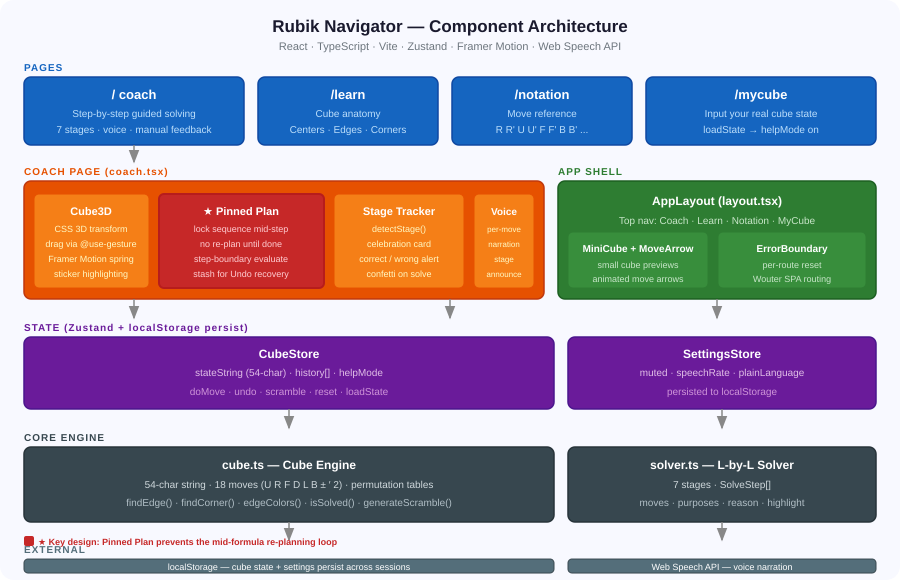

# Rubik Navigator — Build Guide

> How I built a Rubik's Cube coach on Replit that teaches your way — formula or free exploration. Framework, packages, architecture, and the loop bug that took five iterations to fix.

## Sections

- What It Does
- The Story
- Learning Modes
- The Four Pages
- How to Use It
- Tech Stack — Framework, Packages & Why
- Architecture
- The Loop Bug — 5 Iterations
- Build Log — What I Learned
- Try It

## Content

## What It Does

A step-by-step Rubik's Cube coach that runs entirely in the browser. Scramble a cube, turn on the coach, and it walks you through solving it — one move at a time, with a spoken explanation of _why_ each move exists.

7

Solving Stages

18

Move Types

54

Stickers Tracked

3

Learning Modes

0

Server Needed

**What makes it different:** Most tutorials give you a sequence to memorize. This one explains what each move is accomplishing right now — so if you forget the sequence, you understand enough to figure it out.

## The Story

The cube sat on a shelf for thirty years as a "I'll figure it out someday" item. Then my son started learning — coached to memorize R U R' U' until his fingers knew the pattern, with no idea why those four moves worked. My mom picks it up and just tries things — no formula, no patience for memorization.

I couldn't find an app that worked for both of them. So I built one on Replit in a weekend. GenAcademy got me thinking about the difference between knowing _how_ to do something and understanding _why_ it works. Both are valid. The point is knowing which one you're doing.

## Learning Modes

📋

Formula Learner

For my son

-   Coach shows exact move sequence
-   Each move labeled with its purpose
-   Auto-play executes the full step
-   Progress checkmarks per move

🔍

Free Explorer

For my mom

-   Scramble and try anything
-   Right move? Coach confirms it
-   Wrong move? Alert + undo option
-   Hint available anytime

🎛️

Mix Mode

For everyone else

-   Coach off by default
-   Turn it on when stuck
-   Undo always recovers the plan
-   Voice coaching optional

Approach

You get

Trade-off

**Memorize formulas**

Fast, repeatable execution

No intuition — a small variation breaks the routine

**Free exploration**

Real intuition and understanding

Slow to reach a full solve without structure

**Coached with reasons**

Structure + understanding together

Slower than pure memorization

## The Four Pages

Single-page React app with four routes. Entirely client-side — no server.

/ — Coach

#### Guided Solving

3D drag-rotatable cube · stage progress bar · move sequence with per-move labels · voice controls · manual move buttons · scramble / reset / undo.

/learn

#### How the Cube Works

Visual explainer of cube anatomy — 6 centers (never move), 12 edges, 8 corners. Color scheme used throughout the app.

/notation

#### Move Reference

What R, R', U, U', F, F'… actually mean, with interactive diagrams so you see the move before executing it.

/mycube

#### Enter Your Cube

Input your physical cube's colors face by face. The app loads that state and starts coaching from there.

## How to Use It

-   1
    
    #### Scramble or enter your cube
    
    Hit Scramble for 22 random moves, or use /mycube to enter your real cube's colors.
    
-   2
    
    #### Turn coach mode on (optional)
    
    Off by default — explore freely. When you want guidance, toggle Coach Mode to see the next step.
    
-   3
    
    #### Play or turn manually
    
    Auto-play executes the step, or use the move buttons yourself. Right move = confirmed. Wrong move = corrected with an undo option.
    
-   4
    
    #### Read the "why" — or hear it
    
    Each step shows a plain-language explanation of what the sequence accomplishes. Voice reads it aloud if enabled.
    
-   5
    
    #### Repeat through 7 stages
    
    Each stage completes with a celebration card naming what you just finished and what comes next.
    

## Tech Stack — Framework, Packages & Why

Replit scaffolded a React + Vite + TypeScript workspace. Here's what it chose and the reason each package earned its place.

Core Framework State & Routing UI & Animation Replit Tooling

Package

Why it was chosen

reactcatalog (18)

**Component model maps directly to the app's structure** — cube faces, stage panels, coaching steps, and the 3D canvas are all naturally independent components that re-render only when their slice of state changes.

typescript5

**The cube state is a 54-character string with strict index semantics.** TypeScript catches off-by-one errors in permutation tables at compile time rather than at runtime when the cube silently returns wrong colors.

vitecatalog (5)

**Fast hot-module reload inside Replit.** The cube engine is pure browser code — no SSR needed. Vite bundles everything into a static site that runs directly on Replit's hosting with zero server config.

tailwindcsscatalog (3)

**Replit's default template ships with Tailwind.** Utility classes keep layout and spacing changes local to the component — no stylesheet hunting. The `@tailwindcss/vite` plugin integrates with zero config.

Package

Why it was chosen

zustandv5.0

**4 KB vs Redux's ~50 KB.** The cube only has two stores (`CubeStore` and `SettingsStore`). Zustand's `persist` middleware writes both to `localStorage` automatically — that's 3 lines of code vs a custom serializer in Redux. No Provider wrapping needed.

wouterv3.3

**~2 KB vs React Router's ~50 KB for 4 static routes.** The app has four pages (/, /learn, /notation, /mycube) that never need dynamic segments, loaders, or nested layouts. Wouter handles this with a single `<Switch>` and no configuration.

@tanstack/react-querycatalog (5)

**Part of Replit's workspace template.** The app wraps everything in a `QueryClientProvider` — future API calls (e.g. saving solve history) would use React Query's caching automatically. Currently no server calls are made.

Package

Why it was chosen

framer-motioncatalog (11)

**Spring physics for the 3D cube drag.** A CSS transition would snap between angles. Framer Motion's `useSpring` gives the cube real inertia — release mid-drag and it settles naturally. Also used for the solving celebration animation.

@use-gesture/reactv10.3

**Unified mouse + touch drag events.** This package normalises pointer events across desktop (mouse), tablet (pen), and mobile (touch) into a single `useDrag` hook. It pairs with Framer Motion springs — delta XY from gestures feeds directly into `rotateX`/`rotateY` springs.

@radix-ui/\*v1–v2

**Accessible headless components via shadcn/ui pattern.** Dialog, Tooltip, Tabs, AlertDialog, etc. ship with correct ARIA roles and keyboard navigation. Replit's Shadcn template generated all the `src/components/ui/` files from these primitives — the team owns the styles, Radix owns the behaviour.

lucide-reactcatalog

**Tree-shaken React icon components.** `Play`, `SkipForward`, `Award`, `Lightbulb`, `Undo2` are imported individually — only the used icons go into the bundle. Consistent 24px stroke style across all UI controls.

canvas-confettiv1.9

**One function call for the stage-complete celebration.** Writing a confetti canvas animation from scratch is ~200 lines. `confetti({ particleCount: 120 })` produces the celebration burst. The library is 24 KB and tree-shaken, so no performance impact when not firing.

Web Speech APInative

**No npm package — built into every modern browser.** `window.speechSynthesis.speak()` reads move labels and stage announcements aloud. Choosing a browser native API means zero bundle size increase and works offline.

clsx + tailwind-mergecatalog

**Safe conditional class merging.** `clsx` joins class strings conditionally. `tailwind-merge` de-duplicates conflicting Tailwind utilities (e.g. `bg-red-500` overriding `bg-blue-500`). Together they power the `cn()` utility used throughout all shadcn components.

Package

What it does in Replit

@replit/vite-plugin-cartographer

**Maps compiled output back to source files** so Replit's AI agent can pinpoint exactly which line of source code a runtime error came from — even after Vite bundles everything.

@replit/vite-plugin-runtime-error-modal

**Shows a browser overlay when a runtime error crashes the app.** Instead of a blank screen, you see the stack trace inline — the agent reads this to diagnose errors without needing browser devtools access.

@replit/vite-plugin-dev-banner

**Injects the Replit dev banner** (the preview bar at the top of the editor view) so you can share the live preview URL with a single click during development.

.agents/memory/Replit agent memory

**Persists key learnings between agent sessions.** After fixing the loop bug, the agent wrote `coach-step-pinning.md` — "never re-plan mid-step." Later sessions read this file so they don't re-introduce the same bug when adding new features.

**Key Replit workflow:** The agent reads the error overlay → finds the source line via cartographer → writes a fix → checks its own memory for prior constraints → verifies with a screenshot. Each prompt was one iteration of that loop.

## Architecture

Five layers. User interaction flows down from pages through components into state, which feeds the cube engine and solver. Everything persists to the browser.

### The cube state is a 54-character string

The entire cube lives in one variable. A solved cube is `"YYYYYYYYY OOOOOOOOO GGGGGGGGG WWWWWWWWW RRRRRRRRR BBBBBBBBB"` (faces U R F D L B, 9 stickers each). Every move is a permutation table over indices 0–53 — precomputed at startup, applied as an array lookup.

### The solver uses beginner layer-by-layer

Seven stages, each a function that calls helpers (`findEdge()`, `findCorner()`, `uTurnsFromTo()`) to locate pieces and compute the path. Output is a `SolveStep` with `moves[]`, `purposes[]` (one explanation per move), `reason` (why this works), and `highlight[]` (facelet indices to dim on the 3D cube).

### State in two Zustand stores

`CubeStore` — cube string, history stack for undo, helpMode flag. `SettingsStore` — voice mute, rate, plainLanguage. Both persist to `localStorage` via Zustand's persist middleware — refresh the page and you're exactly where you left off.

## The Loop Bug — 5 Iterations

The hardest part wasn't the solver. It was making the coach coherent — feeling like it was following a plan, not reacting to every individual move.

**Core principle discovered:** The coach must only judge the cube at step boundaries — never mid-formula. That one rule fixed all three bugs below.

Iteration 1

Problem

**Re-plan after every move.** Solver computes a fresh plan on every state change. Halfway through R U R' U', the "optimal next move from here" is R' — undoing what you just did. Looks like an infinite loop.

Fix

**Pinned Plan (`planRef`).** Once a step starts, that exact sequence is locked into a `useRef`. The solver isn't called again until the step finishes or the user makes an unexpected change.

Iteration 2

Problem

**Timing race on fast clicks.** Click handlers read cube state from React render props (stale by one render). Rapid clicking desync'd the expected vs actual state — pin dropped, sequence re-planned mid-step.

Fix

**Synchronous `useRef` mirror.** All click handlers read from `planRef.current` — always the live value, never one render behind. Auto-play timer also reads from the ref and cancels immediately on unexpected state change.

Iteration 3

Problem

**Manual moves treated as off-script.** Any move not from the Play button abandoned the plan, even if it was exactly the suggested move.

Fix

**Compare via `applyMove(fromState, expected) === stateString`.** Correct manual move advances the sequence. Wrong move shows alert + sets aside plan so Undo can resume it. `stashRef` holds the plan across the wrong move.

Iteration 4

Problem

**Layout and cube size.** Shrinking the CSS container didn't shrink the 3D cube — it overflowed. Desktop needed scrolling. Mobile layout unstacked.

Fix

**Cube scales with `font-size` em units.** Pass a smaller `size` prop on desktop. Stage goal added to top bar. Celebration card names what finished + what's next.

Iteration 5

Problem

**Stage-complete fires repeatedly.** Mid-formula, the cube passes through states where a stage temporarily looks done, then undone, then done again. Celebration card fired multiple times.

Fix

**One guard: `if (planRef.current !== null) return`.** Stage detection skips entirely while a step is in progress. Fires exactly once per stage, at the step boundary.

## Build Log — What I Learned

Learning 1

#### A coach needs a memory, not just a plan

A solver that re-plans from raw state on every render is technically correct but practically unusable. The coaching sequence must be owned by the session, not recomputed from scratch.

Learning 2

#### UI state and app state are different clocks

React renders asynchronously. For anything time-sensitive, read from a `useRef` that's updated synchronously — never from render props inside an event handler.

Learning 3

#### Manual moves are a feature, not an edge case

Detecting whether a manual move matched the expected move turned "going off-script" into a teaching moment. Undo recovering the plan (via `stashRef`) made it safe to try things.

Learning 4

#### Visual layout needs screenshot verification

The cube size bug (container shrunk, cube didn't) was only visible by looking at the rendered page. CSS and component props don't always express the same thing — check with screenshots.

Learning 5

#### Replit's agent memory prevents re-breaking fixed bugs

After fixing the loop bug, the agent saved the principle ("only judge at step boundaries") to `.agents/memory/coach-step-pinning.md`. Later sessions read this file before making changes. The stage-complete fix in iteration 5 directly referenced that note — the agent didn't re-derive the rule, it already knew it.

## Try It

### Rubik Navigator

No install, no account. Works on mobile and desktop. Cube state saves across sessions.

[Open the App ↗](https://rubik-navigator.replit.app/)

Replit provided the credits and AI-assisted environment that made this a weekend build. GenAcademy got me thinking about the difference between executing a formula and understanding why it works. The cube has been on a shelf long enough.
