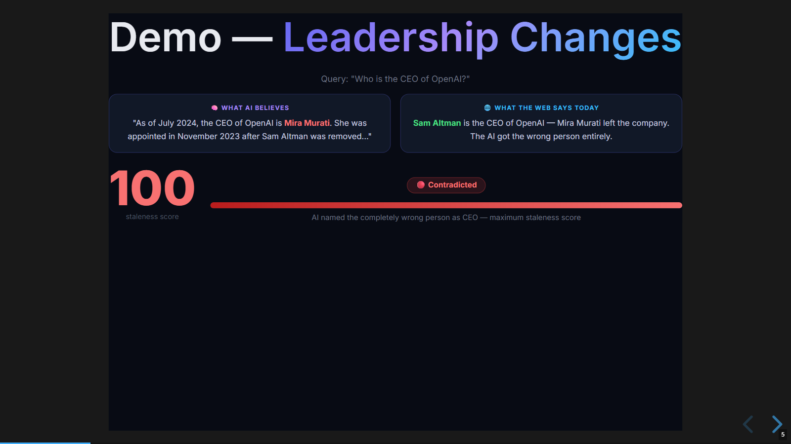
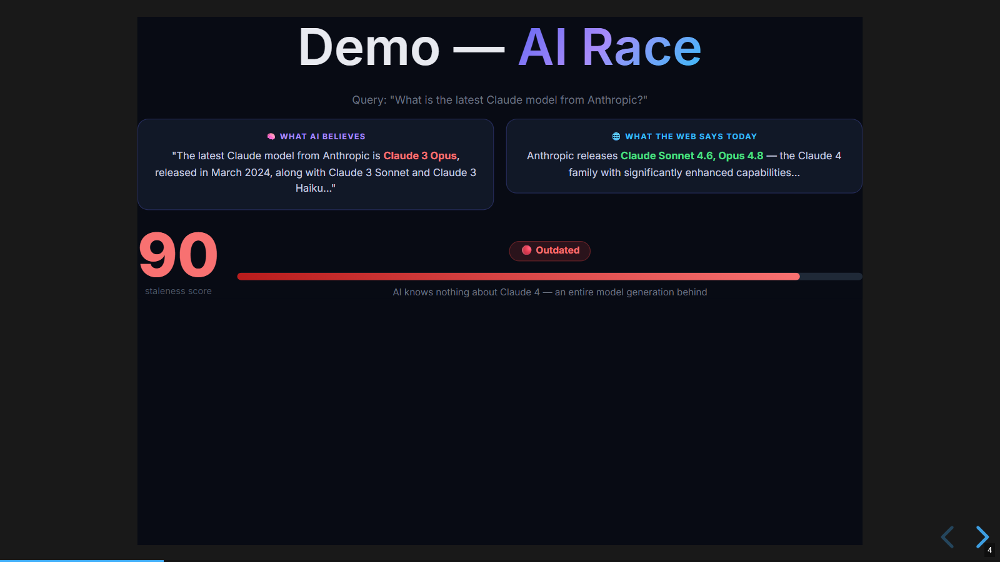
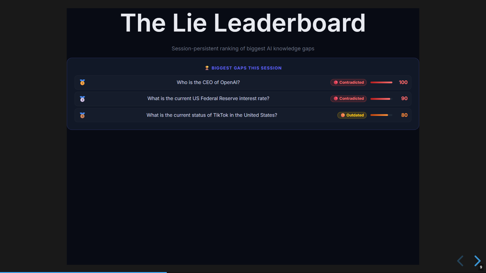
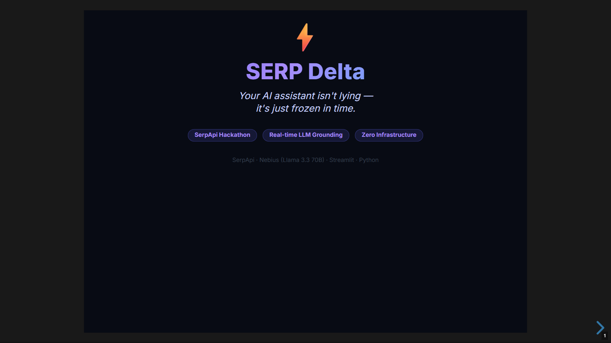

# SERP Delta — LLM Knowledge Gap Detector

> Detect and score LLM knowledge staleness against live Google search results. Zero infrastructure. One API call between you and the truth.

## Sections

- What It Does
- The Inversion
- vs RAG
- Where It Fits
- See It In Action
- How It Works
- Real Learnings
- Moments In Between
- What’s Next
- Platform Review

## Content

## What It Does

Ask any time-sensitive question. SERP Delta runs it through an LLM and through live Google simultaneously, then computes a structured score of the gap between frozen training data and current reality.

0–100

staleness score

~3s

cold analysis

2×

parallel fetch

3

LLM providers

$0

infrastructure

📊

#### Staleness Score

0 = perfectly fresh. 100 = completely wrong. Computed by a second LLM reading both answers.

🔍

#### Specific Discrepancies

“AI says X, web says Y.” Named, citable findings — not just a feeling something is off.

📅

#### Knowledge Timeline

Visual bar showing how many months the AI’s answer appears to lag behind current reality.

⚖️

#### Side-by-Side View

AI training answer left, live Google snippets right. The gap is visible before you read the verdict.

🏆

#### Lie Leaderboard

Session-ranked table of every gap you’ve found. People compete to find the most outdated answer.

🎭

#### Demo Mode

9 pre-loaded results, zero API keys. The app works the moment you open it.

0–20

Fresh

AI answer current

21–50

Slightly Outdated

Minor drift, core holds

51–75

Outdated

Significant change

76–100

Contradicted

AI directly wrong

## The Inversion

Everyone uses SerpApi the same way. SERP Delta uses it differently.

Standard use

Search engines use SerpApi to show users results

👤User searches for a topic

🔍SerpApi fetches live web data

📄Results displayed to the user

→

SERP Delta

SerpApi used to _audit_ AI knowledge

👤User asks a time-sensitive question

🤖LLM answers from frozen training data

🔍SerpApi fetches current ground truth

📊Delta computed between the two

The staleness score is the diff

This is a paradigm inversion: the search results aren’t the product — they’re the benchmark. SerpApi becomes an **accuracy validator**, not a content source. Nobody was doing this.

## vs RAG

RAG (Retrieval-Augmented Generation) is the industry standard for solving LLM staleness. It works — but it’s heavyweight. SERP Delta is the lightweight alternative for external knowledge validation.

❌  RAG Pipeline

⏱️Setup:Weeks — pipeline, embeddings, vector DB

🔄Maintenance:Ongoing re-indexing required

📁Coverage:Only what you indexed

💰Cost:Infrastructure + embedding costs

📚Output:Source chunks returned

📆Freshness:Still goes stale after weeks

VS

✓  SERP Delta

⚡Setup:Hours — pip install, two API keys

✓Maintenance:Zero

🌐Coverage:Entire live web

💸Cost:Per-query API call

🎯Output:Specific discrepancies, named

🔴Freshness:Always current — live at query time

**The tradeoff is real:** RAG wins on private/internal knowledge (documents, databases, intranets). SERP Delta wins on public, fast-moving facts. For external knowledge that changes often, the RAG overhead is rarely worth it.

## Where It Fits

Any domain where AI answers drive decisions and facts change faster than training cycles.

🏢

Enterprise AI Copilots

Internal chatbots answer confidently. No one checks if the answer is a year old.

→ Validate before it drives a decision

⚖️

Legal & Compliance

Regulations, sanctions, and case law change. AI doesn't get the memo.

→ Flag stale regulatory answers automatically

📈

Financial Research

AI answers on rates, valuations, and leadership are months behind the market.

→ Audit AI output against current state

🏥

Healthcare AI

Clinical guidelines and drug approvals update constantly. Stale answers can mislead.

→ Surface outdated clinical guidance

💬

Customer Support Bots

Stale pricing, discontinued products, old policy — all answered with full confidence.

→ Catch stale answers before customers do

🖥️

Developer API

Every LLM API call is a potential stale answer. No existing wrapper checks freshness.

→ Wrap any LLM call with a freshness layer

## See It In Action

The CEO query became the defining moment. Score 100, Contradicted, caught in three seconds.

CEO Query — Score 100 Score Card Lie Leaderboard App Overview

Score 100 · Contradicted **The AI named the wrong CEO** — leadership changed after its training cutoff. Caught in under 3 seconds. This screenshot became the README hero and every demo slide.

Score Card **Full analysis panel:** staleness number, verdict badge, side-by-side AI vs. web, specific discrepancy list, and knowledge decay timeline. Everything the score means is explained inline.

Leaderboard **Lie Leaderboard** — every session query ranked by staleness score. Added in 30 minutes. Turned out to be the most-discussed feature in every demo. People compete to find the highest score.

Overview Full Streamlit interface: query input, 15 pre-configured demo queries in the sidebar organized by category (AI Race, Markets, Geopolitics, Sports, Leadership), SerpApi quota meter, and API key configuration panel.

## How It Works

Two threads. Three cache layers. One structured JSON diff. The critical design decision: LLM answer and live web fetch start at the same time. Neither waits for the other.

-   1
    
    #### Query submitted
    
    `run_pipeline(query)` launches two `ThreadPoolExecutor` workers simultaneously.
    
-   2
    
    #### LLM answer (parallel thread A)
    
    Checks `llm_cache/` first (7-day disk TTL). Cache miss → Nebius Qwen3-32B answers from training data. Training answers are deterministic — cache them for days, not minutes.
    
-   3
    
    #### Live web data (parallel thread B)
    
    Checks `serp_cache/` first (24h disk TTL). Cache miss → SerpApi Google Search + Google News run in a nested executor. Two calls in parallel, not serial.
    
-   4
    
    #### Delta computed
    
    `compute_delta()` sends both answers to Nebius Llama 3.3 70B with a structured prompt. Returns JSON: `staleness_score`, `verdict`, `discrepancies`, `ai_likely_cutoff_hint`.
    
-   5
    
    #### Results rendered
    
    Score card, timeline, side-by-side comparison, discrepancies list. Leaderboard and quota counter updated on the main thread only — never inside a worker.
    

Three caching layers

5 min

st.cache\_data

In-memory, same session. Instant on repeat within a browser tab.

7 days

llm\_cache/

LLM training-data answers. Disk-cached because they never change between calls.

24 hrs

serp\_cache/

SerpApi Search + News. Live data but daily granularity is fine for most questions.

## Real Learnings

01

Streamlit session state is not thread-safe — silently

Updating `st.session_state` from inside a `ThreadPoolExecutor` worker throws `missing ScriptRunContext` and corrupts data silently. Every Streamlit write must happen on the main thread, after the executor finishes. Zero exceptions.

Collect results inside the worker. Write to session state outside it.

02

Demo mode is not a nice-to-have

The SerpApi quota hit its monthly limit mid-presentation. The app switched to pre-loaded demo results seamlessly. Without it the demo would have died live in front of the judges. Build demo mode first.

The safety net you build "just in case" is the one that actually matters.

03

The discrepancy list is more valuable than the score

Early versions led with the number. Reviewers immediately asked "but what specifically is wrong?" Moving the named discrepancies (“AI says X, web says Y”) above the comparison panel changed how people used the tool. The score is the hook. The finding is the value.

Show the baseline difference, not just the summary of it.

04

Cache differently based on what changes

LLM training answers are frozen forever — 7-day disk cache is fine. Live web data changes daily — 24h cache is safe. In-session repeats should be instant — 5-min memory cache. Three different TTLs for three different rates of change. Design them together upfront.

Match cache TTL to the actual rate of change, not to what feels safe.

05

Structured JSON from LLMs needs defensive extraction

Llama 3.3 70B frequently wraps its JSON output in markdown code fences or adds a preamble sentence. `json.loads(response)` fails about 20% of the time without stripping. A small extraction function that strips fences and finds the first `{ }` span fixed it completely.

LLMs that return structured data will sometimes dress it in prose. Always strip defensively.

## Moments In Between

📸

The CEO screenshot found us

A smoke-test query: “Who is the CEO of OpenAI?” Score back: 100. Contradicted. The AI named the previous CEO with full confidence. That screenshot went into every slide, the README, and every tweet from that point forward. The best demo content finds you.

🐛

Threading bug that looked like a math error

The quota counter was doubling and halving seemingly at random. Turned out session state writes inside the executor were racing each other. Looked like arithmetic. Was a concurrency problem. Reading the Streamlit docs properly, not skimming them, would have caught it in five minutes.

🏆

Leaderboard: 30 minutes, outsized impact

Someone asked mid-session “which query had the worst score?” The leaderboard existed an hour later. Demo crowds immediately started competing to find the most outdated AI claim. The feature with the least planning got the most engagement.

🛡️

Quota hit. Demo mode held.

The SerpApi free plan ran out mid-presentation. The app switched silently to pre-loaded demo results. Zero visible degradation. The only person who knew was watching the quota meter. Build the fallback before you need it — you will need it.

## What’s Next

The MVP validates the core idea. These are the features worth building next, ranked by impact vs effort.

🔬

High Impact

Multi-LLM Comparison

Audit GPT-4 vs Claude vs Gemini on the same query. Show which model hallucinates the most on time-sensitive facts.

📦

High Impact

Batch Mode

Paste 10 claims, audit all of them in parallel. Built for enterprise content teams validating AI-generated content before publish.

🔌

High Impact

REST API (FastAPI)

Wrap any LLM API call with a freshness check. Integrate SERP Delta as middleware in any existing pipeline.

📉

Stretch

Historical Staleness Trend

Run the same query weekly and chart how the AI’s answer drifts from reality over time. Shows the decay curve visually.

🌐

Stretch

Browser Extension

Highlight AI answers on any webpage and auto-check their freshness score inline. Zero context switch.

🔔

Stretch

Webhook Alerts

Monitor a set of queries on a schedule. Alert when a cached answer crosses a staleness threshold. Passive knowledge drift monitoring.

## Platform Review

Streamlit ≥ 1.35

✓ Liked

●Prototype-to-app in hours, not days

●One-command Streamlit Cloud deploy

●Secrets management is obvious and clean

! Gotcha

●Session state not thread-safe — crashes silently from workers

●Layout customization limited; CSS overrides required

SerpApi Google Search + News

✓ Liked

●Structured JSON — reliable and consistent

●News endpoint is genuinely separate signal

●Free plan usable for development

! Gotcha

●100 searches/month gone in a live demo day

●No streaming — full response or nothing

Nebius AI Studio Qwen3-32B + Llama 3.3 70B

✓ Liked

●OpenAI-compatible — one SDK, three providers

●Notably cheaper than direct Anthropic pricing

●Qwen3-32B fast for the simpler answer call

! Gotcha

●Occasional timeouts under load — fallback chain is mandatory

●Qwen3 thinking mode adds 2–5s unless explicitly disabled
