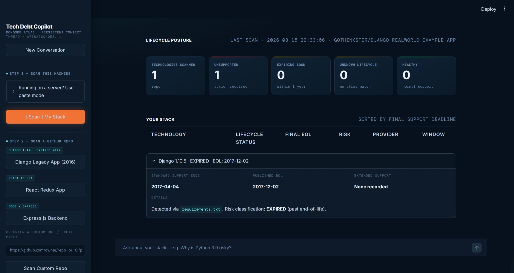
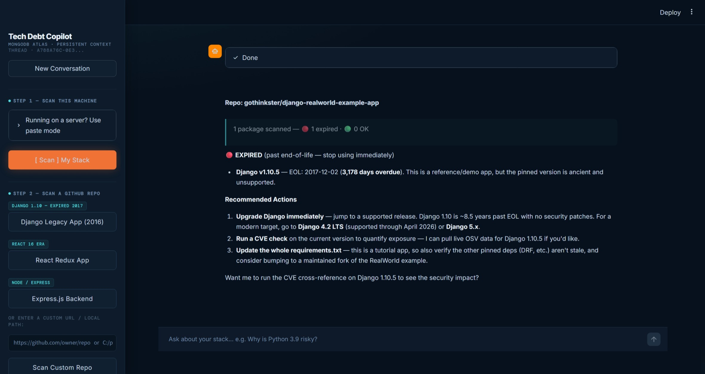
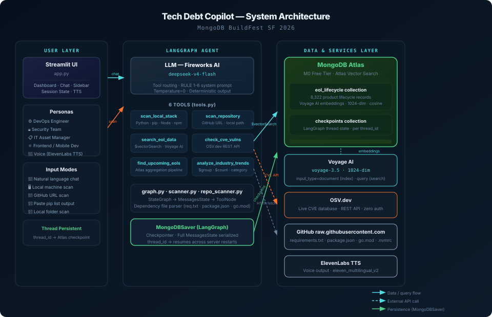
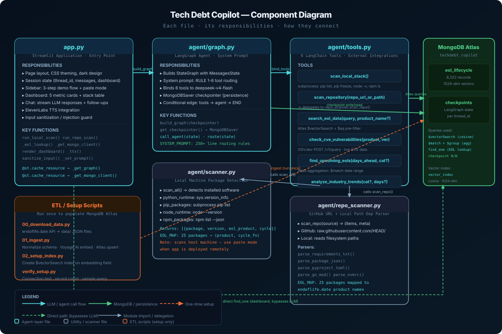

# Tech Debt Copilot — MongoDB BuildFest SF 2026

> An AI agent that audits your software stack for End-of-Life packages, CVE exposures, and upcoming deprecations — with full conversation persistence via MongoDB Atlas.

## Sections

- What It Does
- Who It Helps
- See It In Action
- All Features
- How It Works
- Architecture
- Component Map
- Data Source
- Tech Stack
- What We Actually Learned
- The Team
- Get Started

## Content

## What It Does

Tech Debt Copilot is an AI agent you talk to. You give it a GitHub URL, paste your `pip list` output, or just ask a question. It tells you which software in your stack is past end-of-life, which is expiring soon, and whether there are active CVEs with no fix available — because EOL packages stop receiving security patches.

The agent remembers every conversation. Restart the server. Close the browser. Come back an hour later. It picks up exactly where you left off — because all state is stored in MongoDB Atlas via LangGraph’s MongoDBSaver checkpointer.

8,322

EOL records indexed

464

Products covered

6

Agent tools

<2s

Dashboard render

0

Extra infra needed

## Who It Helps

Tech debt doesn’t care about your org chart. The same EOL problem hits every role differently — the agent speaks to all of them.

🔧DevOps / Platform Engineer

Discovers EOL runtimes the night before a prod deploy. No consolidated view of what’s expiring across the stack.

90-day triage → prioritized upgrade sprint with exact dates

🔐Security Engineer

CVE scanners flag issues but don’t tell you if a fix even exists. EOL packages won’t get one.

Live CVE lookup + EOL status in one query

📋IT Asset Manager

Spreadsheets of software versions updated manually. Compliance audits require a software bill of materials.

Paste pip list → instant EOL breakdown for audits

💻Frontend / Mobile Developer

Node, React, and npm packages all on different EOL calendars. No single source of truth.

Scan any GitHub URL → dependency report, no git clone

🗄Database / Infra Owner

PostgreSQL, MongoDB, Redis, and OS releases have separate lifecycle cadences. Easy to miss a kernel EOL.

Semantic search across 464 products — ask in plain English

⚖️Compliance / Legal

SOC 2 and ISO 27001 auditors require software inventory with support status. Producing this before each audit is expensive.

On-demand SBOM with EOL dates — shareable and fast

📊Engineering Manager

Tech debt is invisible until it’s urgent. Sprint backlog has no objective urgency signal for “upgrade X” tickets.

EOL dates as priority signal: “expires in 23 days”

🤝M&A / Due Diligence

Evaluating an acquisition target’s tech health requires fast triage of dependency hygiene across repos.

Scan target’s GitHub → instant tech debt risk report

## See It In Action

Screenshots from the live app. Each tab shows a different part of the workflow — from the initial chat interface to a full GitHub repo scan with critical EOL findings.

Home & Chat Dashboard — Metrics Stack Details GitHub Scan — Overview GitHub Scan — Critical

UI **Home & Chat interface.** The sidebar walks users through three demo modes: scan local machine, scan a GitHub repo, or ask a lifecycle question. The main area is a persistent chat thread stored in MongoDB Atlas via MongoDBSaver. The thread ID in the sidebar identifies the session — restart the server and the agent picks up here.

EOL **Dashboard — 5 metric cards.** After a local stack scan, the dashboard renders in under 2 seconds from a direct MongoDB `find_one()` call — bypassing the LLM entirely. Cards show: Technologies Scanned · Unsupported (past EOL) · Expiring Soon (≤ 90 days) · Unknown · Healthy.

Details **Stack detail rows.** Each detected package gets an expandable row: name, version, provider, exact EOL date, status badge, and support window. Color-coded: 🔴 past EOL, 🟠 <30 days, 🟡 <90 days, 🔵 <1 year, 🟢 healthy. Data pulled directly from the Atlas `eol_lifecycle` collection.

GitHub Scan **GitHub repo scan — metrics overview.** Paste a GitHub URL into the chat. The agent fetches `requirements.txt`, `package.json`, `pyproject.toml`, `go.mod`, and `.nvmrc` directly over HTTP — no git clone. The dashboard updates with the repo’s risk metrics immediately after the agent responds.

Critical **GitHub scan — critical findings.** The agent returns a risk-grouped report: 🔴 Expired packages past EOL with no security patches available, 🟠 Critical (<30 days), down to 🟢 Healthy. Each finding shows the exact EOL date and a recommended upgrade path. _Update the image path above to your second GitHub scan screenshot._

## All Features

Six agent tools, three scan modes, persistent memory, voice output, and a real-time dashboard — each feature solves a specific gap in how teams currently manage software lifecycle.

### Scan Modes

🖥

#### Local Stack Scan

Detects installed Python runtime, pip packages, Node.js, and npm packages on the host machine. Returns each package with its version, EOL product mapping, and risk level.

📁

#### GitHub Repo Scan

Accepts any GitHub URL or local folder path. Fetches `requirements.txt`, `package.json`, `pyproject.toml`, `go.mod`, `.nvmrc` over HTTP. No git clone, no authentication needed for public repos.

📋

#### Paste Mode (Deployed)

When running on a remote server, `scan_local_stack()` scans the server’s packages — not yours. Paste your local `pip list` or `npm ls` output into the chat and the agent parses and analyses it with the same full EOL check.

### Lifecycle Intelligence

🗄

#### EOL Knowledge Base Search

Semantic search over 8,322 endoflife.date records using Voyage AI 1024-dim asymmetric embeddings. Optional `$eq` pre-filter scopes results to a single product. Ask in plain English: “Is Python 3.9 still supported?”

📅

#### 90-Day Triage

MongoDB aggregation pipeline: `$match` on date range, `$group` by category. Filter by: `os` · `lang` · `database` · `framework` · `service`. Surfaces the exact packages your team needs to act on this sprint.

📈

#### Industry Trends

Aggregates EOL exposure across all tech categories globally. Answers “which ecosystem is most at risk right now?” — useful for vendor assessments and tech landscape reviews.

### Security

🛡

#### Live CVE Cross-Reference

Live POST to OSV.dev for any product + version. Returns CVE IDs, CVSS severity scores, and whether a fix is available — or whether EOL status means no patch is coming. No API key required.

🔴

#### Risk-Grouped Reports

All scan results are formatted as: 🔴 Expired → 🟠 Critical (<30 days) → 🟡 High (<90 days) → 🔵 Medium (<1 year) → 🟢 OK. Recommended actions always included.

🔒

#### Input Sanitization

All chat input is sanitized before reaching the LLM — prompt injection patterns are detected and rejected. URL and path inputs are validated before being passed to repo scanner tools.

### Persistence & Memory

💾

#### Conversation Persistence

Every message, tool call, and result is stored per `thread_id` in MongoDB Atlas via LangGraph’s MongoDBSaver. Restart the server mid-conversation — the agent picks up where it left off. No Redis, no queues.

🔄

#### Follow-up Awareness

Full conversation history flows through the agent on every turn. “What about that Django version?” resolves from context — no need to repeat yourself. References across turns work naturally.

🧵

#### Multi-Thread Support

Each conversation gets a unique `thread_id`. Start a new conversation with a single button click while keeping all previous threads intact in Atlas. Threads persist indefinitely.

### UI & Output

📊

#### Live Dashboard

Five metric cards (Scanned / Unsupported / Expiring / Unknown / Healthy) render in under 2 seconds from a direct MongoDB lookup — no LLM in the loop. Updates on every scan.

🔊

#### Voice Output

ElevenLabs TTS integration reads agent responses aloud when enabled. Toggle per session. Designed for hands-free monitoring scenarios where you need to hear the risk summary.

⚡

#### Quick Follow-ups

After every scan, contextual follow-up buttons appear: “Check CVEs”, “Upgrade path?”, “How long to fix?”. One click sends the next question with full context already loaded.

## How It Works

Three input modes feed a LangGraph agent that routes to one of six tools, queries MongoDB Atlas or live APIs, and writes every turn to a persistent checkpointer.

-   1
    
    #### You Ask, Scan, or Paste
    
    Type a question, paste a GitHub URL, or paste your `pip list` / `npm ls` output. The message shape determines which tool fires — no mode selection required.
    
-   2
    
    #### LLM Routes to the Right Tool
    
    deepseek-v4-flash follows hard RULE 1–6 blocks in the system prompt. Imperative “IMMEDIATELY call” grammar — not descriptive metadata — forces correct tool selection every time.
    
-   3
    
    #### Tool Runs — Atlas or Live API
    
    EOL queries hit MongoDB Atlas `$vectorSearch` (Voyage AI 1024-dim asymmetric embeddings). CVE queries hit OSV.dev live. Scan tools run subprocess or HTTP fetches. All results flow back to the agent node.
    
-   4
    
    #### State Written to Atlas via MongoDBSaver
    
    Every message, every tool call result, every turn — serialized and stored per `thread_id` in the `checkpoints` collection. Two collections: `checkpoints` (completed steps) and `checkpoint_writes` (in-flight state for crash recovery).
    
-   5
    
    #### Risk-Grouped Report Streamed to UI
    
    Results grouped by severity: 🔴 Expired → 🟠 Critical → 🟡 High → 🔵 Medium → 🟢 OK. Dashboard metric cards update from a direct `find_one()` call — LLM not in the loop for the numbers.
    

\# Three lines: graph + persistence + restart-safe conversations graph = build\_graph(checkpointer=get\_checkpointer()) \# MongoDBSaver -> Atlas result = graph.stream(input, config={"configurable": {"thread\_id": tid}}) \# Asymmetric embeddings: document at index, query at search vo.embed(texts, input\_type="document") \# ETL ingest time vo.embed(\[query\], input\_type="query") \# runtime search

## Architecture

Three layers: the Streamlit UI and input modes on the left, the LangGraph agent with six tools in the centre, and MongoDB Atlas plus external services on the right. All persistence flows through Atlas — no separate vector database, no Redis, no queues.

System Architecture — User Layer → LangGraph Agent → Data & Services

## Component Map

Each Python file in the project, its responsibilities, and how they connect. The dashed arrows are paths that bypass the LLM — the dashboard reads MongoDB directly for sub-2s render without going through the agent.

Component Map — file responsibilities and inter-module connections

## Data Source

The knowledge base is built from [endoflife.date](https://endoflife.date) — an open-source, community-maintained registry of software lifecycle dates. We downloaded the full dataset via their public API, normalized the schema, and ingested it into MongoDB Atlas with Voyage AI embeddings.

**Source** endoflife.date API  
Open-source, community-maintained

**Coverage** 464 products  
8,322 lifecycle records

**Embeddings** Voyage AI voyage-3.5  
1024-dim, asymmetric

### Why normalization was necessary

The endoflife.date API returns non-uniform schemas per product — some have `eol: "2025-01-15"`, others have `eol: false`, others have `lts: true` with no EOL field. Storing this raw breaks every date comparison and aggregation query. The ETL script (`01_ingest.py`) normalizes all records before embedding: boolean EOL values are converted to null, `eol_display` is computed for UI rendering, and date strings are standardized. Products covered include languages (Python, Node.js, Go, Ruby, PHP), frameworks (Django, React, Spring, Rails), databases (MongoDB, PostgreSQL, Redis, MySQL), operating systems (Ubuntu, RHEL, Debian, Windows Server), and cloud services.

Category

Example Products

Records

Languages & Runtimes

Python, Node.js, Go, Ruby, Java, PHP, .NET

~1,200

Frameworks & Libraries

Django, React, Spring, Rails, Angular, Laravel

~2,100

Databases

MongoDB, PostgreSQL, MySQL, Redis, Elasticsearch

~800

Operating Systems

Ubuntu, RHEL, Debian, CentOS, Windows Server

~600

Cloud & Infrastructure

Kubernetes, Docker, Terraform, AWS services

~1,400

Developer Tools

VS Code, Git, npm, pip, Gradle, Maven

~2,200

## Tech Stack

Every technology earned its place. The rule: MongoDB Atlas had to be the primary data layer, and every other tool had to genuinely improve on the alternatives available in the hackathon window.

Library / Service

Role

Why This One

`MongoDB Atlas`

Vector store + graph persistence

Two jobs in one service: `$vectorSearch` for EOL lookups, MongoDBSaver for conversation threads. Zero extra infrastructure.

`Voyage AI voyage-3.5`

Asymmetric embeddings

Separate `input_type` for documents vs queries. Measurably better recall on natural-language EOL questions than symmetric models.

`Fireworks AI deepseek-v4-flash`

LLM inference

Hackathon sponsor. Fast inference, low latency, responds well to imperative RULE-based system prompts for strict tool routing.

`LangGraph`

Agent orchestration

StateGraph handles the tool routing loop. MongoDBSaver drops in as a `checkpointer` argument — three lines of code for full persistence.

`Streamlit`

Web UI

Fastest path from Python to a shareable demo. Custom CSS achieves the full dark-mode design. Session state manages chat history between reruns.

`endoflife.date API`

EOL data source

Best freely available lifecycle dataset. 8,322 records across 464 products, community-maintained, regularly updated.

`OSV.dev`

CVE lookups

Open, structured, real-time vulnerability database. Simple REST API, no key required, returns structured advisory data.

`ElevenLabs`

Voice output (TTS)

Optional voice narration of agent responses. Toggleable per session for hands-free monitoring use cases.

## What We Actually Learned

Eight things we did not know going in. The ones we are most proud of are not the technical wins — they are the moments where a wrong assumption cost us hours and changed how we build next time.

01

LLMs follow rules differently than descriptions

We wrote descriptive tool metadata: _“call this tool when the user provides a GitHub URL.”_ deepseek-v4-flash responded in prose instead of calling the tool. We lost about 3 hours. Rewriting the system prompt as hard RULE 1–6 blocks with “IMMEDIATELY call” language fixed it on the next run. Instruction-tuned models need rules, not descriptions.

The prompt was the bug, not the model.

02

Asymmetric embeddings require asymmetric usage

Voyage AI voyage-3.5 has two `input_type` modes: `"document"` at index time and `"query"` at search time. We initially skipped this. Recall on natural-language questions like “is Python 3.9 still supported?” was mediocre. After switching to proper asymmetric mode, results improved noticeably. Read the embedding model docs.

The difference between symmetric and asymmetric usage is not subtle.

03

Share database connections or pay latency on every call

The dashboard was silently returning None. Root cause: `_eol_lookup()` created a fresh `MongoClient()` on every render, which timed out on Atlas during congested periods. The graph builder’s warm connection stayed alive; fresh ones didn’t. Fix: `@st.cache_resource` on a shared client. One line.

Share database connections. A fresh MongoClient() on every call is not free.

04

scan\_local\_stack() scans the server, not the user

When deployed, the tool calls `subprocess` on the server, which reports the server’s packages — not the user’s laptop. The fix: a paste mode sidebar showing `pip list`, `pip freeze`, and `npm ls` commands. Users run them locally, paste the output, and RULE 2b in the system prompt parses it without calling the scan tool.

Know which machine your code runs on. Conceptual bugs are harder than syntax errors.

05

MongoDBSaver makes persistent context trivially easy

We expected persistence to be hard. `MongoDBSaver(client, db_name=...)` dropped in as the `checkpointer` argument to `graph.compile()`. Every message, tool invocation, and state transition is stored automatically per `thread_id`. Restart the server mid-conversation and the agent picks up exactly where it left off. That is the hackathon theme working as advertised.

When the persistence layer is MongoDB, persistent context is genuinely easy.

06

GitHub Push Protection will find your secrets even in history

We committed an API key in an early commit. GitHub blocked the push — not just the current commit, but rejected the entire push because the key existed in git history. Fix: squash and force-push to rewrite history. `.env` is now in `.gitignore` from commit one on every project we touch.

Set up .gitignore before you write any code. Not after the push is blocked.

07

Public APIs return data for humans, not databases

endoflife.date returns non-uniform schemas per product: some have `eol: "2025-01-15"`, others `eol: false`, others `lts: true` with no EOL field. Storing raw breaks every date comparison. Our ETL normalizes everything before embedding — boolean EOL to null, computed display strings, standardized date formats. Without this, the vector search is built on inconsistent data.

Normalize before you store. ETL is not optional.

08

Playwright’s window.scrollTo does nothing in Streamlit

Taking automated screenshots, `window.scrollTo(0,0)` had zero effect. Streamlit renders inside its own scroll container, not the window. The fix was `element.scroll_into_view_if_needed()` on the specific element we needed visible — targeting the DOM element directly instead of the window scroll position.

Test automation against the actual rendering model, not the DOM you assume.

## The Team

Four people with four different initial ideas — the team started the day debating directions and converged on Tech Debt Copilot. What shipped was better for the tension. One working demo, one day.

R

Rikin Shah

Management · DB · Integrations · Coordination

Kept the team moving through the ideation debate. Owned MongoDB Atlas setup, collection schema, vector index configuration, and integration wiring between the ETL pipeline, agent tools, and the checkpointer layer.

E

Eshan Bhimani

Video · Project Submission · Slides

Produced the demo video and presentation slides under time pressure. Handled the full hackathon submission package — documentation, screen recordings, and the project writeup that got the tool in front of judges.

K

Kai Tran

UX · Integrations

Designed the Streamlit UI flow, dashboard layout, and the step-by-step demo sidebar. Wired the ElevenLabs voice integration and the OSV.dev CVE lookup into the agent tool chain.

S

Sham

Ideation · Product Vision

Originated the core concept: make software EOL visible before it becomes a crisis. Defined the problem framing, shaped the agent’s conversation model, and drove the use-case prioritisation through a morning of competing ideas.

## Get Started

Clone the repo, add your keys to `.env`, run the ETL once to populate Atlas (about 12–15 minutes for the full 8,322-record ingest with embeddings), then launch.

\# 1. Clone and install git clone https://github.com/shassanchi/tech-debt-copilot pip install -r requirements.txt \# 2. Configure (copy .env.example and fill in your keys) cp .env.example .env \# 3. One-time ETL — populates Atlas with 8,322 EOL records + embeddings python 00\_download\_data.py \# fetch from endoflife.date python 01\_ingest.py \# normalize + embed + upsert python 02\_setup\_index.py \# create $vectorSearch index python verify\_setup.py \# confirm all checks pass \# 4. Launch streamlit run app.py
