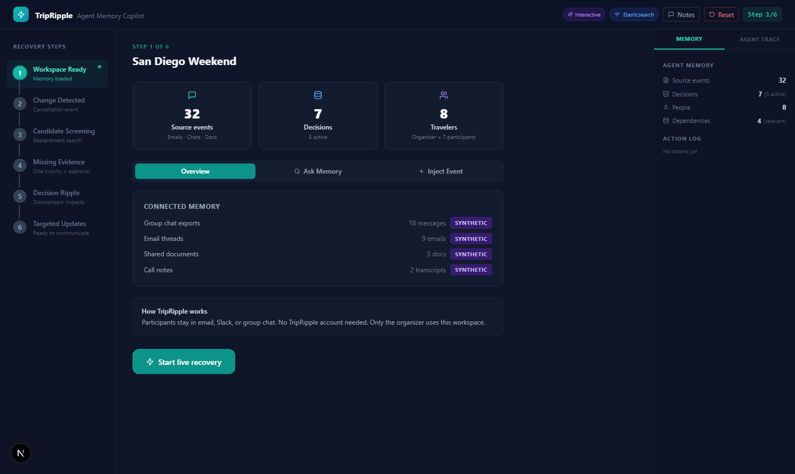
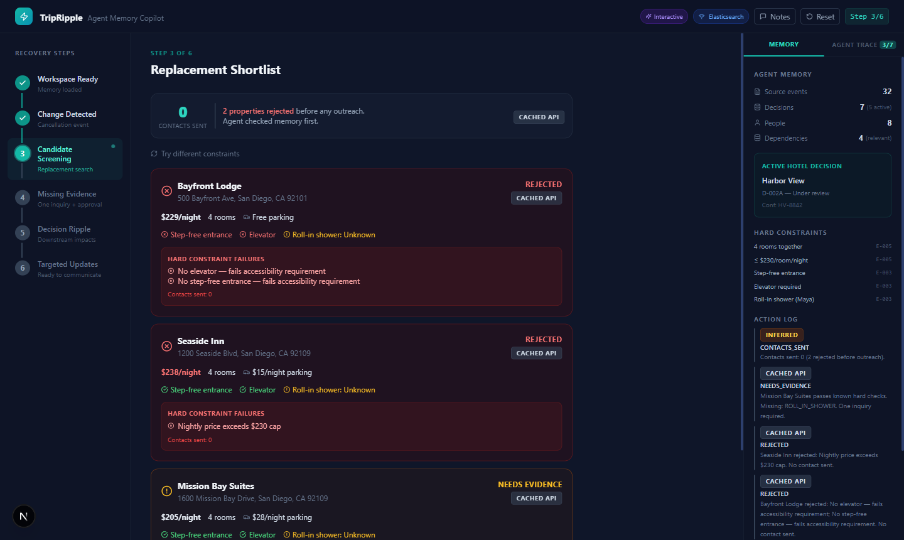
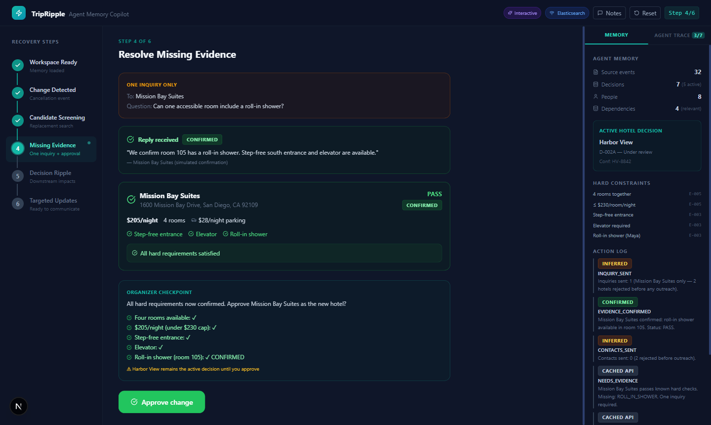
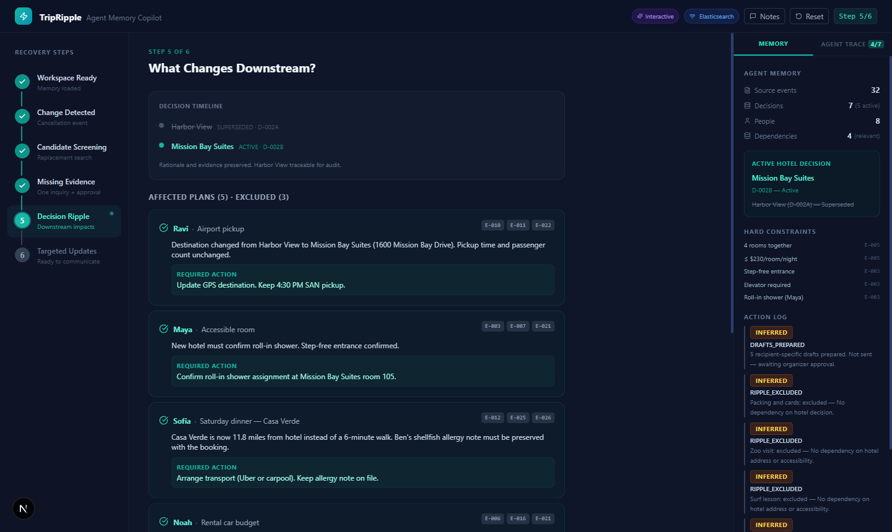
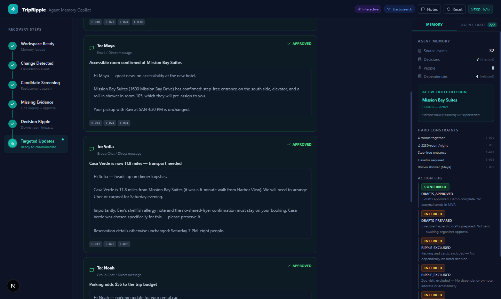
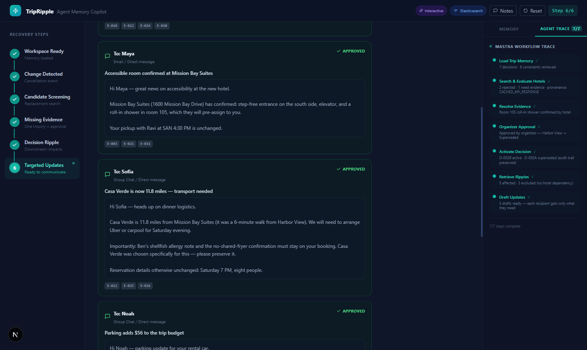
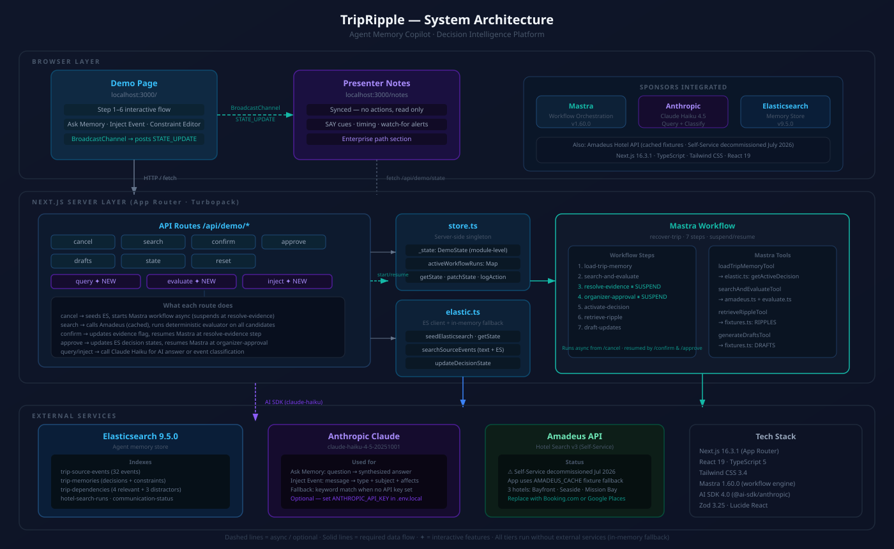
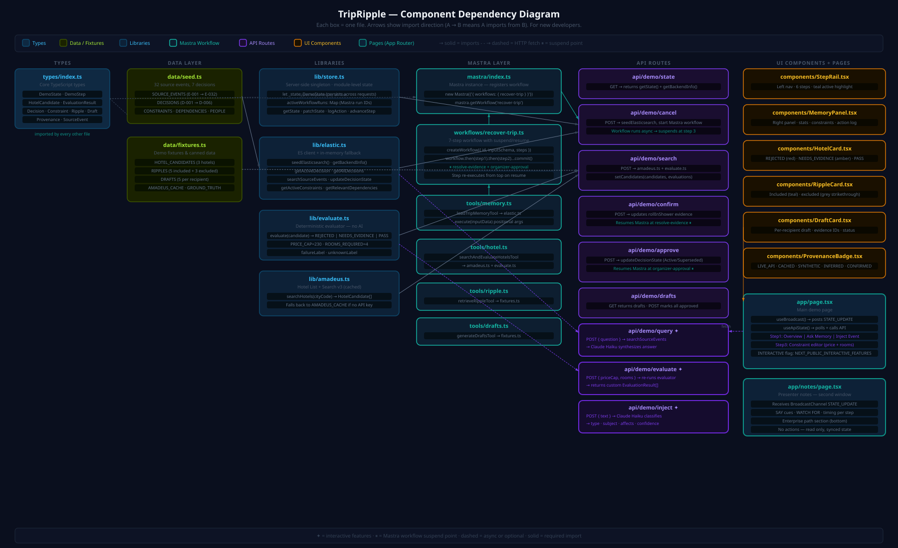

# TripRipple — Agent Memory Copilot

> An AI agent that remembers why every travel decision was made, screens hotel replacements against those constraints, and notifies only the people whose plans depend on what changed. Built at the Mastra Agent Memory Hackathon 2026.

## Sections

- What It Does
- The Memory Layer
- Who It Helps
- See It In Action
- Before / After: Ask Memory
- All Features
- How It Works
- Architecture
- Component Map
- Tech Stack
- What We Actually Learned
- The Team
- Get Started

## Content

## What It Does

Most AI assistants tell you _what_ was decided. TripRipple stores _why_. When something changes — a hotel cancels, a vendor pulls out, a budget shifts — the agent already knows the constraints behind every open plan. It screens replacements against those constraints, asks exactly the questions it doesn’t already know, waits for a human to approve, and then notifies only the people whose plans depend on what changed.

The demo scenario: eight people, one hotel cancellation, 32 prior messages that contain the reasoning. No one had to explain the $230 price cap or Maya’s accessibility requirement again — it was already in Elasticsearch from when it was first discussed.

32

source events

7

decisions stored

0

premature contacts

1

question sent

5

targeted drafts

48m

saved

## The Memory Layer

Five Elasticsearch indexes hold everything the agent needs to reason about a trip:

Index

What’s Stored

Example

`trip-source-events`

Raw messages: emails, chats, notes. Full text + metadata.

“Maya needs accessible room, roll-in shower” — email from Sofia

`trip-memories`

Extracted decisions and constraints. Each decision has a state (Active / Superseded) and links to the source event it came from.

Decision D-001: Harbor View chosen. Constraint C-001: Accessibility required.

`trip-dependencies`

Which plans depend on which decisions. The ripple graph.

Ravi’s airport pickup depends on hotel location. Maya’s room depends on accessibility decision.

`hotel-search-runs`

Results of each screening run with per-candidate evaluation outcomes.

Bayfront rejected: no elevator. Seaside rejected: $238 > $230 cap.

`communication-status`

Draft state per person — pending, sent, confirmed.

Ravi: draft pending. Maya: draft pending.

Every decision that gets superseded stays in the index. It’s marked `state: Superseded` and linked to its replacement. Nothing is deleted — the history is the audit trail.

Search uses Elasticsearch `function_score` with exponential decay on the `timestamp` field. Recent events score higher. Scale: 7 days. This means a message from yesterday ranks above the same content from three weeks ago — which matters when people change their mind.

LIVE\_API CACHED\_API\_RESPONSE SYNTHETIC\_EVENT INFERRED HUMAN\_CONFIRMED

Every piece of information in the UI carries a provenance badge showing where it came from. SYNTHETIC\_EVENT means it was seeded demo data. INFERRED means the agent derived it from a message. HUMAN\_CONFIRMED means a person verified it during the approval step. This matters for trust — you can see exactly how confident to be in any given fact.

## Who It Helps

The demo is travel planning. The pattern it demonstrates applies anywhere a decision has dependencies and those dependencies belong to different people.

🗺Trip Organizer

Hotel cancels three days before the trip. Has to manually check all the original constraints, text eight people, and figure out who actually needs to know.

Agent already knows the constraints → screens candidates → you approve once

♿Traveler with accessibility needs

Accessibility requirement was mentioned once in a group chat months ago. It might not get checked when things change under time pressure.

Constraint is in Elasticsearch → every screening run checks it automatically

📋Project / Event Coordinator

Vendor changes affect some team members but not others. Hard to know who depends on what without reading every plan manually.

Dependency graph → only affected people get notified, excluded plans are shown explicitly

🏢Enterprise (same pattern)

Vendor decision changes. Some teams built their roadmap around it. No one knows who needs to be told or why the original choice was made.

Hotel → Vendor. Traveler → Stakeholder. Cancellation → Risk event. Same architecture.

The enterprise mapping is direct: hotel decision becomes a vendor or platform choice, accessibility constraint becomes a compliance rule, price cap becomes a budget constraint, trip plans become sprint items. The agent doesn’t care about the domain — it operates on the decision graph.

## See It In Action

Six steps from cancellation to targeted drafts. Each tab shows a different moment in the recovery flow.

1\. Workspace 3\. Screening 4\. Evidence & Approval 5\. Ripple 6\. Drafts Agent Trace

1\. Workspace 3\. Screening 4\. Evidence & Approval 5\. Ripple 6\. Drafts Agent Trace

1\. Workspace

Step 1 **Workspace loaded.** 32 source events ingested from group emails and chats. 7 decisions and 6 constraints extracted and stored in Elasticsearch. The right panel shows the memory contents — each decision is stamped with its source event, the person who made it, and its current state (Active or Superseded). Harbor View is the active hotel decision.

3\. Screening

Step 3 **Constraint-aware screening. 0 contacts sent.** Three hotels were found. Bayfront Suites was rejected because it has no elevator — constraint C-001 (accessibility) failed. Seaside Inn was rejected because the rate is $238, eight dollars over the $230 cap — constraint C-004 failed. Neither hotel was contacted. Mission Bay Suites passed four constraints but has one unknown: roll-in shower availability. One question to send.

4\. Evidence & Approval

Step 4 **One question, one answer, one gate.** Mission Bay Suites confirmed: room 105, roll-in shower available. Five hard requirements now pass. The original Harbor View decision is still active — the agent will not supersede it until a human approves. This is the approval gate. Harbor View stays in the audit trail permanently as a Superseded decision linked to the new one.

5\. Ripple

Step 5 **Ripple graph: 4 affected, 3 explicitly excluded.** Ravi’s pickup route, Maya’s room, Sofia’s dinner reservation near the hotel, and Noah’s parking plan all depend on the hotel location — they ripple. Three plans (surfing lesson, zoo day, packing list) have no hotel dependency and are shown as excluded — not just ignored, explicitly shown as “not affected.” The distinction matters: it tells the organizer the agent checked, not that it forgot.

6\. Drafts

Step 6 **5 drafts, 5 different messages.** Each draft contains only the information that person’s plan depends on. Ravi gets the new address and pickup time. Maya gets the room confirmation with accessibility details. Sofia gets the new location for her dinner reservation. Nobody gets a 200-word group blast explaining everything. The drafts are ready to send — no editing required.

Agent Trace

Mastra Trace **7-step Mastra workflow with real-time status.** The Agent Trace tab in the right sidebar shows each step of the `recover-trip` workflow: Load Trip Memory → Trigger Cancellation → Screen Hotels → Resolve Evidence (suspend) → Approve Change → Map Ripples → Generate Drafts. The “Resolve Evidence” step suspends the workflow and waits for external confirmation before resuming — this is Mastra’s suspend/resume pattern. Steps show live status: pending, running (animated), suspended (amber), complete (teal).

## Before / After: Ask Memory

The “Ask Memory” feature in Step 1 shows two answers side by side for the same question: one from a raw AI with no context, one from the agent with Elasticsearch memory. The difference is what the memory layer actually does.

Question asked: _“Why did we choose the hotel near Mission Bay?”_

Without Memory (generic AI)

“We chose the hotel near Mission Bay because of its proximity to the beach and water activities. The location offered easy access to the coastal attractions and recreational opportunities in the area.”

With Memory (Elasticsearch + decay search)

“The group chose the hotel near Mission Bay \[D-002B\] because the preferred hotel, Harbor View, could not accommodate the group’s need to stay together. The Mission Bay Suites offered a suitable option that met the group’s constraints, including accessibility requirements for Maya \[C-001, C-002\] and dietary needs for Ben \[C-003\], as well as the group’s budget \[C-004\].”

The memory-grounded answer cites specific decision IDs and constraint IDs. It knows _why_ Harbor View was the original choice, why it became unavailable, and which constraints the replacement had to satisfy. The generic answer guessed based on geography.

## All Features

### Memory & Search

🧠

#### Decision Memory

Every decision is stored with its rationale, source event, author, and state. Decisions are never deleted — superseded ones stay in the index, linked to what replaced them.

📉

#### Decay Search

Elasticsearch `function_score` with exponential decay on `timestamp`. Recent events score higher. Scale: 7 days. Offset: 1 day. If someone changed their mind last week, the newer preference ranks above the older one.

🔗

#### Dependency Graph

Every plan is tagged with which decisions it depends on. When a decision changes, the graph tells the agent which plans ripple and which are unaffected — and the UI shows both lists explicitly.

### Workflow

⚙️

#### Mastra Workflow (7 steps)

The `recover-trip` workflow in Mastra 1.60.0: Load Memory → Trigger Cancellation → Screen Hotels → Resolve Evidence → Approve Change → Map Ripples → Generate Drafts. All 7 steps with live status updates.

⏸

#### Suspend & Resume

The Resolve Evidence step suspends the workflow and waits. When the hotel confirms room details, the workflow resumes from exactly where it paused. No polling loop, no state reconstruction.

✅

#### Approval Gate

The active decision does not change until a human approves. You see the evidence, you see the candidates, you approve. Only then does the supersede write happen in Elasticsearch.

### Interactive Features

❓

#### Ask Memory

Ask any question about the trip. The agent searches Elasticsearch with decay, builds context from the top results, and answers. Shows the without-memory answer side by side for comparison.

📩

#### Inject Event

Paste any new message into the chat. The agent classifies the type (Cancellation, Update, Request, Confirmation), extracts who it affects, and adds it to the source event index.

🎛

#### Constraint Editor

In the screening step, adjust the price cap slider or change the room count. The agent re-evaluates all candidates against the new constraints without touching the stored decisions.

## How It Works

A single Next.js app: API routes handle state transitions, Mastra orchestrates the workflow, Elasticsearch holds memory, and OpenRouter supplies the AI reasoning. In-memory fallback runs everything if no Elasticsearch URL is configured.

-   1
    
    #### Ingest & Extract
    
    32 source events (emails, chats, notes) seeded into `trip-source-events` with Voyage AI embeddings. Decisions and constraints extracted and stored separately in `trip-memories` with provenance links back to source events.
    
-   2
    
    #### Cancellation triggers Mastra workflow
    
    The `/api/demo/cancel` route kicks off the `recover-trip` workflow. Step 1 loads all active decisions and constraints from Elasticsearch. The workflow ID is stored in app state so the trace panel can poll it.
    
-   3
    
    #### Deterministic constraint evaluation
    
    Each hotel candidate is evaluated against stored constraints by a pure function — no LLM involved. Price cap check, room count check, accessibility check. The function returns pass/fail per constraint and an overall recommendation. This keeps the screening predictable and auditable.
    
-   4
    
    #### Targeted evidence request (suspend)
    
    If one candidate passes all known constraints but has an unknown, the workflow suspends. One question is drafted to one hotel. The agent does not contact hotels that already failed — they were rejected before the question-drafting step.
    
-   5
    
    #### Approval gate & decision supersede
    
    The organizer sees the evidence and approves. On approval, the existing active decision is written as `state: Superseded` in Elasticsearch and a new active decision is created pointing back to it. Nothing is deleted.
    
-   6
    
    #### Dependency ripple & targeted drafts
    
    The dependency graph identifies which plans are affected. For each affected plan, a draft is generated with only the details that plan depends on. Plans with no hotel dependency are explicitly listed as excluded in the UI.
    

\# Decay search: recent events rank higher than old ones function\_score: { query: { multi\_match: { query, fields: \['text^2', 'subject^1.5'\] } }, functions: \[{ exp: { timestamp: { origin: 'now', scale: '7d', offset: '1d', decay: 0.5 } } }\], score\_mode: 'multiply' } \# Mastra suspend/resume — workflow pauses, waits, continues if (!state.evidenceConfirmed) { traceStep('resolve-evidence', 'Resolve Evidence', 'suspended'); await suspend?.({ question, targetHotel }); // workflow sleeps here } traceStep('resolve-evidence', 'Resolve Evidence', 'complete', confirmation);

## Architecture

Three layers: the Next.js UI and API routes on the left, the Mastra workflow and tool layer in the centre, and Elasticsearch plus external services on the right. Every memory read and write goes through Elasticsearch — in-memory arrays are a drop-in fallback for running without credentials.

System Architecture — Next.js UI → Mastra Workflow → Elasticsearch Memory

## Component Map

Each file in the project, its responsibility, and how they connect. The dashed arrows are paths that bypass the workflow — the constraint editor re-evaluates candidates directly without going through Mastra.

Component Map — file responsibilities and inter-module connections

## Tech Stack

Library / Service

Role

Why This One

`Mastra 1.60.0`

Workflow orchestration

Native suspend/resume for the evidence step. `createWorkflow` + `createStep` + `workflow.then(step).commit()`. The hackathon requirement was to use Mastra — this is where it fit naturally.

`Elasticsearch Serverless`

Memory store + decay search

5 indexes, `function_score` with exp decay, sub-200ms queries. Serverless means no cluster management during a one-day build.

`Next.js 16.3.1`

Full-stack app

App Router, API routes, Turbopack. One deploy target for UI and backend. TypeScript throughout.

`OpenRouter`

AI inference

OpenAI-compatible endpoint, `anthropic/claude-3-haiku` for fast classification and reasoning. Raw `fetch` — no SDK needed, no type conflicts.

`Tailwind CSS`

Styling

Dark UI built quickly without writing custom CSS files. All spacing and color utilities inline.

`BroadcastChannel`

Presenter sync

Main demo page broadcasts state updates; the notes page in a second window receives them. No WebSockets, no server involvement.

## What We Actually Learned

01

HTTP headers only accept ASCII — em dashes break API calls silently

We set the `X-Title` header to `"TripRipple — Agent Memory Copilot"` with a Unicode em dash (U+2014, decimal 8212). The fetch call threw _TypeError: Cannot convert argument to a ByteString because the character at index 11 has a value of 8212 which is greater than 255._ HTTP headers are ASCII only. The fix was a plain hyphen. We didn’t catch this during development because the local Next.js server handled it differently than the browser’s fetch.

Read the error message carefully. “Index 11” was exactly the position of the em dash in the string.

02

Decay search is not the same as sorting by date

A `sort` by timestamp ignores relevance entirely — the most recent message wins regardless of content. Elasticsearch’s `function_score` with `exp` decay multiplies the relevance score by a time factor. A highly relevant old message can still outrank a tangentially related recent one. That is what you want for a memory layer: recent preferences win _when content is otherwise equal_, but a specific constraint stated three weeks ago still surfaces for a specific query about that constraint.

Decay search and date sort are different operations. One is a bias, the other is an override.

03

The constraint evaluator has to be deterministic or nobody trusts it

The first version of hotel screening called the LLM to evaluate each candidate. The results varied slightly between runs — sometimes Seaside Inn passed, sometimes it didn’t, depending on how the prompt landed. Nobody would trust an approval workflow where the screening is probabilistic. We rewrote the evaluator as a pure function: price cap is a number comparison, rooms is a number comparison, accessibility is a boolean check. It’s boring and it’s correct every time.

Use the LLM for reasoning and classification. Use deterministic code for decisions that need to be auditable.

04

Showing exclusions is as important as showing inclusions

Early versions of the ripple step only showed the affected plans. A judge asked: “How do I know you checked the surfing lesson and decided it wasn’t affected, versus just missed it?” We added an explicit excluded list with reasons. “Surfing lesson — no hotel dependency.” “Zoo day — no hotel dependency.” This changed the UI from “here are the affected plans” to “here is the complete picture.”

Omissions look like errors unless you make them explicit.

05

Mastra’s suspend/resume requires the step to receive context from the resume call

When a step suspends, it stops execution. When it resumes, it does not automatically have the data that was passed to `suspend()` — that data goes into the workflow’s pending input. The resume call needs to provide the confirmation data explicitly. We initially assumed suspend saved state and resume would restore it. It doesn’t work that way. The resumeData flows in through the step’s input on the resume invocation.

Read the Mastra suspend/resume docs before assuming how state flows between suspend and resume.

06

The before/after comparison is the clearest way to show what memory actually does

We initially just showed the memory-grounded answer. A teammate asked “how does someone know that’s better than what GPT would say without context?” Adding the side-by-side comparison immediately made the value concrete. The generic answer guesses about geography. The memory answer cites decision IDs and constraint IDs. People who see both understand the memory layer immediately. People who only see one answer have to take it on faith.

Show the baseline. Without a baseline, improvement is invisible.

07

In-memory fallback made development fast but hid Elasticsearch bugs

The app falls back gracefully to in-memory arrays when no Elasticsearch URL is set. This was correct for local dev. But it meant we didn’t discover that the decay query syntax was wrong until we seeded the real cluster. The `exp` function on `timestamp` requires ISO 8601 date strings in the indexed documents — not Unix timestamps, not JavaScript Date objects. Our seed data used ISO strings, but it was easy to imagine a case where it wouldn’t.

Fallback layers hide integration bugs. Test against the real service before the demo.

## The Team

Three people. Built over one hackathon day. The travel scenario was deliberate — it’s concrete enough to demo in two minutes and abstract enough that you can see the enterprise pattern underneath.

S

Sham Hassanchi

Agent Architecture · Full-Stack

Ideation was a team discussion. Designed the memory model (decisions vs constraints vs dependencies as separate constructs), built the Mastra workflow, API routes, Elasticsearch integration, and the interactive features. Owns the GitHub repo.

Ar

Arnav Channaveer

Testing · Video · Use Cases · UCSD

Ideation was a team discussion. Handled testing across the full demo flow, produced the demo video, and mapped the travel scenario to enterprise patterns (vendor decisions, compliance constraints, stakeholder dependencies). Student Foundation Investment Committee at UC San Diego.

Ah

Muhammad Ahsan

Submission · ML · Data Pipeline · University of Houston

Ideation was a team discussion. Owned the hackathon submission — DevPost writeup, project documentation, and final package. Also handled seed data design, Elasticsearch index schema, and constraint evaluator validation. MS Data Science & AI at the University of Houston.

## Get Started

Clone the repo, copy `.env.example` to `.env.local` and fill in your keys, then run the seed script to populate Elasticsearch. The app falls back to in-memory data if no Elasticsearch URL is set.

\# 1. Clone and install git clone https://github.com/researchsite/TripRipple npm install \# 2. Configure — copy and fill in your keys cp .env.example .env.local \# OPENROUTER\_API\_KEY=sk-or-... \# ELASTICSEARCH\_URL=https://your-project.es.region.cloud.elastic.co:443 \# ELASTICSEARCH\_API\_KEY=... \# 3. Seed Elasticsearch (safe to run multiple times — uses upserts) npm run reset:elastic \# 4. Start npm run dev

Open `http://localhost:3000` for the demo and `http://localhost:3000/notes` in a second window for presenter notes. The notes page syncs automatically with the demo via BroadcastChannel.
