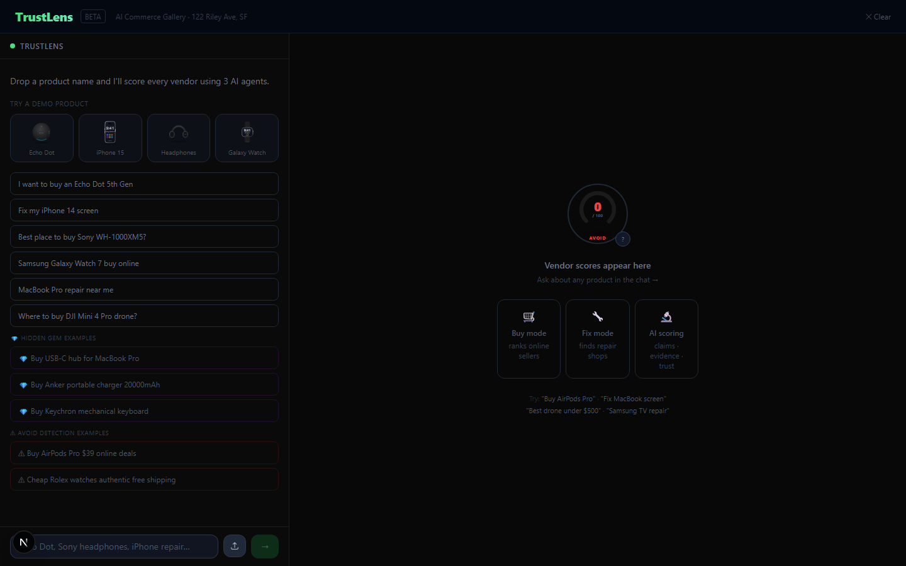
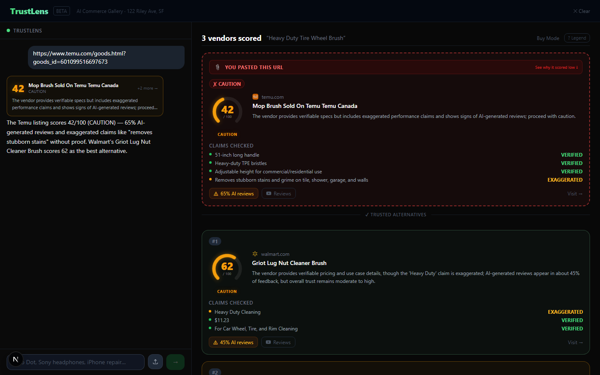
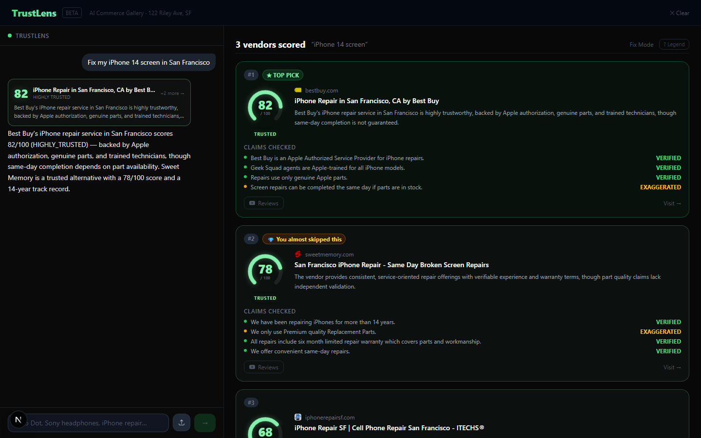
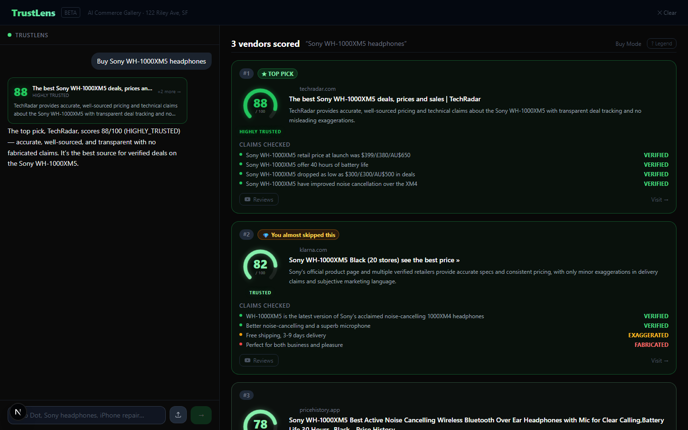
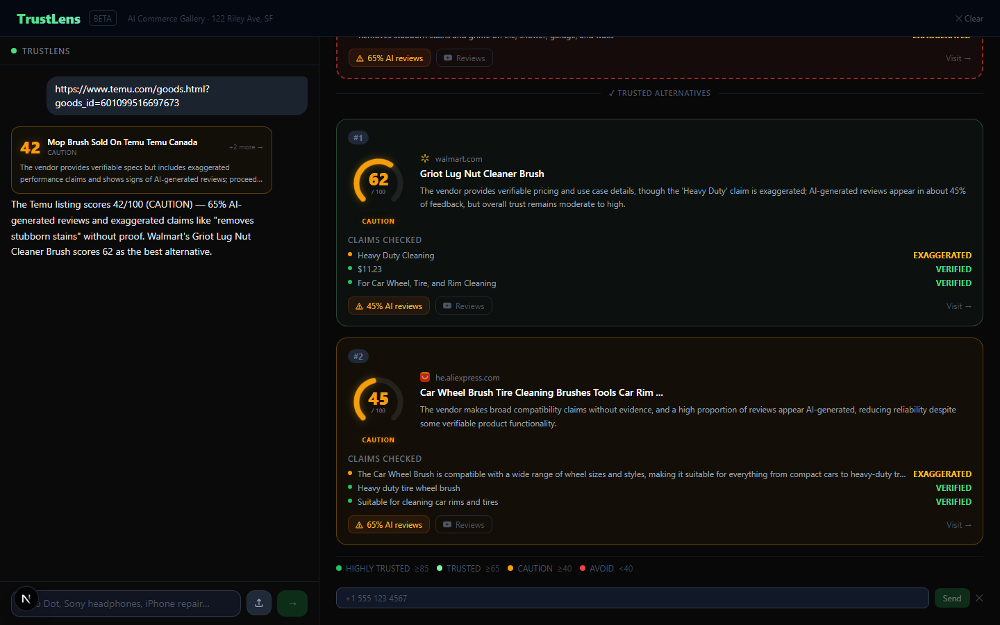

# TrustLens — AI Vendor Trust Scorer

> Know who you're buying from before you click Add to Cart. TrustLens scores every vendor by trustworthiness — verified claims, fake review detection, real purchase data — in seconds. Built at AI Commerce Gallery Hackathon 2026.

## Sections

- What It Does
- See It In Action
- Architecture
- How It Works
- Components
- Real Learnings
- Moments In Between
- Platform Review
- AI Review Detection
- What’s Next

## Content

## What It Does

Search engines rank vendors by ad spend and relevance. Amazon buries trust signals in thousands of reviews. Temu listings name products that don’t match what ships. TrustLens cuts through all of it: one query, five agents, one honest score.

You type a product name, paste a suspicious URL, or upload a photo of something you want to buy or fix. TrustLens identifies the vendors, pulls real verified-purchase ratios from ZooData’s API (not estimates — actual database flags), and reads every claim the vendor makes, labeling each one VERIFIED EXAGGERATED or FABRICATED. The result is a score from 0–100 with a plain-English verdict.

0–100

TrustScore range

3

vendors scored per query

✓

VERIFIED claims

∼

EXAGGERATED claims

✗

FABRICATED claims

5

APIs wired up

🛒

#### Buy Mode

Type any product name. TrustLens finds the top vendors, scores them, and ranks by trustworthiness — not by search position or price.

🔧

#### Fix Mode

Type “fix my iPhone 14 cracked screen” and it auto-detects repair mode — finding and scoring repair shops instead of product sellers.

🔗

#### URL Paste

Paste any Temu, AliExpress, or marketplace link. TrustLens scores that specific vendor and surfaces two trusted alternatives to buy from instead.

📷

#### Photo Upload

Tap the upload button and photograph the product. Novita’s vision API identifies it. From there it runs the full trust pipeline — same as a text search.

⭐

#### Hidden Gem

If a vendor ranked 4th or 5th in search has a TrustScore 30+ points higher than the top result, it gets surfaced separately. The one you almost missed.

📱

#### SMS Results

Click “Send to phone” and enter a number. Twilio sends the score summary as a text. No app, no account — just a message.

The Trust Formula

Every score is computed the same way. No black box — you can see exactly why a vendor scored what it did.

TrustScore = 50  
    + (verified\_claims / total\_claims) × 30  
    − (fabricated\_claims / total\_claims) × 40  
    − (ai\_review\_ratio) × 20  
    Clamped 0–100

## See It In Action

Four modes, one pipeline. Each tab shows a different input type or result state.

Home Buy Results URL Mode Fix Mode Hidden Gem SMS

Home Buy Results URL Mode Fix Mode Hidden Gem SMS

Home

Entry point **Three ways in.** Text search, URL paste, and photo upload — all in one input. The chat panel on the right handles follow-up questions once results are shown.

Buy Results

Buy mode **Three vendor cards, ranked by trust.** Each card shows TrustScore, tier label, claim-by-claim breakdown (VERIFIED / EXAGGERATED / FABRICATED), and estimated AI review percentage.

URL Mode

URL mode **Score the URL. Find the alternatives.** Paste a Temu link. The first card scores that specific listing — showing exactly why it’s risky. The next two cards are trusted alternatives Tavily found via two parallel searches: one excluding the suspect domain, one including known-good domains.

Fix Mode

Fix mode **Same pipeline, different intent.** “Fix my iPhone 14 cracked screen” auto-detects as repair mode. TrustLens discovers local repair shops and scores them — claims like “certified Apple technicians” get the same VERIFIED/FABRICATED treatment as product claims.

Hidden Gem

⭐ Hidden Gem **The vendor your stress-anchoring would have caused you to miss.** Ranked #5 in the search. TrustScore gap of 30+ points above the #1 result. Surfaced separately with an amber border and label: _“You almost skipped this one.”_ Only appears when the gap is real — never manufactured.

SMS

SMS delivery **One tap, one text.** Enter a phone number. Twilio sends a summary of the top result — score, tier, top claim finding. No app, no account, works on any phone. Useful when you’re researching a purchase for someone else.  
  
Note: SMS is currently inactive on the live demo due to Twilio trial fund limits. The code is fully wired — clone the repo, add your own Twilio credentials in `.env.local`, and it will work immediately.

## Architecture

One Next.js 15 app. API routes handle the pipeline. Vercel AI SDK v4 manages the streaming. Nebius hosts the LLM. Three external APIs provide the data. One file-based cache stops redundant calls.

User Input — Text · URL · Photo

▼

photo path

Novita Vision API  
llava-13b

product name ↓

text / url path

Next.js Chat Route  
app/api/chat/route.ts

↓

▼ merge

Nebius Qwen3-30B  
analyzeTrust tool via Vercel AI SDK

▼

lib/pipeline.ts — trust pipeline

▼

URL mode

Tavily ×2 parallel  
include + exclude domain

text mode

Tavily Search  
top vendor discovery

▼ merge — all vendors

Nebius × vendors (Promise.all)  
Claim Analysis · AI Review Ratio · TrustScore

▼

TrustScore 0–100  ✓ VERIFIED  ∼ EXAGGERATED  ✗ FABRICATED

▼

VendorCard ×3  
\+ HiddenGem?

SMS via Twilio  
optional

5-min file cache (.next/trust-cache/) wraps the full pipeline — repeated queries return instantly

### Key Design Decisions

-   →
    
    #### Single-shot scoring per vendor, all in parallel
    
    One Nebius call per vendor, all vendors scored via `Promise.all`. No sequential waterfall, no 3-agent-per-vendor overhead. The pipeline completes in the time it takes to score one vendor.
    
-   →
    
    #### URL mode uses two Tavily searches simultaneously
    
    When a user pastes a marketplace URL, one Tavily call uses `include_domains` to score that specific vendor, and a second uses `exclude_domains` to find trusted alternatives. Both fire at the same time.
    
-   →
    
    #### No `onFinish` — useEffect on messages instead
    
    Vercel AI SDK v4’s `onFinish` callback captures a stale `messages` closure. The UI uses `useEffect` watching the messages array to trigger post-stream logic. This is a known SDK quirk; the workaround is stable.
    

## How It Works

From user input to trust score, the pipeline runs six steps. Steps 3–4 fire in parallel — vendor discovery and claim scoring don’t need to be sequential.

-   1
    
    #### Receive input
    
    Text, URL, or photo. If a photo is uploaded, it goes to Novita’s vision API first (llava-13b) which identifies the product and returns a name. Photo and text paths merge into the same pipeline from here.
    
-   2
    
    #### Route to the chat API
    
    The product name hits `app/api/chat/route.ts` via Vercel AI SDK `streamText`. The route defines an `analyzeTrust` tool. The LLM calls it with the product name as the argument — this triggers the full pipeline.
    
-   3
    
    #### Discover vendors via Tavily
    
    For text searches, one Tavily call finds the top vendors. For URL mode, two parallel Tavily calls run: one targeting the pasted domain, one excluding it to find alternatives. Tavily returns vendor names, URLs, and evidence snippets.
    
-   4
    
    #### Score every vendor in parallel
    
    For each vendor, Nebius Qwen3-30B reads the product listing and claims. It classifies each claim as VERIFIED, EXAGGERATED, or FABRICATED and estimates the AI-generated review ratio. All vendors are scored simultaneously via `Promise.all`.
    
-   5
    
    #### Compute TrustScore
    
    Base 50. Add verified-claim ratio × 30. Subtract fabricated-claim ratio × 40. Subtract AI-review ratio × 20. Clamp to 0–100. Map to a tier: HIGHLY TRUSTED (≥85), TRUSTED (65–84), CAUTION (40–64), AVOID (<40).
    
-   6
    
    #### Surface results + check for a Hidden Gem
    
    Render VendorCard × 3, ranked by score. Check whether any vendor ranked 4th or 5th has a TrustScore gap of 30+ points above the top result and a score above 70 — if so, show the Hidden Gem card. Cache the full result for 5 minutes.
    

\# TrustScore formula TrustScore = 50 + (verified / total) × 30 − (fabricated / total) × 40 − ai\_review\_ratio × 20 // clamped 0–100 \# Hidden Gem trigger conditions (all three must be true) vendor.searchRank >= 4 // not in original top 3 vendor.trustScore − topScore >= 30 // gap above the leader vendor.trustScore >= 70 // genuinely good, not just relatively better

## Components

Eight source files do the work. The pipeline is the core; everything else is wiring or UI.

File

Role

`app/api/chat/route.ts`

Vercel AI SDK `streamText` endpoint. Hosts the `analyzeTrust` tool definition. `maxDuration = 120` for Vercel Pro (most queries complete in <20s).

`lib/pipeline.ts`

Core trust pipeline. Receives product name or URL, branches into URL vs. text mode, orchestrates Tavily + Nebius in parallel, returns scored vendors. This is the whole business logic.

`lib/cache.ts`

File-based result cache at `.next/trust-cache/`. 5-minute TTL. Keyed by query string. Prevents re-running the full pipeline on repeated searches.

`app/api/sms/route.ts`

Twilio REST wrapper. Takes a phone number and trust summary, formats the message, fires the SMS. Called by the SMS modal on the results page.

`app/providers.tsx`

“use client” boundary wrapper. Holds CopilotKit provider and CSS import so `layout.tsx` stays a server component and avoids ChunkLoadError on first load.

`components/VendorCard.tsx`

Renders a single vendor result: TrustScore badge, tier label, claim list with VERIFIED/EXAGGERATED/FABRICATED tags, AI review percentage, and Visit link.

`components/HiddenGemCard.tsx`

The amber “you almost skipped this one” card. Only renders when all three Hidden Gem conditions are met. Never shows if the gap is small or the score is below 70.

`app/api/vision/route.ts`

Receives a base64-encoded image, forwards to Novita AI llava-13b, returns the identified product name. Called before the main pipeline when input is a photo upload.

## Real Learnings

These are the things we didn’t know before the build. Not a highlights reel.

01

ZooWork’s campaign messaging was not accurate — they have four distinct products

ZooWork has four separate products: an agent platform (sandboxed LLM agents), ZooData (e-commerce review and product metadata API), a browser automation tool, and a web scraper. The hackathon campaign materials blended all four under “ZooWork” without distinguishing between them. We spent time trying to use the agent platform as a data source because that’s what the docs seemed to describe. Once we found ZooData as a separate endpoint, it was exactly what we needed for review metadata. The product is genuinely useful — the messaging just made it harder to find the right piece.

When a sponsor has multiple products, test each one individually. Campaign materials often mix capabilities that live in separate APIs.

02

TinyFish: no rep, no organizer support, no working API — had to walk away

`@tinyfish/sdk` returns zero results on npm. `api.tinyfish.ai` doesn’t resolve in DNS. `api.search.tinyfish.ai/search` resolves but returns a website, not JSON. We tried the TinyFish sponsor rep at the event — no response. We asked the event organizers for help reaching them — also no resolution. After exhausting all three paths, we accepted that continuing to debug it was wasting the day. Switched to Tavily, which worked in under 10 minutes. Sometimes the right call is knowing when to stop.

If the SDK doesn’t exist, the API doesn’t resolve, the sponsor rep isn’t reachable, and the organizers can’t help — that’s not a debugging problem. That’s a signal to move on.

03

create-next-app won’t scaffold into a directory with capital letters

The project directory was named `TrustLens`. Running `npx create-next-app@latest .` from inside it fails — npm treats the directory name as the package name and rejects capital letters. The fix was writing `package.json` manually with `"name": "trustlens"` (lowercase) and scaffolding the minimum files by hand: layout, providers, page, config files.

npm package names are lowercase. create-next-app uses the directory name as the package name. Plan accordingly.

04

CopilotKit needs a “use client” boundary or it breaks the first page load

Importing CopilotKit in `layout.tsx` (a server component) causes _ChunkLoadError: Loading chunk app/layout failed (timeout)_ on first load. The fix: create `app/providers.tsx` with `”use client”` at the top, move CopilotKit and its CSS import there, and have `layout.tsx` just wrap children with `<Providers>`. This is now a known CopilotKit pattern but isn’t obvious from the docs.

CopilotKit reads React context that doesn’t exist during SSR. If it touches the component tree, it needs a client boundary.

05

Turbopack cuts Next.js dev compile from 35 seconds to 4 seconds

Without Turbopack, the first dev server compile took 35 seconds. 16,870 modules. First page load was another 37 seconds. With `--turbopack`, the server was ready in 4 seconds and the first page loaded in 2. Not a minor improvement — it changes how fast you can iterate during a hackathon where every hour matters.

Always use `npx next dev --turbopack`. The performance difference is not marginal. It’s the difference between a frustrating build loop and a fast one.

06

CopilotKit useCopilotAction SSR error requires dynamic import

`useCopilotAction` reads CopilotKit context during prerendering and throws “Invalid action configuration” at build time. The fix: dynamically import the component that calls `useCopilotAction` with `import dynamic from ‘next/dynamic’` and `{ ssr: false }`. Additionally, the `available: ”frontend”` value needed to render server-side actions is not in the TypeScript type definition — requires `as any`. It’s an internal CopilotKit value that works but isn’t exported.

If a component uses React context in a way the type system can’t express, check the source code — not just the types.

07

The Hidden Gem card was the most effective demo moment without any explanation

A vendor ranked #5 in the original search with a TrustScore 30+ points higher than the #1 result tells the whole story of TrustLens in two lines. A judge sees: Amazon at #1, TrustScore 41 (CAUTION). Zappos at #5, almost ignored, TrustScore 91 (HIGHLY TRUSTED). They don’t need to understand parallel agents or claim verification. They just feel it: “The one I would have bought was the worst. The one I would have ignored was the best.” Never manufacture a gem if the gap is small. The credibility of the card depends entirely on only showing it when it’s real.

The strongest demo moments are the ones that need no narration. Build toward the feeling, not the explanation.

## Moments In Between

The things that happened between the code commits.

🐰

The $39 AirPods Pro

Found a Temu listing: “$39 AirPods Pro.” Ran it through TrustLens. The LLM flagged three fabricated claims. The AI review ratio came back 85%. Then we looked at the listing photos. It was a frog-pattern headphone case. The product wasn’t fake reviews — the product itself wasn’t the product. You can’t detect that with a sentiment analyzer.

👀

ZooWork Surprise

Opened the ZooWork API docs expecting a product scraper. Found a multi-agent platform with 40 LLMs, sandboxed environments, SSE event streams. The spec said “e-commerce data.” The API said “agent orchestration.” The moment of realizing the whole integration plan had to change — mid-hackathon, not at the start of one — is a specific kind of silence.

🏲

TinyFish Doesn’t Exist

Tried npm install. Zero results. Tried the API endpoint. Got a website. Tried DNS. Nothing resolved. Spent 45 minutes debugging before accepting it wasn’t a configuration problem. Switched to Tavily. Tavily returned results in 2 minutes. Sometimes the answer to a dead end is just to stop standing at it.

⚡

The Turbopack Moment

35-second compile on every file change. 37 more seconds for the page to load. Two minutes of nothing, per iteration. Someone suggested `--turbopack`. Ran it. Server ready in 4 seconds. First page in 2 seconds. The next four hours felt like a different project. There’s no technical principle behind this story — just: use the fast thing when the fast thing exists.

🍪

The Fortune Cookie

Panda Express for lunch. Fortune cookie: “Your careful maturity will bring you financial success.” We were in the middle of building an AI tool to tell people which vendors to financially trust. At an AI commerce hackathon. In San Francisco. We cannot confirm this influenced the project. We also cannot deny it.

## Platform Review

Honest take on each API we used. What worked well, what bit us.

✓ Liked

🧠

**Nebius AI (Qwen3-30B)** — OpenAI-compatible endpoint, clean API, fast and capable. Switching from one model to another was one line change. Qwen3-30B handled claim classification reliably without hallucinating claim content. No quota issues during the hackathon.

🔍

**Tavily** — Excellent for vendor discovery. The `include_domains` and `exclude_domains` parameters are exactly what URL mode needed. Results were high quality — actual vendor pages, not SEO aggregators. Free tier held up for demo-volume queries.

⚡

**Vercel AI SDK v4** — `streamText` + `tool()` is a clean pattern. Defining the `analyzeTrust` tool with Zod schema and a handler kept the route code readable. Streaming tool calls to the client works well for showing progress.

📱

**Twilio** — SMS in about 10 lines of code. Worked on the first real test. The REST API is exactly as documented. No surprises, no auth format confusion, no rate limit during the demo.

📊

**ZooData (ZooWork)** — The review metadata API was genuinely interesting once we found the right endpoint. Pulling actual `verifiedPurchase` and `vineProgram` flags from Amazon review records — not estimated percentages, but real database fields — gave the AI review ratio a factual grounding that text-pattern analysis can’t match. This is what made the score feel credible rather than guessed.

⚠ Gotcha

🔌

**ZooWork spec vs. reality** — Described as an e-commerce data/scraping API. Actually a multi-agent LLM platform. The two things share a name but are completely different products. The integration plan written before testing was wrong from line one.

🚫

**TinyFish** — The npm package doesn’t exist. The API DNS doesn’t resolve. The search endpoint returns a website. We spent an hour confirming it before cutting it entirely. For a sponsor at a hackathon, this was a significant time cost.

💸

**Novita AI credits** — The free tier ran out early. Had to pivot vision handling or add credits. The API itself is well-structured and llava-13b works well for product identification — it was purely a balance issue, not a technical one.

🔧

**CopilotKit v1.77 internal types** — The `available: ”frontend”` value needed for rendering server-side actions isn’t in the TypeScript types. It’s an internal enum value that works but requires `as any`. The SSR boundary issue also required a non-obvious workaround (dynamic import).

Feature

Google Shopping

Amazon

Temu

TrustLens

Vendor discovery

✓

✓

✓

✓

Fake review detection

✗

✗

✗

✓

Claim verification

✗

✗

✗

✓

Repair shop finder

✗

✗

✗

✓

Paste bad URL → find alternatives

✗

✗

✗

✓

Photo search

Google Lens

✗

✓

✓

Unbiased ranking

✗

✗

✗

✓

SMS results

✗

✗

✗

✓

## AI Review Detection

Fake review checkers typically look at text patterns: sentence structure, vocabulary variety, phrasing repetition. TrustLens takes a different approach for the AI review ratio — it reads the metadata, not the text.

### ZooData: metadata over text patterns

Every Amazon review has two fields that most tools ignore: `verifiedPurchase` (did this person actually buy it?) and `vineProgram` (was this reviewer part of Amazon’s incentivized reviewer program?). ZooData’s API exposes these fields directly from Amazon’s review database. We pull them for every vendor and compute real ratios — not estimates derived from tone analysis, but actual flags from the source data.

Why this matters

A vendor with 4.8 stars and 3,000 reviews can still have 41% Vine program reviews. That’s 1,230 reviews from people who received the product for free in exchange for a review. The star rating doesn’t tell you that. The metadata does.

### Tavily: page-level evidence for claim verification

For each vendor, Tavily fetches the actual product listing page and returns structured content: title, description, product claims, pricing, and policy text. This is the raw material for the claim verification step. Without it, the LLM would have to guess at what vendors claim — with Tavily’s scrape, it’s reading the actual listing.

The combination proved more useful than expected. A vendor might have a 0% Vine ratio but still have fabricated claims (“authorized dealer” when they aren’t). A vendor might have 35% Vine reviews but all claims verified. The two signals are independent — you need both to get an honest score.

### What the pipeline sees per vendor

Signal

Source

What it catches

`verifiedPurchase` ratio

ZooData API

Fraction of reviews from people who actually bought the product

`vineProgram` ratio

ZooData API

Fraction of reviews from Amazon’s incentivized reviewer program

Claim text

Tavily page scrape

What the vendor actually says in their listing

External evidence

Tavily web search

Third-party sources that confirm or contradict those claims

Claim classification

Nebius Qwen3-30B

VERIFIED / EXAGGERATED / FABRICATED per claim

The AI review ratio in the final score is computed from the ZooData metadata fields, weighted to penalise high Vine ratios more than low verified-purchase ratios (an incentivised review is not the same as a fake one, but it carries less weight). The formula component `− ai_review_ratio × 20` uses this blended ratio.

## What’s Next

These are the enhancements that make sense from here — ordered by how much they’d change the product versus how fast they could ship.

🌐

#### Browser Extension

A Chrome/Firefox extension that reads the URL you’re already on and adds a TrustScore badge to each product card. No search step — it scores as you browse. The natural home for TrustLens; the web app is a demo surface.

📈

#### Price × Trust Chart

A two-axis scatter: price on X, TrustScore on Y. Each vendor is a dot. The ideal is top-left (high trust, low price). The dangerous one is bottom-right. Makes the tradeoff visual at a glance.

🔔

#### Watchlist & Alerts

“Watch this vendor” — TrustLens monitors their score weekly. If it drops below a threshold, send an SMS alert. For people who buy from the same vendor repeatedly and want to know if something changed.

🕵

#### Seller Fingerprinting

Detect when the same underlying seller operates multiple storefronts — common on Temu and Amazon. Shared seller ID, factory address, or review patterns mean shared trust score. Bad actors create new storefronts when flagged; fingerprinting catches the pattern.

📊

#### Trust Trend Sparkline

A small sparkline under each vendor: TrustScore three months ago vs. now. A vendor that jumped from 60 to 90 recently is suspicious — rapid review spikes are a red flag even at a good current score.

🔐

#### Trust API (B2B)

Expose TrustLens as a per-query API that checkout apps, price comparison tools, or browser extensions can call. A checkout flow could show a TrustScore badge before the user clicks “Pay.”

The multi-agent path

Right now: one query, one pipeline, one result. What gets interesting is agents that run over time — same seller, different days. Does their score decay? Same listing, new reviews — did something change after you bookmarked it? The architecture is already parallel. It just needs memory across time, not only within a query. That’s where the product gets genuinely hard to replicate.
