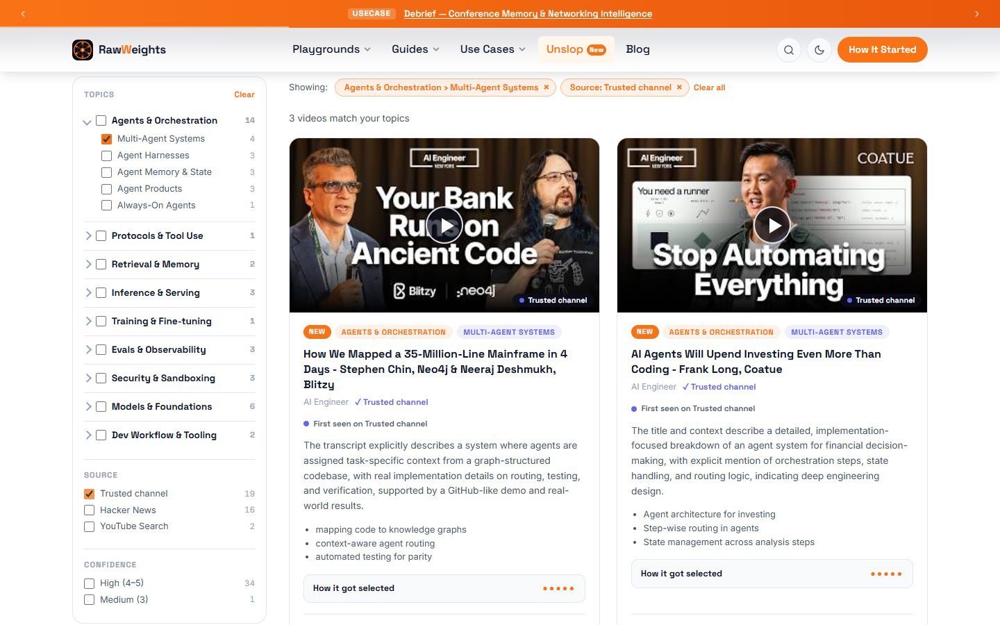
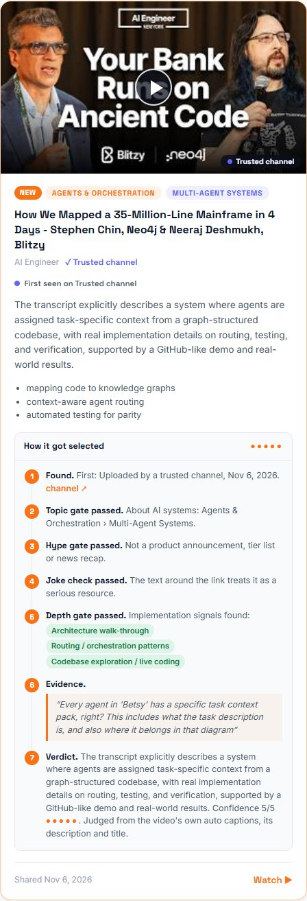
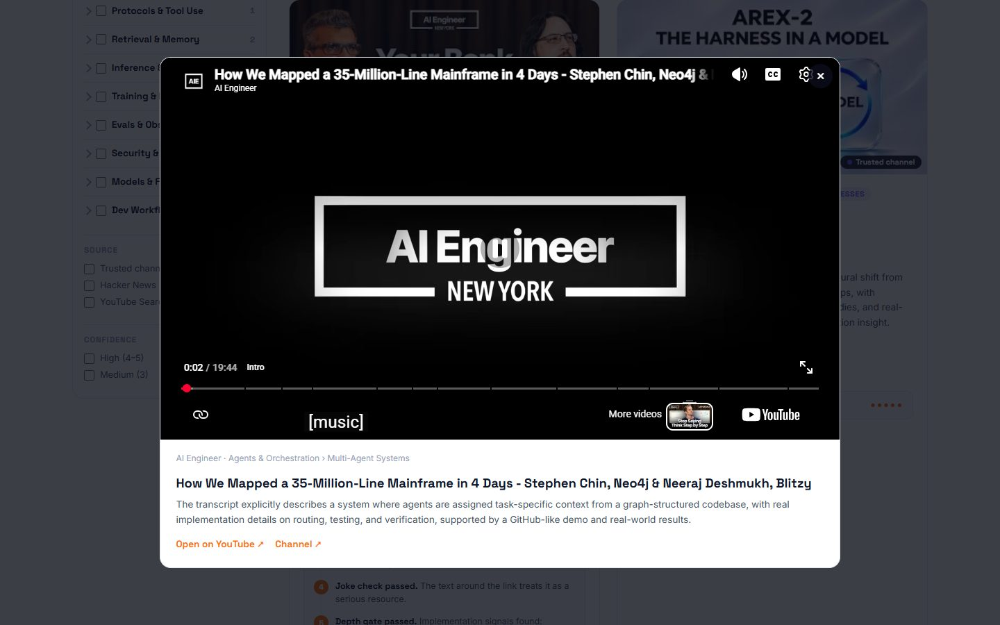
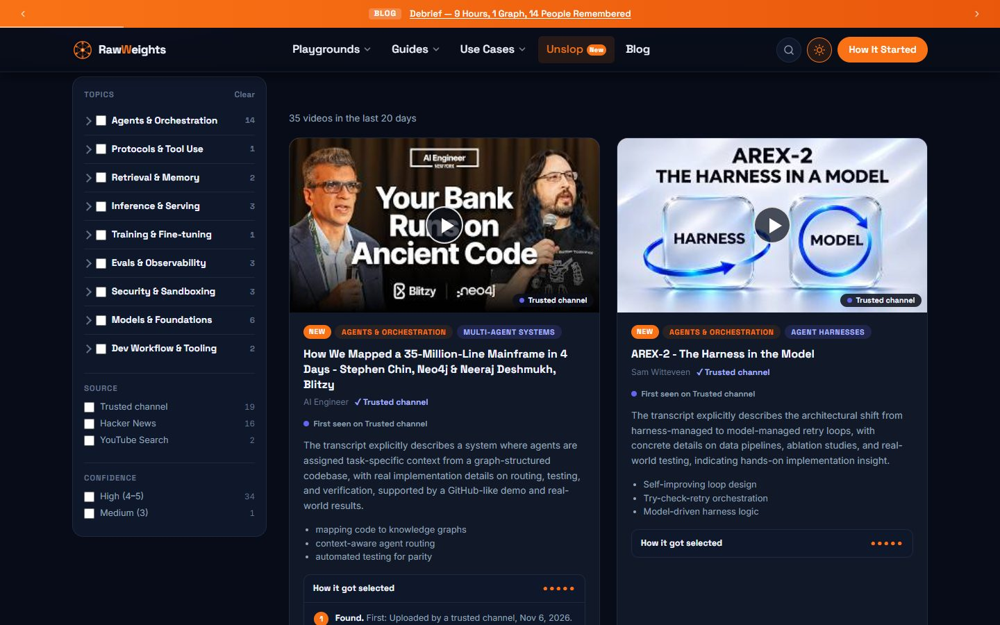

# Unslop: I Got Tired of AI Video Slop, So I Built a Daily Feed

> AI moves weekly and most AI video is noise. Why I built Unslop, a daily feed of hands-on AI engineering videos that shows its evidence, how it differs from Karpathy's HackerTube, and what broke along the way.

## Sections

- Every week there is something new I am supposed to know
- Yes, I copied Andrej Karpathy. Here is what I changed.
- Why a filter: most AI video is not for people who build things
- A feed that shows its work
- Five minutes a day, and you are caught up
- A script on my laptop, a static page on the web
- Run the four gates on real videos
- How the filters combine
- What broke, and what I changed

## Content

My problem

## Every week there is something new I am supposed to know

A new protocol. A new agent framework. A new way to serve models. The best explanations are usually on YouTube, buried between sponsor reads, reaction videos and “AI will change everything” talks. I kept losing evenings to the wrong ones.

I did not want a bigger list. I wanted a **short daily list of what is new in AI and worth an hour**, with a reason attached to each item. Nothing I could find did that for the part of AI I work on: the application layer, meaning agents, retrieval, tool protocols and serving.

So I built it for myself first. Then it occurred to me that anyone who builds with AI has the same problem, and that a feed you check every day is more useful when other people can check it too. That is why it is a public page and not a private script.

The rule I set myself: if a video makes the list, I should be able to point at the exact sentence that earned it a place.

#### How I used to find videos

-   Scroll YouTube, judge by thumbnail
-   Trust a title that promises “full course”
-   Lose an hour to a sponsor read
-   Never learn why something was recommended

#### What Unslop does instead

-   Collects what practitioners actually share
-   Reads the captions, not just the title
-   Drops hype, jokes and off-topic content
-   Shows the evidence behind every pick

Inspiration

## Yes, I copied Andrej Karpathy. Here is what I changed.

On Oct 31, 2026 Andrej Karpathy published **HackerTube**, a YouTube-style site built from videos people recommend in Hacker News comments. As reported, it holds **6,454 videos from 2007 to 2026 across about 150 topics**, put together with Claude in around two hours. I loved it, and I copied the idea on purpose.

Where we differ is time. His is a _historic_ collection: the best of what people have recommended over almost two decades. I care about the opposite end. AI moves so fast that what happened _this week_ matters more to me than what was good in 2014. So Unslop keeps the idea and flips the clock.

What we have in common

Start from what practitioners recommend, not what an algorithm pushesUse an LLM to filter at a scale a person can’tSmall, static, no loginSignal over view counts

Where they differ

HackerTube (Karpathy)

Unslop (this site)

Question it answers

What is worth watching, across everything people have recommended?

What is new in AI this week that is worth an hour?

Time span

2007 to 2026, about 6,454 videos (as reported)

Rolling last 20 days; older picks roll off

Topics

About 150 topics

One: the AI application layer

Where videos come from

Recommendations in Hacker News comments

Hacker News, Lobsters, trusted YouTube channels and YouTube search

Freshness

A snapshot collection, published Oct 31 (as reported)

Refreshed daily; dead links are removed

Selection

LLM-assisted filtering (as reported)

Four gates with a published rubric, plus a sample of the captions

Showing the work

A site to browse

Every card shows its evidence quote, confidence and where it was first seen

Staying in touch

Visit when you want to browse

RSS feed and a “New” badge, built for a daily habit

I know HackerTube from his post and press coverage, not from his code, so the left column is my reading of it, not his description. Reports: [AI Weekly](https://aiweekly.co/alerts/karpathy-ships-hackertube-in-2-hours-with-claude-opus-55), [FourWeekMBA](https://fourweekmba.com/ai-karpathy-has-claude-build-hackertube-from-6454-hn-videos/). Unslop is an independent project and is not affiliated with him.

The problem

## Why a filter: most AI video is not for people who build things

These numbers come live from the data behind the Unslop page, for the last 20 days.

**7%** of videos considered made it through

35 picked from 503 considered

Considered

**503**

− Unavailable

**6**

− Off-topic

**281**

− Hype

**35**

− Joke / meme

**3**

− Too shallow

**144**

Picked

**35**

The biggest bucket is not hype. It is **off-topic**: if you search a discussion site for YouTube links, most of them are music, politics and cooking. The second surprise was **depth**. Plenty of on-topic videos talk _about_ agents without ever showing one working.

Filtering by view count would not help, because popular and useful are different things. I needed something that could read.

What it adds

## A feed that shows its work

Topic, source and confidence facets on the left. Choices inside a group mean “or”, choices across groups mean “and”.

#### Evidence, not vibes

Each card opens a “How it got selected” panel: where the link was found, each gate, the quote that justified it, and a confidence score.

#### Reads the captions

When captions exist, the model sees a sample from the opening, middle and end. A technical title over a sponsor-read transcript fails.

#### Honest about origin

You see where a link was first seen, who shared it, and whether the channel is on my short trusted list.

#### Stays on the site

Videos play in a privacy-friendly player. If a video blocks embedding, the card says so and opens YouTube instead.

One card, fully opened. Every step is the model’s recorded reasoning.

Playing in the modal, with a link out if you want YouTube itself.

Light and dark follow the rest of RawWeights. There is also an RSS feed and a “New” badge on anything added in the last 48 hours.

For you

## Five minutes a day, and you are caught up

The window is 20 days, so anything you miss slowly rolls off. That is on purpose: it keeps the list short and current.

**1**

#### Glance at what is new

Cards added in the last 48 hours carry a NEW badge. That is your daily list, usually a handful of videos.

**2**

#### Narrow to your corner

Pick the topics you care about. Add “Trusted channel” or “High confidence” when you only have time for the strongest picks.

**3**

#### Check the receipts

Open “How it got selected” before you press play. If the evidence quote does not convince you, skip it.

**4**

#### Let it come to you

Subscribe to the [RSS feed](../unslop-feed.xml) in any reader, and you will not need to remember to visit.

Implementation

## A script on my laptop, a static page on the web

No server, no database. A Python script writes one JSON file. The page reads it.

1 · Find

#### Four sources

Hacker News, Lobsters, a short list of trusted YouTube channels, and YouTube search.

2 · Free checks

#### Drop the obvious

Private, live, or under 8 minutes? Gone, before any model is paid for.

3 · Read

#### Captions + context

Transcript sample, description, and the lines around the link.

4 · Judge

#### Four gates

Topic, hype, joke, depth, in that order. First failure stops.

5 · Check

#### Grounding

The model’s quote must exist in what it was given, or confidence is capped.

6 · Write

#### One JSON file

Plus an RSS feed and search-engine markup, all regenerated each run.

7 · Verify

#### Link check

A second script removes videos that were deleted since.

8 · Show

#### Static page

Filters and cards render in the browser from the JSON.

#### Public (what visitors get)

-   `unslop.html` the page
-   `data/unslop.json` the picks
-   `unslop-feed.xml` RSS

#### Private (stays on my machine)

-   `ingest.py` fetch, judge, write
-   `verify_links.py` clean-up
-   `channels.json`, `queries.json`, `seen.json`, keys, caches

Why local? I wanted to run it by hand for two weeks and read every pick before trusting it to a schedule. Keeping the scripts out of the public repo also means no API keys can leak into it.

Playground

## Run the four gates on real videos

Pick a video. Watch it go through the same checks the script uses. These are real decisions from my runs, with the model’s own reasons.

#### Gate runner

↻ Replay

##### Rejected

A joke about a product taglineWould you believe it’s jank? (Clojure talk)I Think AI Just Killed The Plugin IndustryMost Imp For Any AI Engineer Interview

##### Free checks

LGTM, a Claude Opus music videoAI Engineer Code Summit, Day 1 (upcoming)

##### Picked

Let’s build GPT (Karpathy)41% to 97% accurate (AI Engineer)

What the model saw

**Title:** ‘You want to know what comes between me and my Calvins’ ?

**Channel:** EFM by Salima Chaieb C.

**Context (summarized):** A Hacker News comment quotes an AI app’s tagline, compares it to a famous 1980 jeans ad slogan to mock it, then links the ad.

✓

###### Free checks

Public, not live, at least 8 minutes. No model needed.

✓

###### 1 · Topic

Is it mainly about building or understanding AI systems?

✓

###### 2 · Hype

Not marketing, a tier list, or a news recap?

✕

###### 3 · Joke

Stopped here: posted as meme/parody of Calvin Klein ad

•

###### 4 · Depth

Any real implementation signal: code, schemas, state, routing, deployment?

The model reports the first gate that stopped a video; gates before it are inferred as cleared. Gates after it are never run.

Playground

## How the filters combine

The same facet logic as the Unslop page, running on today’s real picks. Tick a few boxes and watch the list.

#### Filter lens

##### Topic (top 4)

 Agents & Orchestration 14 Models & Foundations 6 Security & Sandboxing 3 Evals & Observability 3

##### Source

 Trusted channel 19 Hacker News 16 YouTube Search 2

##### Confidence

 High 34 Medium 1

Nothing selected, so everything shows.

**35** of 35 picks match

How We Mapped a 35-Million-Line Mainframe in 4 Days - Stephen Chin, Neo4j & Neeraj Deshmukh, BlitzyAgents & Orchestration · Trusted channel

High

AREX-2 - The Harness in the ModelAgents & Orchestration · Trusted channel

High

7 Things Your AI Coworker Needs - Philipp Schmid, Google DeepMindAgents & Orchestration · Trusted channel

High

Your AI Agent Keeps Making the Same Mistakes - Sparsh Jain, CentralAgent AIAgents & Orchestration · Trusted channel

Medium

Let's build GPT: from scratch, in code, spelled out.Models & Foundations · Hacker News, Trusted channel

High

AI Agents Will Upend Investing Even More Than Coding - Frank Long, CoatueAgents & Orchestration · Trusted channel

High

Stop Giving Your AI Agents API Keys - Kim Maida, Keycard & Mason Egger, TemporalSecurity & Sandboxing · Trusted channel

High

How Netflix Evaluates AI When There's No Right Answer - Cameron Wolfe, NetflixEvals & Observability · Trusted channel

High

Stanford CS146S: How always-on agents workAgents & Orchestration · Hacker News

High

How Apple Fits a LLM on Your iPhone With Surgical EfficiencyInference & Serving · Hacker News

High

How We Took an AI Agent From 41% to 97% Accurate - Milind Sunil Shah, Brainbase LabsAgents & Orchestration · Trusted channel

High

Our Smaller Model Beat Opus on Finance Tasks - Alexander Shevchenko, RampAgents & Orchestration · Trusted channel

High

Robots Will Be Trained on Video Games - Pim de Witte, General IntuitionAgents & Orchestration · Trusted channel

High

Don't Approve the AI Model. Approve the App - Doneyli De Jesus, LangfuseEvals & Observability · Trusted channel

High

Why Datasite Stopped Building Its Own Parsing - Adit Abraham, Reducto & Raj Bakhru, DatasiteRetrieval & Memory · Trusted channel

High

Building the AI Agent Is Easy. Proving It's Safe Isn't - Jonathan Osborne, NatWestSecurity & Sandboxing · Trusted channel

High

Attention in transformers, step-by-step | Deep Learning Chapter 6Models & Foundations · Hacker News, Trusted channel

High

Twisting the rules of building software: Bending Spoons (the team behind Evernote)Dev Workflow & Tooling · Hacker News

High

NEW DeepSeek Harness -  Super Agent!Agents & Orchestration · Trusted channel

High

What's in a Token? \[Wading Through AI - Episode 11\]Models & Foundations · Hacker News

High

Dory - NVIDIA's Looped TransformerModels & Foundations · Trusted channel

High

I Run an AI Civilization in HerdrAgents & Orchestration · Hacker News

High

How to Build RAG From Scratch in 50 Lines of Python - Full TutorialRetrieval & Memory · YouTube Search

High

tinyserve 2.0: How Fast Can We Make LLM Inference From Scratch?Inference & Serving · YouTube Search

High

Live Speech-to-Text on a ~$5 Microcontroller | ESP32-P4XInference & Serving · Hacker News

High

Moldable LLM Chats in Glamorous Toolkit - Andrei ChisDev Workflow & Tooling · Hacker News

High

Geoffrey Litt: Dynamic Documents as Personal SoftwareAgents & Orchestration · Hacker News

High

100% Open Image Model Lets You Place Text With JSONModels & Foundations · Trusted channel

High

DevRel @ Fireworks Webinar: Fine-Tuning 101Training & Fine-tuning · Hacker News

High

How To Build Agents That Don't Hack Foreign Governments (Or Leak Company Secrets!) (Part 1 of 2)Security & Sandboxing · Hacker News

High

Flint - The First RSI Coding Model?Models & Foundations · Trusted channel

High

AntFabric by GeekyAnts at TC Disrupt 2026 SF: Sanket Sahu on AI WorkspacesAgents & Orchestration · Hacker News

High

Context Nest for Governed Agent Collaboration DemoAgents & Orchestration · Hacker News

High

RuneScape Bench: MMOs for Agents | Max BittkerEvals & Observability · Hacker News

High

Yes, AI Edits Your Video Now BUT... | DaVinci Resolve MCP VS Cloud Based invideo Editor WorkflowsProtocols & Tool Use · Hacker News

High

Trusted channel is a property of the video’s **channel**, not of how I found it. I got that wrong at first (see below).

Field notes

## What broke, and what I changed

#### A joke made the list

A video was picked because a comment mocked an AI product’s tagline by linking a famous 1980 jeans ad. The title sounded relevant; the model only saw the link. The fix was to feed it the text just before and after the link, plus the comment being replied to, and add a **joke gate**.

#### My first version approved everything technical

A Nintendo 64 port, a Lisp compiler talk and an Electron memory essay all passed, because the original rubric said “deep” but never said “about AI”. A topic gate, placed first, fixed it.

#### The model invented function names

An early card listed tools like `libdragon_init()` that nobody ever said. I deleted that feature and replaced it with a short “covers” list, plus a check that every quote really appears in the text the model was given.

#### Reddit said no

Reddit now requires approval for new API apps. I applied, and was turned down with a generic message. I switched to the YouTube Data API for discovery, and gained transcripts in the process, which made the quality noticeably better.

#### Every date said Nov 6

I was showing the day _I_ found a video, not the day it was shared. Share dates now drive the 20-day window.

#### “Trusted channel” filtered the wrong thing

Karpathy’s “Let’s build GPT” vanished from the trusted filter because I had found it on Hacker News. The filter meant “found via my channel list” when it should mean “from a channel on my list”.

#### Embed-blocked is not broken

Three of the first six “unavailable” videos were fine; their owners had just disabled embedding. Those now stay in the feed and open on YouTube.

#### I show who shared it, but do not filter by it

The sharer’s name and Hacker News karma appear on the card. I did not make it a filter, because that would reward established accounts and bury newcomers.

Limits worth knowing: the model never watches the video, it reads a sample of the captions. It can still be wrong, which is why every card carries its confidence and its quote.

The goal is not more AI video. It is fewer videos, from this week, with receipts.

Rolling 20 days. Updated by hand while I tune it, so expect it to get better.

[Open Unslop →](../unslop.html) [Subscribe (RSS)](../unslop-feed.xml)
